# shippress-themes

Japanese-inspired WordPress block themes for [ShipPress](https://github.com/oberonlai/shippress-themes), the desktop app that builds WordPress sites with AI.

Each theme is a complete, standalone WordPress **block theme** (full-site editing: `theme.json`, HTML templates, template parts and block patterns). Every theme covers the same eight pages (home, about, news, article, category, tag, newsletter and contact), plus pages of its own industry (such as rooms or a menu); store themes add WooCommerce templates and sample products and still work without WooCommerce, ships English sample copy, and bundles its own fonts, so it makes no third-party requests. ShipPress shows the themes on its template wall, using the metadata in `index.json` and screenshots it renders itself.

## Themes

| Theme | For | Type | Colors | Style | Download |
|-------|-----|------|--------|-------|----------|
| [Aizome Shoten](themes/aizome-shoten) | Independent bookshops and small presses (WooCommerce store) | store | blue, indigo | typographic, retro | [aizome-shoten.zip](https://github.com/oberonlai/shippress-themes/releases/download/themes/aizome-shoten.zip) |
| [Beni Kappo](themes/beni-kappo) | Kappo, izakaya and omakase counter restaurants | food-drink | red, dark | bold, layered | [beni-kappo.zip](https://github.com/oberonlai/shippress-themes/releases/download/themes/beni-kappo.zip) |
| [Fuji Shinkyu](themes/fuji-shinkyu) | Acupuncture, moxibustion and bodywork clinics | health | purple, pastel | geometric, airy | [fuji-shinkyu.zip](https://github.com/oberonlai/shippress-themes/releases/download/themes/fuji-shinkyu.zip) |
| [Hamono Kaji](themes/hamono-kaji) | Kitchen knife forges and kitchen-tool shops (WooCommerce store) | store | dark, neutral | minimal, bold | [hamono-kaji.zip](https://github.com/oberonlai/shippress-themes/releases/download/themes/hamono-kaji.zip) |
| [Ginrin Cycle](themes/ginrin-cycle) | Small bicycle workshops selling handbuilt frames, wheels and accessories, with a repair service (WooCommerce store) | store | cool, neutral, orange | minimal, technical | [ginrin-cycle.zip](https://github.com/oberonlai/shippress-themes/releases/download/themes/ginrin-cycle.zip) |
| [Kinu Kimono](themes/kinu-kimono) | Kimono rental and dressing houses selling rental plans, obi, accessories and yukata (WooCommerce store) | store | purple, dark, light | elegant, traditional | [kinu-kimono.zip](https://github.com/oberonlai/shippress-themes/releases/download/themes/kinu-kimono.zip) |
| [Undo Ba](themes/undo-ba) | Small strength and conditioning studios, boutique gyms and personal trainers | health | neutral, light | minimal, elegant | [undo-ba.zip](https://github.com/oberonlai/shippress-themes/releases/download/themes/undo-ba.zip) |
| [Kaori Cosme](themes/kaori-cosme) | Clean-skincare ateliers and small cosmetics brands selling serums, creams, oils and mists (WooCommerce store) | store | purple, light | clean, luxe | [kaori-cosme.zip](https://github.com/oberonlai/shippress-themes/releases/download/themes/kaori-cosme.zip) |
| [Tabi Note](themes/tabi-note) | Small walking-tour and slow-travel agencies running small-group journeys (route map, journeys with prices, day-by-day itinerary) | business | teal, light | handmade, serene | [tabi-note.zip](https://github.com/oberonlai/shippress-themes/releases/download/themes/tabi-note.zip) |
| [Hakuba Dental](themes/hakuba-dental) | Family dental clinics, dentists and dental hygiene practices | health | blue, light | minimal, geometric | [hakuba-dental.zip](https://github.com/oberonlai/shippress-themes/releases/download/themes/hakuba-dental.zip) |
| [Hana Kago](themes/hana-kago) | Florists selling bouquets, baskets, dried flowers, wreaths and flower subscriptions (WooCommerce store) | store | pink, orange, light | elegant, botanical | [hana-kago.zip](https://github.com/oberonlai/shippress-themes/releases/download/themes/hana-kago.zip) |
| [Hanabi Matsuri](themes/hanabi-matsuri) | Summer fireworks and music festivals, event organisers | events | orange, vivid | kinetic, poster | [hanabi-matsuri.zip](https://github.com/oberonlai/shippress-themes/releases/download/themes/hanabi-matsuri.zip) |
| [Hinoki Yado](themes/hinoki-yado) | Ryokan and small hot-spring inns | hospitality | green, natural | serene, organic | [hinoki-yado.zip](https://github.com/oberonlai/shippress-themes/releases/download/themes/hinoki-yado.zip) |
| [Ikebana Kyoshitsu](themes/ikebana-kyoshitsu) | Ikebana and flower-arranging schools | education | pastel, pink | botanical, asymmetric | [ikebana-kyoshitsu.zip](https://github.com/oberonlai/shippress-themes/releases/download/themes/ikebana-kyoshitsu.zip) |
| [Kami no Ne](themes/kami-no-ne) | Washi paper and stationery shops (WooCommerce store) | store | indigo, neutral | minimal, editorial | [kami-no-ne.zip](https://github.com/oberonlai/shippress-themes/releases/download/themes/kami-no-ne.zip) |
| [Kami Salon](themes/kami-salon) | Hair salons, barbers and colour studios | business | dark, pink | bold, editorial, geometric | [kami-salon.zip](https://github.com/oberonlai/shippress-themes/releases/download/themes/kami-salon.zip) |
| [Kaze Yoga](themes/kaze-yoga) | Small yoga studios, meditation rooms and slow-movement teachers | health | green, light | minimal, serene, airy | [kaze-yoga.zip](https://github.com/oberonlai/shippress-themes/releases/download/themes/kaze-yoga.zip) |
| [Kenchiku Grid](themes/kenchiku-grid) | Architecture studios | business | monochrome, cool | minimal, editorial | [kenchiku-grid.zip](https://github.com/oberonlai/shippress-themes/releases/download/themes/kenchiku-grid.zip) |
| [Kiroku Studio](themes/kiroku-studio) | Creative agencies, motion and brand studios, design and animation studios | business | dark, green, vivid | bold, kinetic | [kiroku-studio.zip](https://github.com/oberonlai/shippress-themes/releases/download/themes/kiroku-studio.zip) |
| [Kissaten Counter](themes/kissaten-counter) | Coffee shops and kissaten cafes | business | dark, warm | cozy, handmade | [kissaten-counter.zip](https://github.com/oberonlai/shippress-themes/releases/download/themes/kissaten-counter.zip) |
| [Komugi Pan](themes/komugi-pan) | Neighbourhood bakeries selling bread and pastries online (WooCommerce store) | store | orange, warm | playful, cozy | [komugi-pan.zip](https://github.com/oberonlai/shippress-themes/releases/download/themes/komugi-pan.zip) |
| [Kura Shizuku](themes/kura-shizuku) | Sake breweries and tasting rooms (WooCommerce store) | store | gold, neutral | luxe, symmetric | [kura-shizuku.zip](https://github.com/oberonlai/shippress-themes/releases/download/themes/kura-shizuku.zip) |
| [Ma Vertical](themes/ma-vertical) | Craft studios and ateliers | portfolio | warm, earth | vertical-type, wabi-sabi, minimal | [ma-vertical.zip](https://github.com/oberonlai/shippress-themes/releases/download/themes/ma-vertical.zip) |
| [Menya Kaen](themes/menya-kaen) | Quiet ramen-ya and small noodle counters | food-drink | dark, warm, neutral | elegant, minimal, editorial | [menya-kaen.zip](https://github.com/oberonlai/shippress-themes/releases/download/themes/menya-kaen.zip) |
| [Oto Radio](themes/oto-radio) | Podcasts, radio shows and audio series | media | dark, purple, yellow | retro, bold | [oto-radio.zip](https://github.com/oberonlai/shippress-themes/releases/download/themes/oto-radio.zip) |
| [Sakura Juku](themes/sakura-juku) | Language schools, tutoring centres and small academies | education | pink, blue, light | playful, rounded | [sakura-juku.zip](https://github.com/oberonlai/shippress-themes/releases/download/themes/sakura-juku.zip) |
| [Seiji Utsuwa](themes/seiji-utsuwa) | Handmade ceramics and tableware shops (WooCommerce store) | store | teal, cool | sculptural, gallery | [seiji-utsuwa.zip](https://github.com/oberonlai/shippress-themes/releases/download/themes/seiji-utsuwa.zip) |
| [Shiro Horitsu](themes/shiro-horitsu) | Boutique law firms, solicitors and legal practices | business | neutral, blue | minimal, editorial | [shiro-horitsu.zip](https://github.com/oberonlai/shippress-themes/releases/download/themes/shiro-horitsu.zip) |
| [Shashin Folio](themes/shashin-folio) | Photographers | portfolio | monochrome, cool, dark | minimal, cinematic | [shashin-folio.zip](https://github.com/oberonlai/shippress-themes/releases/download/themes/shashin-folio.zip) |
| [Sumai Realty](themes/sumai-realty) | Estate agents, letting offices and small property developers | business | blue, cool | minimal, geometric | [sumai-realty.zip](https://github.com/oberonlai/shippress-themes/releases/download/themes/sumai-realty.zip) |
| [Sushi Ginza](themes/sushi-ginza) | Omakase sushi counters and small set-menu restaurants | food-drink | light, blue, neutral | crisp, precise, elegant | [sushi-ginza.zip](https://github.com/oberonlai/shippress-themes/releases/download/themes/sushi-ginza.zip) |
| [Hikari App](themes/hikari-app) | Software products, SaaS and small startups | business | light, indigo, neutral | modern, product, elegant | [hikari-app.zip](https://github.com/oberonlai/shippress-themes/releases/download/themes/hikari-app.zip) |
| [Neiro Hall](themes/neiro-hall) | Listening halls, chamber-music rooms and small concert venues | events | neutral, dark, warm | elegant, audio, cinematic | [neiro-hall.zip](https://github.com/oberonlai/shippress-themes/releases/download/themes/neiro-hall.zip) |
| [Wagu Mono](themes/wagu-mono) | Furniture workshops and furniture stores selling chairs, tables, benches and shelves (WooCommerce store) | store | warm, neutral | handmade, cozy, minimal | [wagu-mono.zip](https://github.com/oberonlai/shippress-themes/releases/download/themes/wagu-mono.zip) |
| [Yuzu Chaya](themes/yuzu-chaya) | Japanese tea and wagashi shops (WooCommerce store) | store | green, neutral | minimal, editorial | [yuzu-chaya.zip](https://github.com/oberonlai/shippress-themes/releases/download/themes/yuzu-chaya.zip) |
| [Kuyuru Incense](themes/kuyuru-incense) | Small incense houses selling hand-rolled sticks and cones, with a burn-time timeline home page (WooCommerce store) | store | purple, light | minimal, serene, elegant | [kuyuru-incense.zip](https://github.com/oberonlai/shippress-themes/releases/download/themes/kuyuru-incense.zip) |
| [Mimi Veterinary](themes/mimi-veterinary) | Calm neighbourhood veterinary clinics for dogs, cats and small animals, with a map-first home page and locator card | health | teal, green, light | clean, serene, minimal | [mimi-veterinary.zip](https://github.com/oberonlai/shippress-themes/releases/download/themes/mimi-veterinary.zip) |
| [Tsuya Lacquer](themes/tsuya-lacquer) | Small urushi lacquerware workshops selling bowls, trays and table pieces, with a full-bleed glossy bowl and layer counts on every piece (WooCommerce store) | store | red, dark | luxe, minimal, elegant | [tsuya-lacquer.zip](https://github.com/oberonlai/shippress-themes/releases/download/themes/tsuya-lacquer.zip) |
| [Tsumiki Accounting](themes/tsumiki-accounting) | Small accounting practices, bookkeepers and tax offices, with an editorial masthead, a numbered service index with fees in tabular figures and a month-by-month tax calendar | business | blue, light | minimal, editorial, precise | [tsumiki-accounting.zip](https://github.com/oberonlai/shippress-themes/releases/download/themes/tsumiki-accounting.zip) |
| [Hari Tailor](themes/hari-tailor) | Quiet bespoke tailors and made-to-measure suit ateliers, with a navy side rail and tape-measure scale, a numbered tailor's-chalk fitting timeline, cloth book swatch cards and an appointment hours table footer | business | blue, dark | elegant, precise, traditional | [hari-tailor.zip](https://github.com/oberonlai/shippress-themes/releases/download/themes/hari-tailor.zip) |
| [Koke Garden](themes/koke-garden) | Small garden design studios making and keeping moss, stone and gravel gardens, with a full-screen moss-paper menu, a mosaic of photo and plan-sketch project cards, a five-season care calendar and a book-colophon footer | business | green, mid | organic, serene, editorial | [koke-garden.zip](https://github.com/oberonlai/shippress-themes/releases/download/themes/koke-garden.zip) |
| [Amane Wagashi](themes/amane-wagashi) | Small Kyoto-style wagashi houses that make a different sweet each month, with a season dateline masthead, a sideways-scrolling tray of twelve months of sweets, a seasonal calendar, pre-orders and a street-sketch visit card footer | store | red, light | traditional, elegant, minimal | [amane-wagashi.zip](https://github.com/oberonlai/shippress-themes/releases/download/themes/amane-wagashi.zip) |
| [Mizuha Glass](themes/mizuha-glass) | Small glass studios making hand-blown and kiln-formed tableware, with a transparent header over a full-bleed photograph of backlit glass, long calm pauses, soft CSS refraction highlights on product cells, The studio and Shipping & care pages and a one-line footer | store | green, light | clean, sculptural, serene | [mizuha-glass.zip](https://github.com/oberonlai/shippress-themes/releases/download/themes/mizuha-glass.zip) |
| [Nameshi Leather](themes/nameshi-leather) | Small leather ateliers making vegetable-tanned wallets, bags and belts by hand, with a centred wordmark and split menu over a stitched seam, a filter-first directory by item and leather with a patina strip on every product, Patina guide and Repairs pages and a split two-tone footer | store | brown, mid | handmade, minimal, crafted | [nameshi-leather.zip](https://github.com/oberonlai/shippress-themes/releases/download/themes/nameshi-leather.zip) |
| [Eda Bonsai](themes/eda-bonsai) | Small bonsai nurseries selling nursery-grown trees, handmade pots, tools and soil, with a slim right-edge rail, four chapters beside one sticky tree photograph, a seasonal care calendar and weekend workshops (WooCommerce store) | store | green, light | organic, minimal, elegant | [eda-bonsai.zip](https://github.com/oberonlai/shippress-themes/releases/download/themes/eda-bonsai.zip) |

<!-- gallery:start -->
## Gallery

<table>
<tr>
<td align="center" valign="top" width="33%"><a href="themes/aizome-shoten">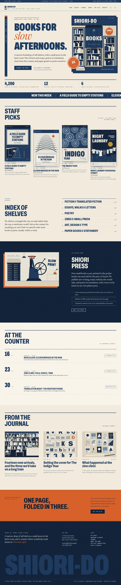</a><br><a href="themes/aizome-shoten">Aizome Shoten</a></td>
<td align="center" valign="top" width="33%"><a href="themes/amane-wagashi">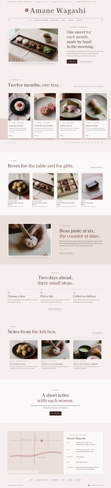</a><br><a href="themes/amane-wagashi">Amane Wagashi</a></td>
<td align="center" valign="top" width="33%"><a href="themes/asa-linen">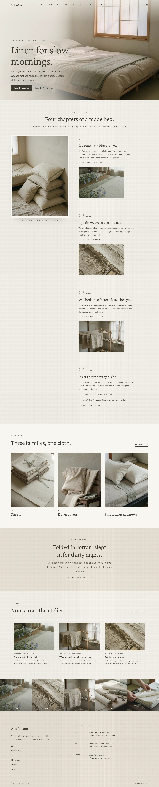</a><br><a href="themes/asa-linen">Asa Linen</a></td>
</tr>
<tr>
<td align="center" valign="top" width="33%"><a href="themes/beni-kappo">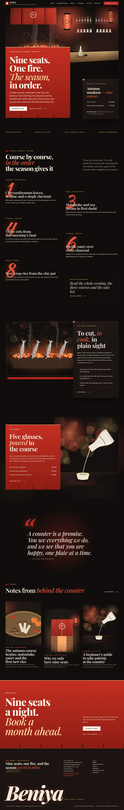</a><br><a href="themes/beni-kappo">Beni Kappo</a></td>
<td align="center" valign="top" width="33%"><a href="themes/eda-bonsai">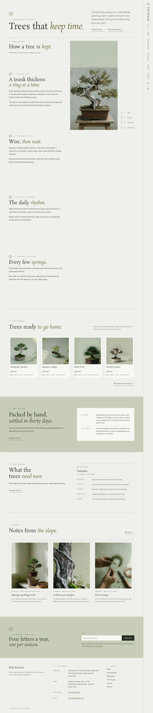</a><br><a href="themes/eda-bonsai">Eda Bonsai</a></td>
<td align="center" valign="top" width="33%"><a href="themes/engawa-works">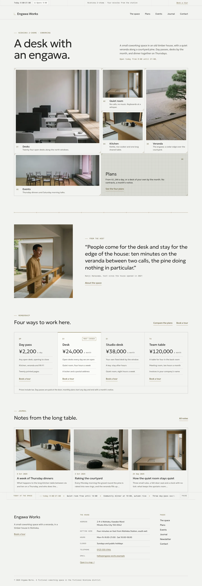</a><br><a href="themes/engawa-works">Engawa Works</a></td>
</tr>
<tr>
<td align="center" valign="top" width="33%"><a href="themes/fuji-shinkyu">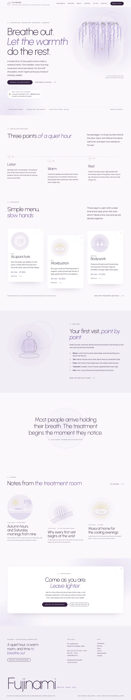</a><br><a href="themes/fuji-shinkyu">Fuji Shinkyu</a></td>
<td align="center" valign="top" width="33%"><a href="themes/ginrin-cycle">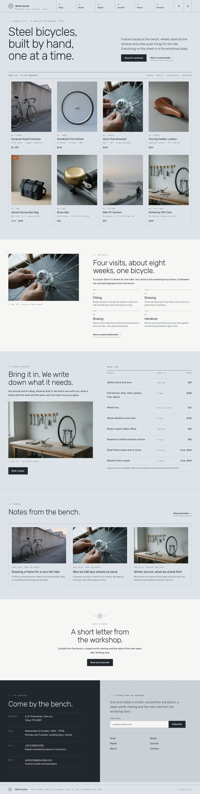</a><br><a href="themes/ginrin-cycle">Ginrin Cycle</a></td>
<td align="center" valign="top" width="33%"><a href="themes/hakuba-dental">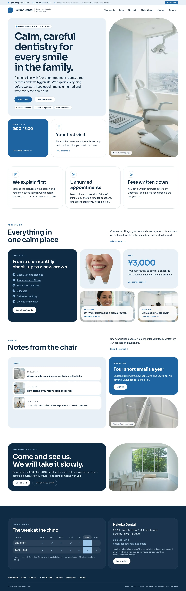</a><br><a href="themes/hakuba-dental">Hakuba Dental</a></td>
</tr>
<tr>
<td align="center" valign="top" width="33%"><a href="themes/hamono-kaji">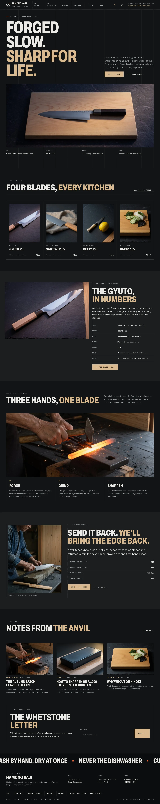</a><br><a href="themes/hamono-kaji">Hamono Kaji</a></td>
<td align="center" valign="top" width="33%"><a href="themes/hana-kago">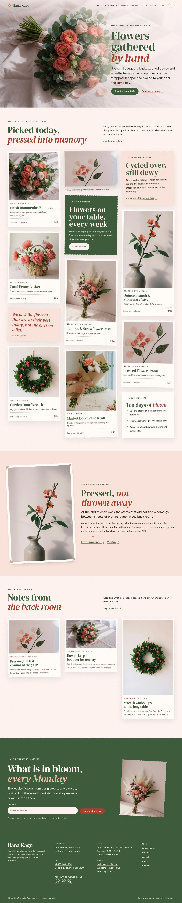</a><br><a href="themes/hana-kago">Hana Kago</a></td>
<td align="center" valign="top" width="33%"><a href="themes/hanabi-matsuri">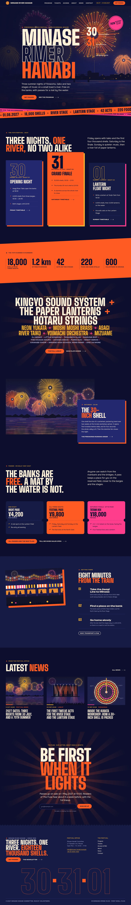</a><br><a href="themes/hanabi-matsuri">Hanabi Matsuri</a></td>
</tr>
<tr>
<td align="center" valign="top" width="33%"><a href="themes/hari-tailor">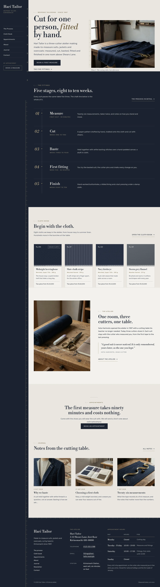</a><br><a href="themes/hari-tailor">Hari Tailor</a></td>
<td align="center" valign="top" width="33%"><a href="themes/hibiki-records">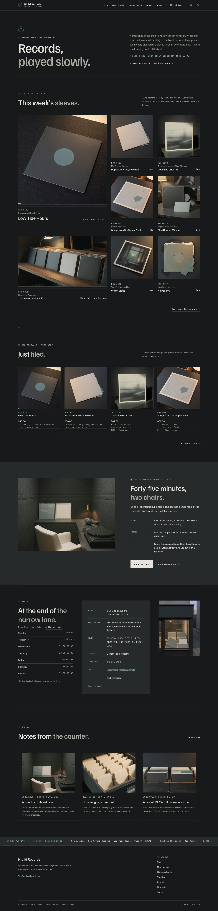</a><br><a href="themes/hibiki-records">Hibiki Records</a></td>
<td align="center" valign="top" width="33%"><a href="themes/hikari-app">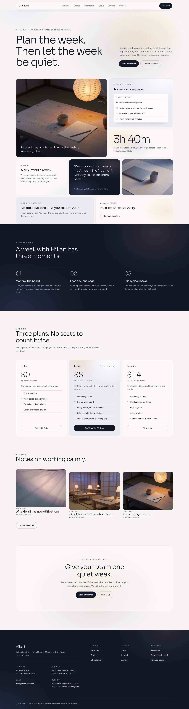</a><br><a href="themes/hikari-app">Hikari App</a></td>
</tr>
<tr>
<td align="center" valign="top" width="33%"><a href="themes/hikari-musubi">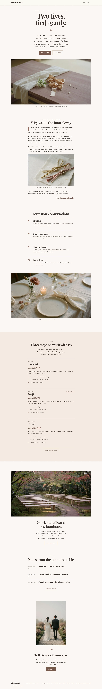</a><br><a href="themes/hikari-musubi">Hikari Musubi</a></td>
<td align="center" valign="top" width="33%"><a href="themes/hinoki-yado"></a><br><a href="themes/hinoki-yado">Hinoki Yado</a></td>
<td align="center" valign="top" width="33%"><a href="themes/ikebana-kyoshitsu">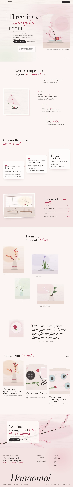</a><br><a href="themes/ikebana-kyoshitsu">Ikebana Kyoshitsu</a></td>
</tr>
<tr>
<td align="center" valign="top" width="33%"><a href="themes/kami-no-ne">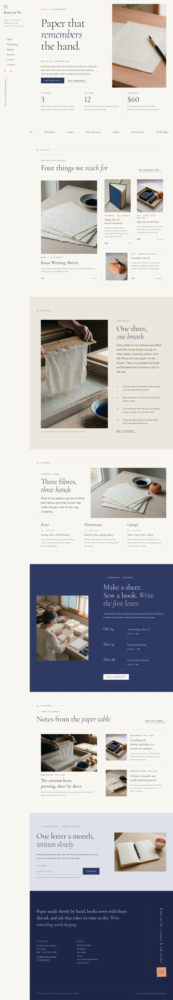</a><br><a href="themes/kami-no-ne">Kami no Ne</a></td>
<td align="center" valign="top" width="33%"><a href="themes/kami-salon">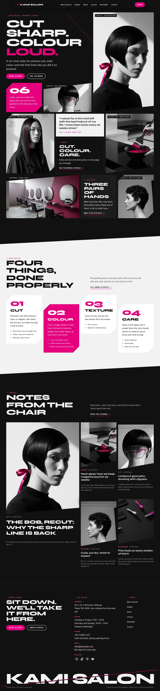</a><br><a href="themes/kami-salon">Kami Salon</a></td>
<td align="center" valign="top" width="33%"><a href="themes/kaori-cosme">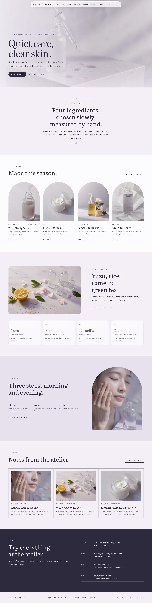</a><br><a href="themes/kaori-cosme">Kaori Cosme</a></td>
</tr>
<tr>
<td align="center" valign="top" width="33%"><a href="themes/kasumi-bar">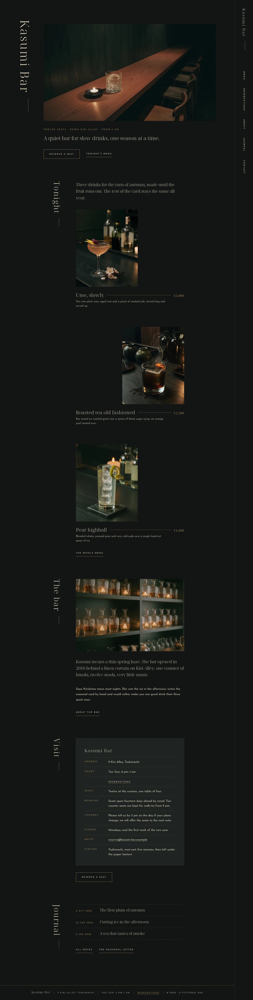</a><br><a href="themes/kasumi-bar">Kasumi Bar</a></td>
<td align="center" valign="top" width="33%"><a href="themes/kaze-yoga"></a><br><a href="themes/kaze-yoga">Kaze Yoga</a></td>
<td align="center" valign="top" width="33%"><a href="themes/kenchiku-grid">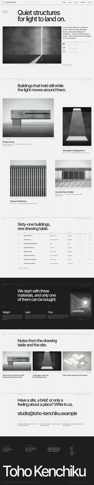</a><br><a href="themes/kenchiku-grid">Kenchiku Grid</a></td>
</tr>
<tr>
<td align="center" valign="top" width="33%"><a href="themes/kinu-kimono">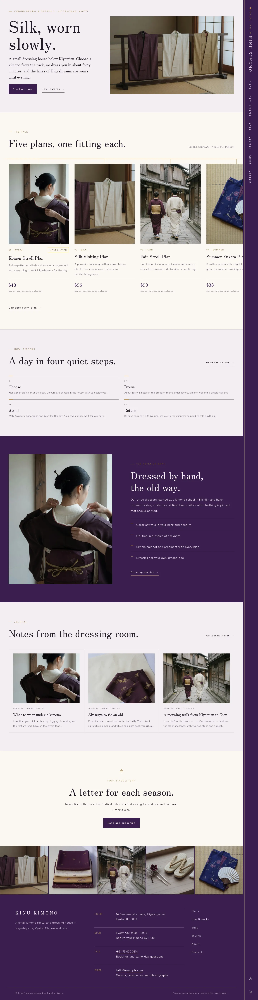</a><br><a href="themes/kinu-kimono">Kinu Kimono</a></td>
<td align="center" valign="top" width="33%"><a href="themes/kiroku-studio">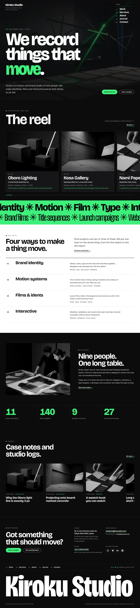</a><br><a href="themes/kiroku-studio">Kiroku Studio</a></td>
<td align="center" valign="top" width="33%"><a href="themes/kissaten-counter">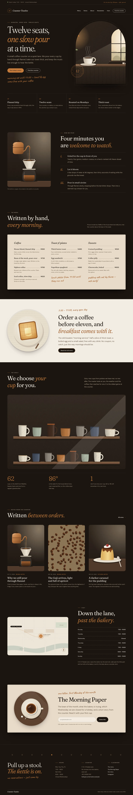</a><br><a href="themes/kissaten-counter">Kissaten Counter</a></td>
</tr>
<tr>
<td align="center" valign="top" width="33%"><a href="themes/koke-garden">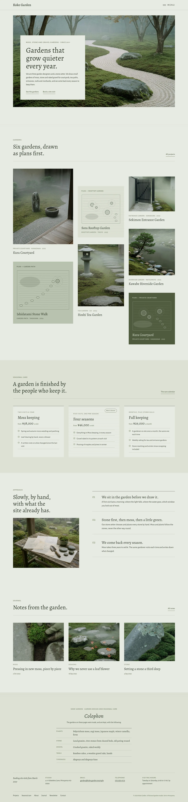</a><br><a href="themes/koke-garden">Koke Garden</a></td>
<td align="center" valign="top" width="33%"><a href="themes/komugi-pan">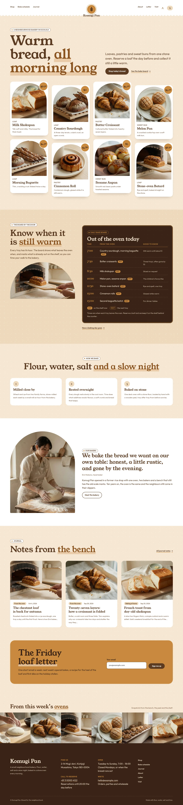</a><br><a href="themes/komugi-pan">Komugi Pan</a></td>
<td align="center" valign="top" width="33%"><a href="themes/kumo-eyewear">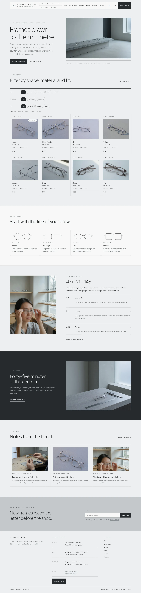</a><br><a href="themes/kumo-eyewear">Kumo Eyewear</a></td>
</tr>
<tr>
<td align="center" valign="top" width="33%"><a href="themes/kura-shizuku">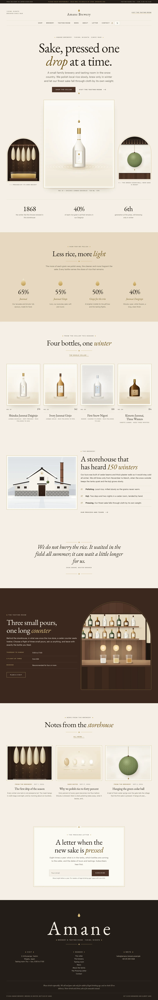</a><br><a href="themes/kura-shizuku">Kura Shizuku</a></td>
<td align="center" valign="top" width="33%"><a href="themes/kuyuru-incense">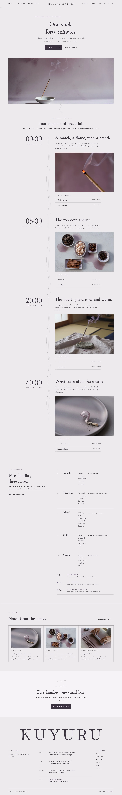</a><br><a href="themes/kuyuru-incense">Kuyuru Incense</a></td>
<td align="center" valign="top" width="33%"><a href="themes/ma-vertical">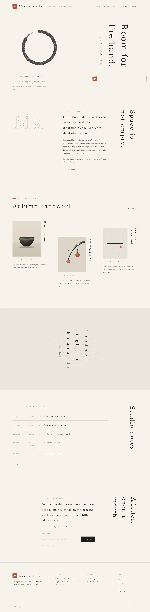</a><br><a href="themes/ma-vertical">Ma Vertical</a></td>
</tr>
<tr>
<td align="center" valign="top" width="33%"><a href="themes/menya-kaen"></a><br><a href="themes/menya-kaen">Menya Kaen</a></td>
<td align="center" valign="top" width="33%"><a href="themes/mimi-veterinary">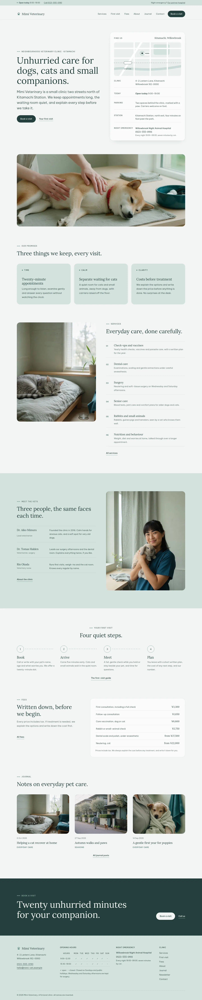</a><br><a href="themes/mimi-veterinary">Mimi Veterinary</a></td>
<td align="center" valign="top" width="33%"><a href="themes/mizuha-glass">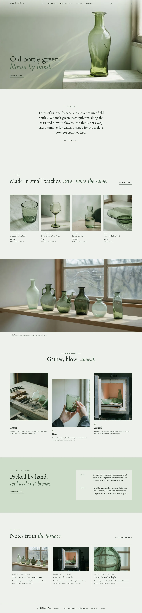</a><br><a href="themes/mizuha-glass">Mizuha Glass</a></td>
</tr>
<tr>
<td align="center" valign="top" width="33%"><a href="themes/mori-no-kai">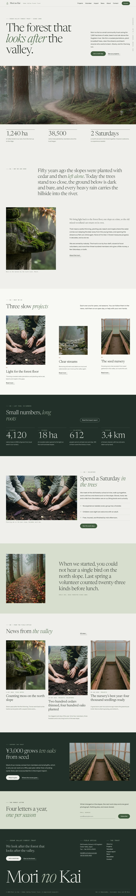</a><br><a href="themes/mori-no-kai">Mori no Kai</a></td>
<td align="center" valign="top" width="33%"><a href="themes/nameshi-leather">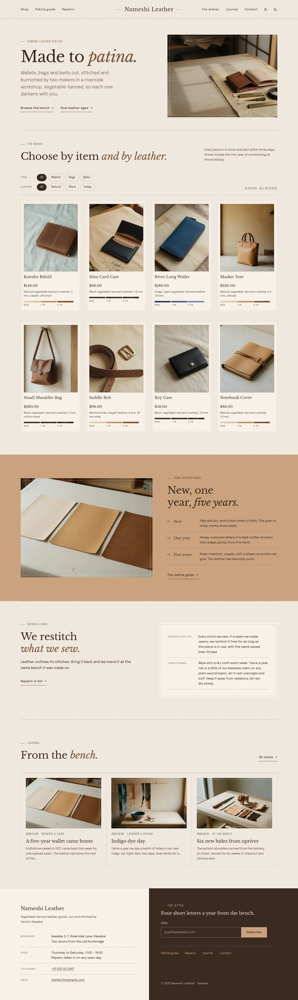</a><br><a href="themes/nameshi-leather">Nameshi Leather</a></td>
<td align="center" valign="top" width="33%"><a href="themes/neiro-hall">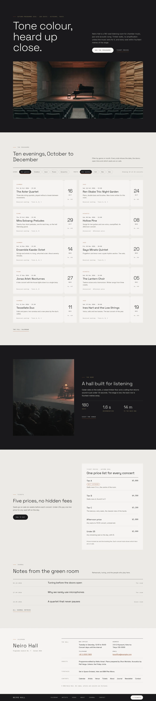</a><br><a href="themes/neiro-hall">Neiro Hall</a></td>
</tr>
<tr>
<td align="center" valign="top" width="33%"><a href="themes/oto-radio"></a><br><a href="themes/oto-radio">Oto Radio</a></td>
<td align="center" valign="top" width="33%"><a href="themes/sakura-juku">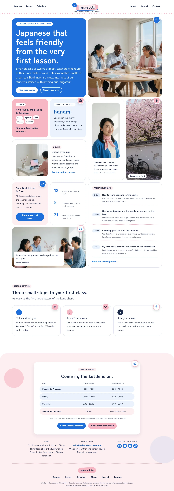</a><br><a href="themes/sakura-juku">Sakura Juku</a></td>
<td align="center" valign="top" width="33%"><a href="themes/seiji-utsuwa">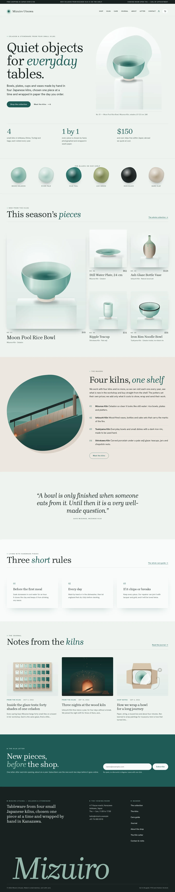</a><br><a href="themes/seiji-utsuwa">Seiji Utsuwa</a></td>
</tr>
<tr>
<td align="center" valign="top" width="33%"><a href="themes/shashin-folio">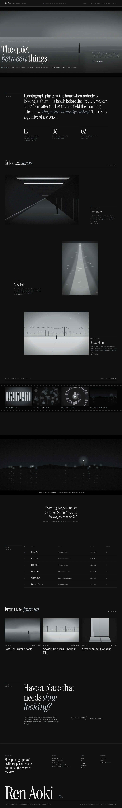</a><br><a href="themes/shashin-folio">Shashin Folio</a></td>
<td align="center" valign="top" width="33%"><a href="themes/shiori-review">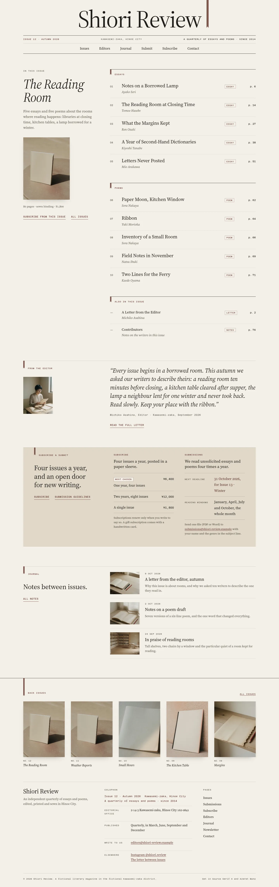</a><br><a href="themes/shiori-review">Shiori Review</a></td>
<td align="center" valign="top" width="33%"><a href="themes/shiro-horitsu">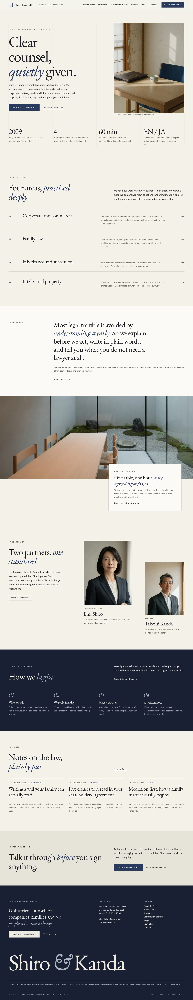</a><br><a href="themes/shiro-horitsu">Shiro Horitsu</a></td>
</tr>
<tr>
<td align="center" valign="top" width="33%"><a href="themes/sumai-realty">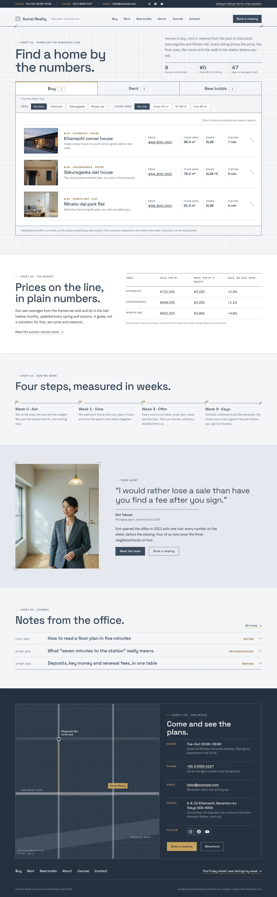</a><br><a href="themes/sumai-realty">Sumai Realty</a></td>
<td align="center" valign="top" width="33%"><a href="themes/sushi-ginza">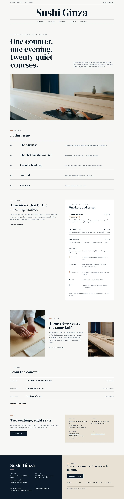</a><br><a href="themes/sushi-ginza">Sushi Ginza</a></td>
<td align="center" valign="top" width="33%"><a href="themes/suzuri-shodo">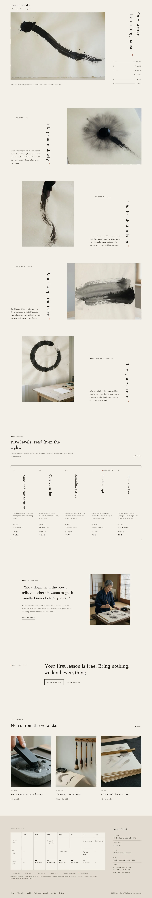</a><br><a href="themes/suzuri-shodo">Suzuri Shodo</a></td>
</tr>
<tr>
<td align="center" valign="top" width="33%"><a href="themes/tabi-note">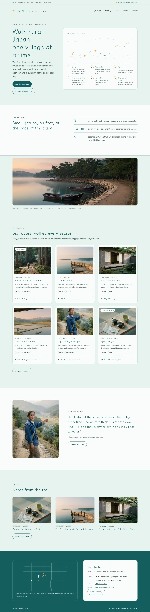</a><br><a href="themes/tabi-note">Tabi Note</a></td>
<td align="center" valign="top" width="33%"><a href="themes/tsuki-silver">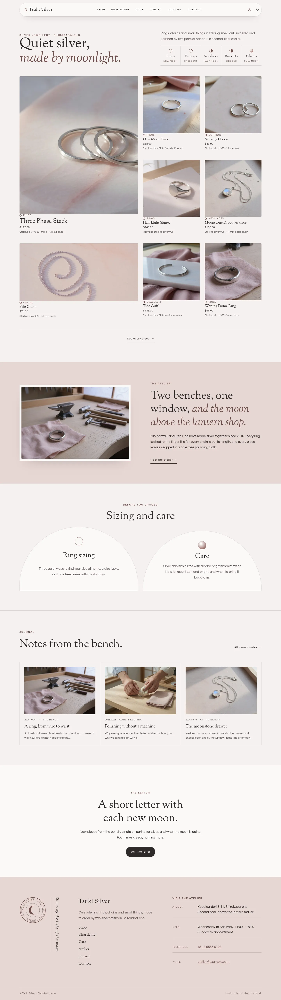</a><br><a href="themes/tsuki-silver">Tsuki Silver</a></td>
<td align="center" valign="top" width="33%"><a href="themes/tsumiki-accounting">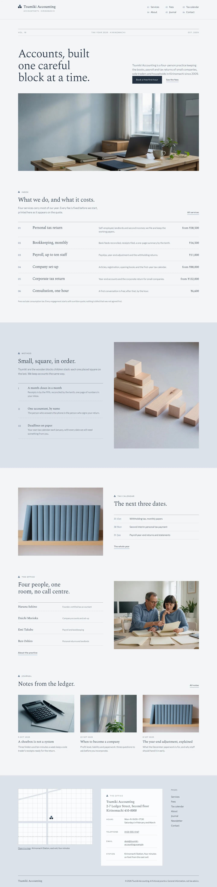</a><br><a href="themes/tsumiki-accounting">Tsumiki Accounting</a></td>
</tr>
<tr>
<td align="center" valign="top" width="33%"><a href="themes/tsuya-lacquer">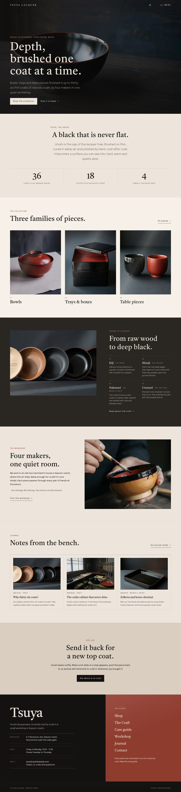</a><br><a href="themes/tsuya-lacquer">Tsuya Lacquer</a></td>
<td align="center" valign="top" width="33%"><a href="themes/undo-ba">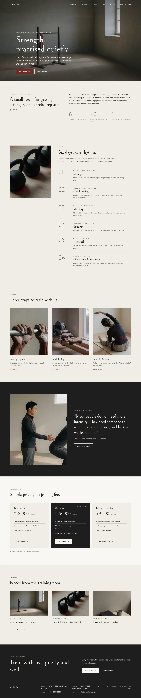</a><br><a href="themes/undo-ba">Undo Ba</a></td>
<td align="center" valign="top" width="33%"><a href="themes/wagu-mono">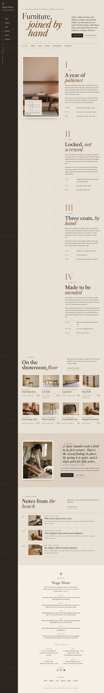</a><br><a href="themes/wagu-mono">Wagu Mono</a></td>
</tr>
<tr>
<td align="center" valign="top" width="33%"><a href="themes/yohaku-studio"></a><br><a href="themes/yohaku-studio">Yohaku Studio</a></td>
<td align="center" valign="top" width="33%"><a href="themes/yuge-sento"></a><br><a href="themes/yuge-sento">Yuge Sento</a></td>
<td align="center" valign="top" width="33%"><a href="themes/yuzu-chaya"></a><br><a href="themes/yuzu-chaya">Yuzu Chaya</a></td>
</tr>
</table>
<!-- gallery:end -->

## Install a theme

1. Download the theme's zip. The newest version of every theme is always at
   `https://github.com/oberonlai/shippress-themes/releases/download/themes/<slug>.zip`
2. In WordPress admin, go to **Appearance → Themes → Add New Theme → Upload Theme**, choose the zip and click **Install Now**.
3. Click **Activate**.

Each zip contains a single `<slug>/` folder, which is what WordPress expects.

## Releases

GitHub Actions (`.github/workflows/themes.yml`) builds one reproducible zip per theme (fixed timestamps, sorted entries), so a zip's bytes change only when the theme's files change. On every push to `main`:

1. **Versioned release, never overwritten.** Each theme version gets its own release, tagged `<slug>-v<Version>` (`Version` from the theme's `style.css`), with the zip at
   `https://github.com/oberonlai/shippress-themes/releases/download/<slug>-v<Version>/<slug>.zip`.
   A new version is published once; a version that is already released with the same bytes is left alone. If the bytes differ, the job fails before publishing anything (`scripts/release-themes.mjs`): **change a theme → bump `Version` in its `style.css`** (x.y.z). Pull requests run the same check without publishing, so a forgotten bump shows up before merging.
2. **Moving release `themes`.** The newest zip of every theme (the install URL above), replaced on each push.
3. **`releases.json`**, attached to the `themes` release:
   `https://github.com/oberonlai/shippress-themes/releases/download/themes/releases.json`
   lists every theme's current `version`, `tag`, immutable `url`, `sha256` and `size`.

ShipPress pins the versioned URL plus its sha256 and refuses any other bytes, so a push here never breaks installs from the app. To offer a new version in ShipPress, run `npm run themes:pin` in the app repo after the workflow has finished (it reads `releases.json`); the app's daily "theme pins" check warns when a newer version is waiting.

## Repository layout

```
index.json                 all themes' metadata + filter lists (generated, see below)
scripts/check-themes.mjs   validator (Node 18+, no dependencies)
scripts/release-themes.mjs versioned releases + releases.json (run by the workflow)
themes/<slug>/
  style.css                theme header (GPL-2.0-or-later, Text Domain = <slug>)
  theme.json               settings, palette, bundled font faces, styles
  functions.php            block styles and pattern categories
  templates/  parts/  patterns/  styles/
  assets/fonts/            WOFF2 files + their license texts
  assets/images/           original artwork
  screenshot.png           1200×900 WordPress theme thumbnail
  readme.txt               copyright and license of every bundled font and image
  README.md                design notes
  theme-meta.json          template-wall metadata (industry, type, colors, style, fonts, pages, license)
  demo-content.json        sample pages, posts and terms, plus the URL of each catalogue page
```

## Add a theme

1. Create `themes/<slug>/` (lowercase, hyphenated) with a valid block theme. It needs at least these templates: `index`, `front-page` or `home`, `single`, `page`, `archive` or `category`, `tag` and `404`. Use a page template (`page-about`, `page-newsletter`, `page-contact`) where a page needs its own layout.
2. Put a GPL-2.0-or-later header in `style.css` (`License`, `License URI`, `Text Domain: <slug>`).
3. **Fonts:** bundle only fonts under the SIL OFL, Apache 2.0 or another GPL-compatible license. Put the files in `assets/fonts/` with their license text and register them as `fontFace` in `theme.json`. Never load fonts from Google Fonts or another CDN.
4. **Images:** use only your own work, generated artwork, or CC0 / public-domain images, and note the source of each in `readme.txt`.
5. Never include secrets, API keys, real email addresses (use `@example.com` or `*.example`), personal data or local file paths. Sample copy is English and names only fictional people, companies, publications and awards (real city names are fine); `check-themes.mjs` refuses a list of known real ones.
6. Add `theme-meta.json` (copy an existing one) and `demo-content.json` with a `screens` URL for each page in `pages`.
   Copy `shared/inc/demo-import.php` to `inc/demo-import.php` unchanged (the check compares the bytes) and `require_once` it from `functions.php`. It imports the demo content on activation, from the wp-admin "Import demo content" button and with `wp shippress demo-import [--reading]`. Every run is safe to repeat: items are found again by their `_shippress_demo` tag, an empty page with the same slug or title (such as a blank "Home" made by a host) is filled in instead of doubled, the user's own pages are used as they are and never changed, and one run at a time holds a lock. Switching from another ShipPress theme: each imported item carries a fingerprint (`_shippress_demo_hash`, sha256 of its title and content as saved), so another theme's demo pages, posts and menu that nobody edited get the new theme's version in place (same ID and slug, a revision of the old version saved first), edited ones are kept and listed (wp-admin notice with a "Use <Theme>'s text" button per page, or `wp shippress demo-use-text <id>`), and the old theme's unedited extras move to Draft (switching back publishes them again). `wp shippress demo-import --format=json` prints `{replaced, keptEdited, added, drafted}`. ShipPress tests this on fresh local sites for every theme (`mcp-server/theme-idempotency.test.mjs` in the app repo).
7. Run `node scripts/check-themes.mjs --write` to validate the theme and regenerate `index.json`, then `node --test scripts/check-themes.test.mjs scripts/release-themes.test.mjs`. Open a pull request: CI runs the same checks. When you change an existing theme, bump `Version` in its `style.css` too (see [Releases](#releases)).

ShipPress then renders the theme on a throwaway local WordPress and keeps its full-page desktop and mobile screenshots, plus a copy of the metadata, in the app repo.

## License

All themes are GPL-2.0-or-later (see [LICENSE](LICENSE)). Bundled fonts keep their own licenses (SIL Open Font License 1.1), listed in each theme's `readme.txt`.
