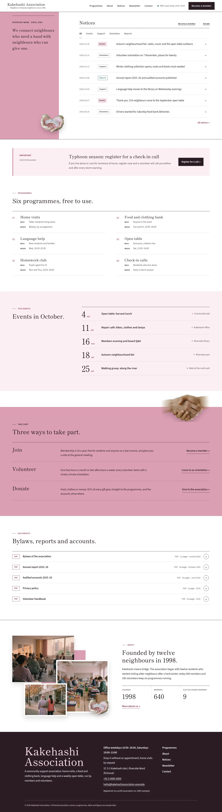
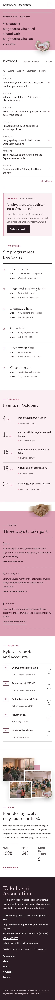

# Kakehashi Association

Kakehashi Association — a theme for a community support association (home visits, a food and clothing bank, language help, an open table), built around a notice feed: a formal white top header with the association's name, the office hours and a Become a member button, the main menu in one row on the right. Nadeshiko pink (#DC9FB4) is the main colour: the full-height purpose banner on the left of the first screen, the take-part field, the page heads and the mobile menu are pink. The front page opens on a narrow vertical banner with the association's purpose in one Shippori Mincho sentence and a cut-out photograph of a paper-cut sculpture (two hands holding a small bridge) that breaks out over the banner edge; beside it, the notice board: category tabs (All, Events, Support, Volunteers, Reports) that filter seven dated notice rows without JavaScript, and Become a member / Donate links. Below: the pinned important notice in a pale box, six programmes as a two-column text index, this month's events as a date list with large day numbers, three ways to take part on a pink field where cut-out clasped hands break over the top edge, a documents download list and a short about with a collage of three overlapping photographs. Photographs are realistic film-grain images (35mm look, 50mm f/2, natural side light, graded toward nadeshiko pink). Shippori Mincho B1 for headings, Source Sans 3 for text. Sample content in English. WCAG AA colours; no entrance animations.

- Design plan row b5-14: sidebar-app, vertical-banner, top-bar nav, collage, paper-cut (rendered as film-grain photographs under the 2026-10-18 photo rule: a cut-out photograph of a paper-cut sculpture and a three-photo collage), nadeshiko #DC9FB4, Shippori Mincho B1 + Source Sans 3; first screen index-list, page structure notice-feed.
- Front page blocks: hero-notice-board, pinned-notice, programmes-index, events-month, take-part, documents, about-short.
- Sample content language: en (English-only theme).
- Contrast: plum ink #2B1D25 on nadeshiko #DC9FB4 7.4:1 (purpose banner, take-part field, page heads, mobile menu; white on nadeshiko is only 2.2:1 and never used for text there); ink on white 16.1:1; white on ink 16.1:1 (buttons); deep rose #8E3556 on white 7.5:1 and on tint #FBEFF3 6.7:1 (labels, links, arrows); quiet #62525A on white 7.3:1 and on tint 6.5:1; moss #2F6A5C on white 6.3:1 (report tags, status dot).
- Break-frame: the paper-cut bridge sculpture is a transparent cut-out photograph (WebP with alpha) that breaks out over the right edge of the pink purpose banner; cut-out clasped hands break over the top edge of the take-part field and the page heads.

<!-- screenshots:start -->
## Screenshots

<table>
<tr>
<td valign="top"></td>
<td valign="top"></td>
</tr>
</table>

- Programmes: [desktop](screenshots/programmes-desktop.webp) · [mobile](screenshots/programmes-mobile.webp)
- About: [desktop](screenshots/about-desktop.webp) · [mobile](screenshots/about-mobile.webp)
- News: [desktop](screenshots/news-desktop.webp) · [mobile](screenshots/news-mobile.webp)
- Article: [desktop](screenshots/article-desktop.webp) · [mobile](screenshots/article-mobile.webp)
- Category: [desktop](screenshots/category-desktop.webp) · [mobile](screenshots/category-mobile.webp)
- Tag: [desktop](screenshots/tag-desktop.webp) · [mobile](screenshots/tag-mobile.webp)
- Newsletter: [desktop](screenshots/newsletter-desktop.webp) · [mobile](screenshots/newsletter-mobile.webp)
- Contact: [desktop](screenshots/contact-desktop.webp) · [mobile](screenshots/contact-mobile.webp)
- Search: [desktop](screenshots/search-desktop.webp) · [mobile](screenshots/search-mobile.webp)
<!-- screenshots:end -->
