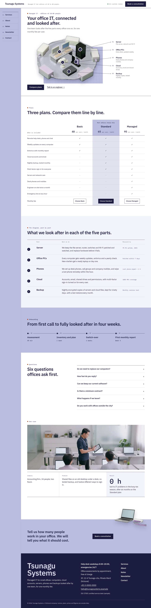
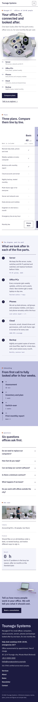

# Tsunagu Systems

Tsunagu Systems — a theme for an IT services company (managed IT for small offices), built around plan comparison: a formal white top header with the company name, a status line and the Book a consultation button, and under it a 200px wisteria side rail holding the numbered main menu. Wisteria (#BBBCDE) is the main colour: the side rail runs the full page height, the hero grid floor, the recommended plan column, the onboarding field, the consultation band and every page head are wisteria. The front page opens on a two-line headline over a centred tabletop model of an office network (a transparent cut-out photograph that overflows its grid floor) with five numbered callouts whose hairline leaders run to labels in a right-hand column; then a three-plan comparison table with a sticky header, the five parts explained row by row, four onboarding steps in one line, six questions in an accordion, one client case and a one-line consultation band where a cut-out laptop breaks over the band edge. Photographs are realistic high-key images (85mm, softbox light, near-white backgrounds, graded toward wisteria). IBM Plex Sans JP for headings and text, IBM Plex Mono for labels, numbers and prices. Sample content in English. WCAG AA colours; no entrance animations.

- Design plan row b5-13: editorial-magazine, scene-map, side-rail nav, full-illustration, 2.5d-isometric (rendered as a high-key photograph of an isometric tabletop model under the 2026-10-18 photo rule), fuji #BBBCDE, IBM Plex Sans JP + IBM Plex Mono; first screen map-diagram, page structure plan-comparison.
- Front page blocks: hero-system-diagram, plan-table, diagram-parts, onboarding, faq, case-row, consult-cta.
- Sample content language: en (English-only theme).
- Contrast: ink #1C1B3F on wisteria #BBBCDE 8.9:1 (side rail, onboarding, consultation band, page heads, mobile menu; white on wisteria is only 1.8:1 so it is never used for text there); white on ink 16.4:1 (buttons, pins); deep wisteria #47468A on white 8.4:1, on tint #F3F3FA 7.6:1 and on wisteria 4.5:1 (labels, rail numbers); quiet #56566F on white 7.1:1 and on tint 6.4:1; signal orange #B1441C is used only for 8px label squares (decorative).
- Break-frame: the hero network model is a transparent cut-out photograph (WebP with alpha) that overflows its wisteria grid floor at the top and left; the cut-out laptop and switch break out over the top edge of the consultation band and the page heads.

<!-- screenshots:start -->
## Screenshots

<table>
<tr>
<td valign="top"></td>
<td valign="top"></td>
</tr>
</table>

- Services: [desktop](screenshots/services-desktop.webp) · [mobile](screenshots/services-mobile.webp)
- About: [desktop](screenshots/about-desktop.webp) · [mobile](screenshots/about-mobile.webp)
- News: [desktop](screenshots/news-desktop.webp) · [mobile](screenshots/news-mobile.webp)
- Article: [desktop](screenshots/article-desktop.webp) · [mobile](screenshots/article-mobile.webp)
- Category: [desktop](screenshots/category-desktop.webp) · [mobile](screenshots/category-mobile.webp)
- Tag: [desktop](screenshots/tag-desktop.webp) · [mobile](screenshots/tag-mobile.webp)
- Newsletter: [desktop](screenshots/newsletter-desktop.webp) · [mobile](screenshots/newsletter-mobile.webp)
- Contact: [desktop](screenshots/contact-desktop.webp) · [mobile](screenshots/contact-mobile.webp)
- Search: [desktop](screenshots/search-desktop.webp) · [mobile](screenshots/search-mobile.webp)
<!-- screenshots:end -->
