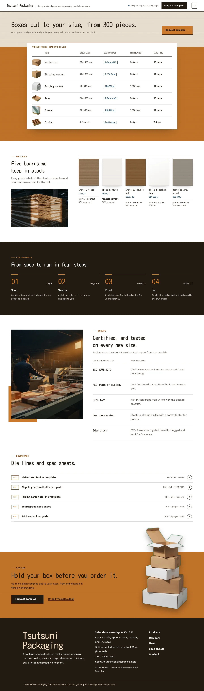
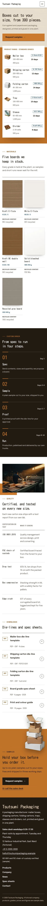

# Tsutsumi Packaging

Tsutsumi Packaging — a theme for a packaging manufacturer (mailer boxes, shipping cartons, folding cartons, trays, sleeves and dividers), built around a spec catalogue: a formal header with the company name, the Request samples button and a menu button that opens a full-screen amber overlay. Amber (#CA7A2C) is the main colour: the lower half of the first screen, the sample request band, the menu overlay and the page heads are amber. The front page opens on a full-bleed kraft-board texture with a one-line Kosugi Maru headline and a solid amber Request samples button; below it a white spec table card straddles the amber field with six product rows (cut-out product photograph, type, size range, board grade, minimum lot, lead time). Below: five board swatches with grade codes and recycled content beside a photograph of the board edges, a four-step custom-order flow in one line (spec, sample, proof, run) with amber step numbers on an ink field, certifications and tests as a two-column table scrolling beside a sticky factory photograph, a die-line and spec-sheet download list and an amber sample request band where a cut-out stack of boxes breaks over the top edge. Photographs are realistic low-key images (50mm f/1.4, single hard window light, deep shadows, graded toward amber) and studio cut-outs. Kosugi Maru for headings, Epilogue for text and figures. Sample content in English. WCAG AA colours; no entrance animations.

- Design plan row b5-15: sticky-media, full-bleed-illustration (as a full-bleed kraft-board photographic texture field), overlay nav, pattern-texture, sumi-ink (rendered as low-key photographs under the 2026-10-18 photo rule: 50mm f/1.4, single hard window light, deep shadows, graded toward amber, plus studio cut-outs), amber #CA7A2C, Kosugi Maru + Epilogue; first screen spec-table, page structure spec-catalogue.
- Front page blocks: hero-spec-table, materials, custom-order, quality, downloads, sample-cta.
- Sample content language: en (English-only theme).
- Contrast: ink #221A12 on amber #CA7A2C 5.2:1 (first-screen field, sample band, page heads, menu overlay, amber buttons with ink text; white on amber is only 3.3:1 and never used for text); amber #CA7A2C on ink 5.2:1 (custom-order step numbers and labels on the ink field); ink on white 17.1:1; white on ink 17.1:1; deep amber #87470F on white 7.1:1 and on warm paper #F6EFE4 6.3:1 (labels, links, arrows); quiet #5C5148 on white 7.7:1 and on paper 6.7:1; slate #2D5470 on white 8.0:1 (board-grade tags).
- Break-frame: a transparent cut-out photograph (WebP with alpha) of a stack of boxes breaks over the top edge of the amber sample band; the six product cut-outs sit in the spec table, and a cut-out carton breaks over the bottom edge of the page heads.

<!-- screenshots:start -->
## Screenshots

<table>
<tr>
<td valign="top"></td>
<td valign="top"></td>
</tr>
</table>

- Products: [desktop](screenshots/products-desktop.webp) · [mobile](screenshots/products-mobile.webp)
- About: [desktop](screenshots/about-desktop.webp) · [mobile](screenshots/about-mobile.webp)
- News: [desktop](screenshots/news-desktop.webp) · [mobile](screenshots/news-mobile.webp)
- Article: [desktop](screenshots/article-desktop.webp) · [mobile](screenshots/article-mobile.webp)
- Category: [desktop](screenshots/category-desktop.webp) · [mobile](screenshots/category-mobile.webp)
- Tag: [desktop](screenshots/tag-desktop.webp) · [mobile](screenshots/tag-mobile.webp)
- Newsletter: [desktop](screenshots/newsletter-desktop.webp) · [mobile](screenshots/newsletter-mobile.webp)
- Contact: [desktop](screenshots/contact-desktop.webp) · [mobile](screenshots/contact-mobile.webp)
- Search: [desktop](screenshots/search-desktop.webp) · [mobile](screenshots/search-mobile.webp)
<!-- screenshots:end -->
