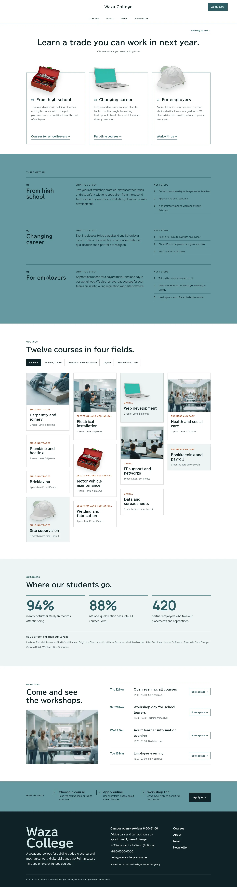

# Waza College

Waza College — a theme for a vocational training college, built as an audience gateway under a formal centred white header: the college name in the centre, the Apply button at the right and the menu centred on a second row. Rust asagi (#6699A1) is the main colour: the path detail section, the apply steps, every page head and the mobile menu are rust-asagi fields in ink type. The front page opens on white with one centred headline and three equal framed panels (from high school, changing career, for employers), each with a transparent cut-out photograph (toolbox, laptop, hard hat) breaking out of the frame top edge; then one short two-column section per path, twelve courses in an asymmetric masonry with a field filter, outcomes with three large figures and partner employers, a dated list of open days and three application steps in one row. Photographs are realistic high-key images (85mm, softbox light, near-white backgrounds, graded toward rust asagi). BIZ UDPGothic for headings, Manrope for text and figures. Sample content in English. WCAG AA colours; no entrance animations.

- Design plan row b5-12: asymmetric-masonry, framed-window, centered nav, cutout-break-frame, 2d-flat (rendered as high-key photography under the 2026-10-18 photo rule), sabi-asagi #6699A1, BIZ UDPGothic + Manrope; first screen three-equal-columns, page structure audience-gateway.
- Front page blocks: hero-three-paths, path-detail, course-masonry, outcomes, open-days, apply-steps.
- Sample content language: en (English-only theme).
- Contrast: ink #0F2226 on rust asagi #6699A1 5.2:1 (path detail, apply steps, page heads, mobile menu; white on it is only 3.2:1 so it is never used for text there); white on deep asagi #2E5C64 7.4:1 (buttons); deep asagi on white 7.4:1 and on tint #EDF4F5 6.7:1 (links, figures, eyebrows); ink on white 16.4:1 and on tint 14.8:1; quiet #4A5D61 on white 6.9:1 and on tint 6.2:1; rust #A64B24 on white 5.7:1 (course field labels); rust-asagi frames are 1px decorative hairlines.
- Break-frame: three transparent cut-out photographs (toolbox, laptop, hard hat; WebP with alpha) break 40px out of the top edge of the hero path frames; the hard hat also breaks the page-head edges.

<!-- screenshots:start -->
## Screenshots

<table>
<tr>
<td valign="top"></td>
<td valign="top"></td>
</tr>
</table>

- Services: [desktop](screenshots/services-desktop.webp) · [mobile](screenshots/services-mobile.webp)
- About: [desktop](screenshots/about-desktop.webp) · [mobile](screenshots/about-mobile.webp)
- News: [desktop](screenshots/news-desktop.webp) · [mobile](screenshots/news-mobile.webp)
- Article: [desktop](screenshots/article-desktop.webp) · [mobile](screenshots/article-mobile.webp)
- Category: [desktop](screenshots/category-desktop.webp) · [mobile](screenshots/category-mobile.webp)
- Tag: [desktop](screenshots/tag-desktop.webp) · [mobile](screenshots/tag-mobile.webp)
- Newsletter: [desktop](screenshots/newsletter-desktop.webp) · [mobile](screenshots/newsletter-mobile.webp)
- Contact: [desktop](screenshots/contact-desktop.webp) · [mobile](screenshots/contact-mobile.webp)
- Search: [desktop](screenshots/search-desktop.webp) · [mobile](screenshots/search-mobile.webp)
<!-- screenshots:end -->
