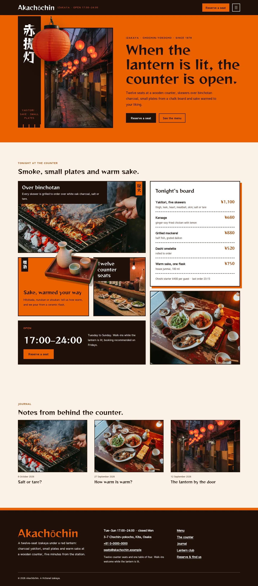
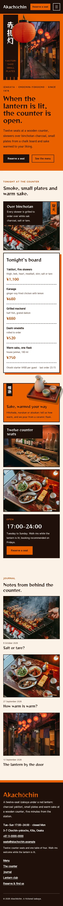

# Akachōchin

Akachōchin — An izakaya theme laid out as a card mosaic in shu vermilion (#EB6101), the main colour on the full hero field, the page heads, the menu overlay and the mosaic cards, with sumi brown-black, warm paper and deep vermilion links; Reggae One display over Sawarabi Gothic. The pictures are documentary-style photographs (35 mm, available light, handheld, fine grain, graded toward vermilion): the hero is a pair of tall vertical banners, a sumi nobori with the shop name set vertically beside a tall photograph of the lantern alley, with a red paper lantern as a transparent cut-out hanging over both; a cut-out sake flask breaks out of its vermilion card in the mosaic. A full top header: the shop name, a Reserve a seat button and a menu button that opens a full-screen vermilion overlay. Vertical Japanese only on Japanese text; English always runs horizontally. Tonight's board and the shop details are synced patterns edited in one place. WCAG AA colours; no entrance animations.

- Design plan row: b3-19 (card-mosaic archetype, vertical-banner hero, overlay nav, real-photography images, documentary photo direction, shu #EB6101, Reggae One + Sawarabi Gothic).
- Header: a full sumi bar with the shop name, the opening hours, a Reserve a seat button and a menu button; the menu opens as a full-screen vermilion overlay with large Reggae One links.
- Vertical-banner hero: on the full vermilion field, a tall sumi nobori with the shop name set vertically and a tall documentary photograph of the lantern alley stand side by side as banners.
- Break-frame: the cut-out red lantern hangs from the header edge over both banners; the cut-out sake flask breaks out of its vermilion card into the grill photograph in the mosaic and leaves the photo stack on Menu; the lantern also breaks out of the vermilion card on The counter.
- Card mosaic: the home page is a 12-column mosaic of cards in different sizes: grill photo, the synced board, the vermilion sake card, the counter and plates photos, and the hours.
- Photography: documentary style (35 mm, available light, handheld, fine grain), graded toward vermilion so the set stays consistent.
- Vertical Japanese (nobori, card labels, page-head labels, spine) is lang="ja"; only CJK text runs vertically, English stays horizontal.
- Synced: tonight's board (home, Menu) and shop details (footer, Contact).
- Contrast: sumi brown-black #1E1009 on shu vermilion #EB6101 5.5:1 (all text on the hero field, page heads, the menu overlay and the vermilion cards); white on sumi 18.5:1; shu on sumi 5.5:1 (header tag line, nobori caption, footer name, header button); sumi on warm paper #FBF1E7 16.6:1; deep vermilion #A63E00 on paper 5.7:1 and on white 6.3:1; quiet #5C4234 on paper 8.2:1 and on white 9.2:1; white on shu only 3.4:1, never used for text.

## Templates
front-page, home, index, page, page-wide, single, archive, category, tag, search, 404.

## Patterns
home-hero, home-mosaic, home-journal, menu-head, menu-main, about-head, about-main, newsletter-head, newsletter-signup, contact-head, contact-main, prices, details-card, not-found.

<!-- screenshots:start -->
## Screenshots

<table>
<tr>
<td valign="top"></td>
<td valign="top"></td>
</tr>
</table>

- Menu: [desktop](screenshots/menu-desktop.webp) · [mobile](screenshots/menu-mobile.webp)
- About: [desktop](screenshots/about-desktop.webp) · [mobile](screenshots/about-mobile.webp)
- News: [desktop](screenshots/news-desktop.webp) · [mobile](screenshots/news-mobile.webp)
- Article: [desktop](screenshots/article-desktop.webp) · [mobile](screenshots/article-mobile.webp)
- Category: [desktop](screenshots/category-desktop.webp) · [mobile](screenshots/category-mobile.webp)
- Tag: [desktop](screenshots/tag-desktop.webp) · [mobile](screenshots/tag-mobile.webp)
- Newsletter: [desktop](screenshots/newsletter-desktop.webp) · [mobile](screenshots/newsletter-mobile.webp)
- Contact: [desktop](screenshots/contact-desktop.webp) · [mobile](screenshots/contact-mobile.webp)
- Search: [desktop](screenshots/search-desktop.webp) · [mobile](screenshots/search-mobile.webp)
<!-- screenshots:end -->
