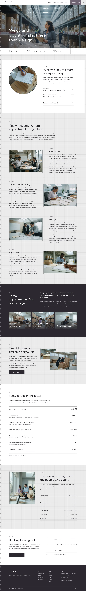

# Akira Audit

A block theme (type business) for an audit firm serving owner-managed companies and grant-funded charities. Home page and eleven inner pages (Services, Company audit, Charity audit, Grant assurance, How an audit runs, Cases, Fees, About, People, Insights, Contact, Privacy) plus one sample article, in English; every page carries the page head, tally-tick ruler strip and footer. Other languages follow.

## Signature
- A full-bleed stock-count photograph with the verb "count" in a 1 px frame with crop marks, an outline AKIRA AUDIT watermark cut by a white info bar, and a tally-tick ruler strip down the left edge of every screen.
- A scope circle: a 476 px circular photograph with a 3 px ink ring, a tick ring and a cross-hair, beside three hairline link rows with boxed arrows.
- Photographs in hairline frames with crop marks: alternating engagement chapters, and an overlapping pair for the case.

## Patterns
- `front-hero`, `front-scope`, `front-chapters`, `front-services`, `front-case`, `front-fees`, `front-people`, `front-contact`, `header-main`, `footer-main`

## Fonts
Instrument Sans and Atkinson Hyperlegible (SIL OFL 1.1, licences in assets/fonts); digits 0-9 are set in Instrument Sans (declared as "AA Digits" with a unicode-range) so the body face's slashed zero does not read as a typo; Noto Sans TC and JP for the Chinese and Japanese sample content.

## Images
AI-generated for this theme, no text or logos (assets/images/, listed in readme.txt).

## Scroll effects
sp-scroll (assets/sp-scroll.css and .js): photos fade in inside their frames, link rows rise 10 px, the scope circle scales in, and the hero photograph moves in parallax; all stop under reduced motion and stay visible without JavaScript.

<!-- screenshots:start -->
## Screenshots

<table>
<tr>
<td valign="top"></td>
<td valign="top"></td>
</tr>
</table>

- About: [desktop](screenshots/about-desktop.webp) · [mobile](screenshots/about-mobile.webp)
- News: [desktop](screenshots/news-desktop.webp) · [mobile](screenshots/news-mobile.webp)
- Article: [desktop](screenshots/article-desktop.webp) · [mobile](screenshots/article-mobile.webp)
- Category: [desktop](screenshots/category-desktop.webp) · [mobile](screenshots/category-mobile.webp)
- Tag: [desktop](screenshots/tag-desktop.webp) · [mobile](screenshots/tag-mobile.webp)
- Newsletter: [desktop](screenshots/newsletter-desktop.webp) · [mobile](screenshots/newsletter-mobile.webp)
- Contact: [desktop](screenshots/contact-desktop.webp) · [mobile](screenshots/contact-mobile.webp)
- Other languages (home page): [zh-TW](screenshots/zh-TW/home-desktop.webp) · [ja](screenshots/ja/home-desktop.webp) · [fr](screenshots/fr/home-desktop.webp) · [de](screenshots/de/home-desktop.webp)
<!-- screenshots:end -->
