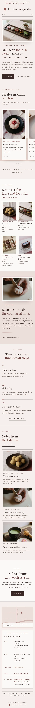

# Amane Wagashi

An elegant, restrained block theme for a **small silver jewellery atelier** and its online shop. A ShipPress **store** theme: WooCommerce templates styled to match, eight sample products in five moon-phase categories, and a shop that still works without WooCommerce.

*Tsuki* means moon. The demo atelier is a fictional second-floor room above a lantern maker in Shirakaba-cho, run by Mio Kanzaki and Ren Oda.

## Concept: quiet silver on pale stone

- **Palette.** Moonstone blush paper `#F6F1F0`, muted rose panels `#E6D6D3`, ink `#2E2A2A` and one muted rose accent `#A07873`, plus pearl `#FBF8F7` cards, soft silver `#C9C1BF` hairlines, deep rose `#6E4E4A` for links and labels (6.6:1 on blush) and quiet ink `#5E5455` for secondary text (6.5:1). The muted rose itself (3.5:1) is kept to moon marks and large marks.
- **Type.** Sorts Mill Goudy (display, with its italic for soft accents) and Questrial (text, labels in spaced capitals).
- **Moon-phase marks.** The five product families carry a phase drawn in CSS: Rings new moon, Earrings crescent, Necklaces half, Bracelets gibbous, Chains full. They mark the category index, every product card, the sizing and care steps.
- **Soft silver reflections.** A faint sheen drifts across a product photograph on hover; off for `prefers-reduced-motion`. No entrance animations and no front-end script.
- **Metal line on every product**, read from the product's `Metal` attribute (one source, edited in the product editor).

## Header, footer, layout (ROADMAP codes)

- **H10 floating pill header.** A pearl pill with a silver edge floats over the blush page: crescent mark and Goudy wordmark, centred spaced-capital menu, account and a rose cart chip. On phones the wordmark, a quiet "Menu" and the cart stay on one line inside the pill.
- **F12 stamped seal + vertical text footer.** On the muted rose panel: a round SVG seal (ring text and a crescent, tilted like a stamp) in deep rose, a vertical italic line "Silver, by the light of the moon", the wordmark and menu, and the visit rows of the synced atelier card.
- **L11 product-first grid.** A short title and the moon-phase index, then straight into a four-column grid of pieces on pale stone: a 2 x 2 feature tile, pairs of squares and one wide tile in every eight pieces (two columns on tablets and phones).

## One source for shared details

| What | Source | Shown on |
| --- | --- | --- |
| Atelier address, hours, telephone, email, sizing note, care note | `inc/info/atelier.html` (synced pattern) | Footer (visit rows), Ring sizing, Care, Contact |
| The tray: eight pieces, metal lines, prices, the editable "Most loved" badge | `inc/info/shelf.html` (synced pattern) | Home grid and Shop (without WooCommerce) |
| Metal line | each product's `Metal` attribute | Product cards and product page |

Pages that already show the atelier card hide it in the footer, so it never appears twice.

## Pages and templates

Demo pages: Home, Shop, Ring sizing (four ways, a US size table, free resizing), Care (four habits, what silver dislikes, free re-polishing), The atelier, Journal (posts page), Newsletter and Contact. Six sample posts in three categories (At the bench, Moon notes, Care & keeping) with six tags.

Templates: front page, page, wide page, single post, journal, archive, category, tag, search, 404, plus WooCommerce shop, product, cart, checkout, my account, order confirmation and product search.

## WooCommerce

Optional. With it active, `inc/woo-import.php` adds five product categories (Rings, Earrings, Necklaces, Bracelets, Chains), six tags and eight products with photographs, prices and attributes (metal, size, finish, care); run twice it creates nothing new. Without it the home grid and the Shop page show the synced tray and orders go by email.

## Licence

GPL-2.0-or-later. Fonts OFL-1.1 without Reserved Font Names (see `assets/fonts/`). Photographs AI-generated for this theme, released under GPL-2.0-or-later / CC0.

<!-- screenshots:start -->
## Screenshots

<table>
<tr>
<td valign="top"></td>
<td valign="top"></td>
</tr>
</table>

- Shop: [desktop](screenshots/shop-desktop.webp) · [mobile](screenshots/shop-mobile.webp)
- Product: [desktop](screenshots/product-desktop.webp) · [mobile](screenshots/product-mobile.webp)
- Seasonal calendar: [desktop](screenshots/seasonal-calendar-desktop.webp) · [mobile](screenshots/seasonal-calendar-mobile.webp)
- Pre orders: [desktop](screenshots/pre-orders-desktop.webp) · [mobile](screenshots/pre-orders-mobile.webp)
- About: [desktop](screenshots/about-desktop.webp) · [mobile](screenshots/about-mobile.webp)
- Contact: [desktop](screenshots/contact-desktop.webp) · [mobile](screenshots/contact-mobile.webp)
- News: [desktop](screenshots/news-desktop.webp) · [mobile](screenshots/news-mobile.webp)
- Article: [desktop](screenshots/article-desktop.webp) · [mobile](screenshots/article-mobile.webp)
- Category: [desktop](screenshots/category-desktop.webp) · [mobile](screenshots/category-mobile.webp)
- Tag: [desktop](screenshots/tag-desktop.webp) · [mobile](screenshots/tag-mobile.webp)
- Newsletter: [desktop](screenshots/newsletter-desktop.webp) · [mobile](screenshots/newsletter-mobile.webp)
- Search: [desktop](screenshots/search-desktop.webp) · [mobile](screenshots/search-mobile.webp)
<!-- screenshots:end -->
