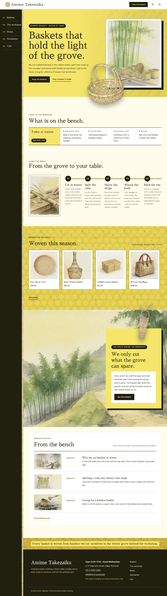
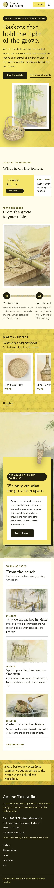

# Amime Takezaiku

Amime Takezaiku — a WooCommerce store theme for a bamboo basket workshop in a mountain valley, laid out as horizontal strips you read from left to right. A formal white top header carries the shop name, the Shop the baskets button, account and cart; from 1100 px the main menu stands as a fixed sumi side rail on the left (vertical entries in Chinese and Japanese), below that it opens from a Menu button as a full-screen kariyasu overlay. Kariyasu yellow (#F5E56B) is the main colour: the hero field, the shelf band, the grove card, every page head and the footer strip are kariyasu fields with sumi olive-black text, and woven bamboo textures (ajiro twill and kagome hexagon, raster watercolour) run through them. The hero sets the shop line on the left and a framed watercolour of the bamboo grove on the right; a cut-out round basket (transparent WebP) breaks out over the frame and the hero's bottom edge. The workshop board is one horizontal strip, the five steps from grove to basket stand side by side on one long bamboo strip, the baskets line up on a shelf that scrolls sideways, and a full-bleed grove panorama carries a kariyasu card that a cut-out flower basket breaks out of. Every picture is a soft watercolour illustration. Sawarabi Mincho for display, Urbanist for reading. Sample content and products in English, Traditional Chinese, Japanese, French and German; vertical lines only in Chinese and Japanese. Works without WooCommerce. WCAG AA colours; no entrance animations.

- Design plan row b4-13: horizontal-strip, text-left-art-right hero, side-rail nav, pattern-texture, watercolour, kariyasu #F5E56B, Sawarabi Mincho + Urbanist.
- Sample content languages: en, zh-TW, ja, fr, de.
- Contrast: sumi olive-black #22200F on kariyasu #F5E56B 12.7:1 (all text on the hero field, the shelf band, page heads, the board lead cell, the band card and the footer strip; the woven textures multiplied in only darken the field slightly); ink on kariyasu washi #FFFCEB 15.9:1, on white 16.4:1 and on pale kariyasu #FAF3C4 14.6:1; deep olive #5F5410 on washi 7.4:1, on white 7.6:1 and on kariyasu 5.9:1 (links, prices, labels; white on deep 7.6:1); quiet olive grey #5A5644 on washi 7.2:1 (secondary text); pale kariyasu #F9EFA0 on ink 14.0:1 and kariyasu on ink 12.7:1 (side rail numbers, buttons, chips, footer); bamboo green #4F6B2E on washi 5.9:1 (small dots only); white on kariyasu only 1.3:1, never used for text.
- Break-frame: the cut-out round basket (transparent WebP) breaks out over the hero frame and over the hero bottom edge into the workshop board; the cut-out flower basket breaks out of the kariyasu card over the top edge of the grove band; the basket also breaks over the bottom edge of every page head.

## Templates and patterns

Every template is the header (the shop name on the left; the Shop the baskets button, account and cart on the right), the fixed sumi side rail with the main menu from 1100 px (a full-screen kariyasu overlay below that), the page column and the footer. Page bodies come from patterns: home-hero (text left, framed watercolour grove right on the kariyasu field, cut-out basket breaking out), home-board (synced workshop board as one horizontal strip), home-waters (five steps side by side on one bamboo strip), home-shelf (baskets on a kariyasu band as a sideways-scrolling shelf; WooCommerce products, pictures without it), home-break (full-bleed grove panorama with a kariyasu card and the cut-out flower basket), home-journal (workshop notes as strips), and the page heads and bodies of Baskets, The workshop, Newsletter and Visit. WooCommerce templates (shop, product, cart, checkout, account, order confirmation, product search) use tpl-* patterns for their text.

<!-- screenshots:start -->
## Screenshots

<table>
<tr>
<td valign="top"></td>
<td valign="top"></td>
</tr>
</table>

- Shop: [desktop](screenshots/shop-desktop.webp) · [mobile](screenshots/shop-mobile.webp)
- Product: [desktop](screenshots/product-desktop.webp) · [mobile](screenshots/product-mobile.webp)
- About: [desktop](screenshots/about-desktop.webp) · [mobile](screenshots/about-mobile.webp)
- Contact: [desktop](screenshots/contact-desktop.webp) · [mobile](screenshots/contact-mobile.webp)
- News: [desktop](screenshots/news-desktop.webp) · [mobile](screenshots/news-mobile.webp)
- Article: [desktop](screenshots/article-desktop.webp) · [mobile](screenshots/article-mobile.webp)
- Category: [desktop](screenshots/category-desktop.webp) · [mobile](screenshots/category-mobile.webp)
- Tag: [desktop](screenshots/tag-desktop.webp) · [mobile](screenshots/tag-mobile.webp)
- Newsletter: [desktop](screenshots/newsletter-desktop.webp) · [mobile](screenshots/newsletter-mobile.webp)
- Search: [desktop](screenshots/search-desktop.webp) · [mobile](screenshots/search-mobile.webp)
- Other languages (home page): [zh-TW](screenshots/zh-TW/home-desktop.webp) · [ja](screenshots/ja/home-desktop.webp) · [fr](screenshots/fr/home-desktop.webp) · [de](screenshots/de/home-desktop.webp)
<!-- screenshots:end -->
