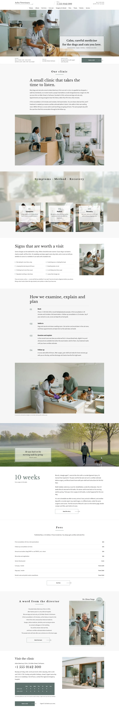

# Aoba Veterinary

A calm block theme (type health) for a dogs-and-cats veterinary clinic. Home page, ten inner pages and three recovery stories in English; the other four languages (zh-TW, ja, fr, de) follow.

## Signature
- Framed translucent statement box (2 px grey-green outline) at the lower right of a full-bleed photograph.
- Numbered translucent panels (01–03) inset on square photo cards that overlap a blurred photo band.
- Slanted hairline strokes between nav items, long-arrow outline buttons, and a solid timetable block with white dots.
- Scroll effects (sp-scroll, no custom script): parallax on the hero and story photographs, fade-in with stagger on the cards, rise-in on the story text and greeting.

## Patterns
- `front-hero`, `front-intro`, `front-path`, `front-signs`, `front-method`, `front-story`, `front-fees`, `front-director`, `front-visit`
- `page-about`, `page-services`, `page-cat-care`, `page-surgery-dental`, `page-fees`, `page-first-visit`, `page-team`, `page-access`, `page-book` (each opens on a photo head with the framed box; Services, Cat care, Surgery and dental, First visit and Team add the numbered panel cards)
- `timetable`, `footer-main`, `tpl-index`, `tpl-stories`, `tpl-search`, `tpl-single` (featured image as photo head), `tpl-404`

## Fonts
Libre Baskerville and Source Sans 3 (SIL OFL 1.1, licences in assets/fonts).

## Images (AI-generated for this theme, no text or logos; assets/images/)
p01-consult-room, p02-cradle, p03-waiting, p04-ear, p05-exam, p06-walk, p07-director, p08-entrance, p09-paw, p10-listening, p11-recovery, p12-surgery-prep, p13-dental, p14-reception, p15-cat-room, p16-team (all .webp; p02, p12, p13, p15, p16 are for the inner pages).

<!-- screenshots:start -->
## Screenshots

<table>
<tr>
<td valign="top"></td>
<td valign="top"></td>
</tr>
</table>

- About: [desktop](screenshots/about-desktop.webp) · [mobile](screenshots/about-mobile.webp)
- Services: [desktop](screenshots/services-desktop.webp) · [mobile](screenshots/services-mobile.webp)
- Cat care: [desktop](screenshots/cat-care-desktop.webp) · [mobile](screenshots/cat-care-mobile.webp)
- Surgery dental: [desktop](screenshots/surgery-dental-desktop.webp) · [mobile](screenshots/surgery-dental-mobile.webp)
- Fees: [desktop](screenshots/fees-desktop.webp) · [mobile](screenshots/fees-mobile.webp)
- First visit: [desktop](screenshots/first-visit-desktop.webp) · [mobile](screenshots/first-visit-mobile.webp)
- Team: [desktop](screenshots/team-desktop.webp) · [mobile](screenshots/team-mobile.webp)
- News: [desktop](screenshots/news-desktop.webp) · [mobile](screenshots/news-mobile.webp)
- Article: [desktop](screenshots/article-desktop.webp) · [mobile](screenshots/article-mobile.webp)
- Access: [desktop](screenshots/access-desktop.webp) · [mobile](screenshots/access-mobile.webp)
- Book: [desktop](screenshots/book-desktop.webp) · [mobile](screenshots/book-mobile.webp)
- Search: [desktop](screenshots/search-desktop.webp) · [mobile](screenshots/search-mobile.webp)
- Category: [desktop](screenshots/category-desktop.webp) · [mobile](screenshots/category-mobile.webp)
- Tag: [desktop](screenshots/tag-desktop.webp) · [mobile](screenshots/tag-mobile.webp)
- Newsletter: [desktop](screenshots/newsletter-desktop.webp) · [mobile](screenshots/newsletter-mobile.webp)
- Contact: [desktop](screenshots/contact-desktop.webp) · [mobile](screenshots/contact-mobile.webp)
- Other languages (home page): [zh-TW](screenshots/zh-TW/home-desktop.webp) · [ja](screenshots/ja/home-desktop.webp) · [fr](screenshots/fr/home-desktop.webp) · [de](screenshots/de/home-desktop.webp)
<!-- screenshots:end -->
