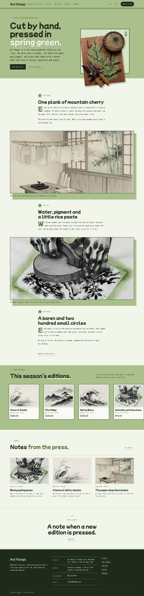
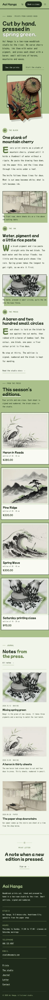

# Aoi Hanga

Aoi Hanga — a store theme for a small woodblock print studio, with WooCommerce templates styled to match. Moegi spring green (#A9C08B) is the main colour on the top-bar header, the hero band, the editions grid and every page head, set against sumi green-black ink; Mochiy Pop One for display and Kosugi Maru for reading. The hero puts the studio line on the left and the art on the right: a sumi-ink cut-out of a carved cherry block with a baren and knives tilts out of its frame and hangs past the bottom of the band. The home page is one long single column (numbered chapters on the block, the ink and the press) broken by full-width sumi-ink plates, then this season’s editions, the journal and the print letter. The studio details and the edition terms each live in one synced pattern (WooCommerce optional: without it the editions show as static cells and orders go by email).

- Design plan row: b3-14 (single-column-longform archetype, text-left-art-right hero, top-bar nav, full-illustration images, sumi-ink illustration, moegi #A9C08B, Mochiy Pop One + Kosugi Maru).
- Header: a full moegi top bar with the studio name and tag on the left, the menu in one row, account and cart, and a Book a class button.
- Break-frame: the sumi-ink cut-out of a carved cherry block tilts out of its sumi frame and hangs past the bottom of the moegi hero band into the long read.
- Long read: one 680px column with numbered chapters and drop caps, broken by full-width sumi-ink plates on offset moegi blocks.
- Synced: studio details (footer, Contact) and edition terms (product pages, Contact).
- Contrast: sumi ink #1F2A1A on moegi #A9C08B 7.6:1 (all text on the moegi header, hero, editions band and page heads); ink on pale moegi page #F1F5EA 13.5:1; pine links #3E5A2A on #F1F5EA 7.0:1; moss #4A5640 on #F1F5EA 7.0:1; moegi on sumi footer 7.6:1; pale #EEF3E6 on sumi 13.9:1; deep moegi #5F7A45 on #F1F5EA 4.4:1 (large drop caps and marks only).

<!-- screenshots:start -->
## Screenshots

<table>
<tr>
<td valign="top"></td>
<td valign="top"></td>
</tr>
</table>

- Shop: [desktop](screenshots/shop-desktop.webp) · [mobile](screenshots/shop-mobile.webp)
- Product: [desktop](screenshots/product-desktop.webp) · [mobile](screenshots/product-mobile.webp)
- About: [desktop](screenshots/about-desktop.webp) · [mobile](screenshots/about-mobile.webp)
- Contact: [desktop](screenshots/contact-desktop.webp) · [mobile](screenshots/contact-mobile.webp)
- News: [desktop](screenshots/news-desktop.webp) · [mobile](screenshots/news-mobile.webp)
- Article: [desktop](screenshots/article-desktop.webp) · [mobile](screenshots/article-mobile.webp)
- Category: [desktop](screenshots/category-desktop.webp) · [mobile](screenshots/category-mobile.webp)
- Tag: [desktop](screenshots/tag-desktop.webp) · [mobile](screenshots/tag-mobile.webp)
- Newsletter: [desktop](screenshots/newsletter-desktop.webp) · [mobile](screenshots/newsletter-mobile.webp)
- Search: [desktop](screenshots/search-desktop.webp) · [mobile](screenshots/search-mobile.webp)
<!-- screenshots:end -->
