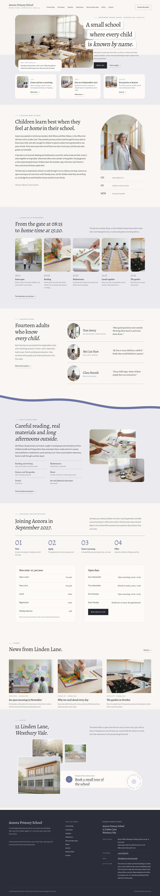

# Aozora Primary School

A quiet, photograph-led block theme for a **small independent primary school**: one class in each year from Year 1 to Year 6, a morning that starts with a quiet circle, teachers known by name, and admissions, fees and open days in plain lists.

The demo school is fictional: Aozora Primary School, founded in 1979 by Ruth Ellison and Peter Aldane at 12 Linden Lane, Westbury Vale, led today by Eleanor Marsh with Tom Avery, Mei Lin Hart, Clara Brandt and Samuel Reyes. The whole brand (people, place, tone, a school day) is written down in [`brand.md`](brand.md); every page's copy comes from it. Type: education. Sample content in English, Traditional Chinese (zh-TW), Japanese, French and German. Built to the quality gate in ROADMAP section 4 (rule 0) and `rules.quality_gate` in design-plan.json (row b6-9). The design references are listed in [`brand/reference.md`](brand/reference.md).

## Concept: a small school that shows an ordinary morning

- **Palette.** Morning `#F7F6F3` ground, chalk stone `#ECEBEE` bands, paper `#FCFBFA` fields, ink `#26272E` text, quiet ink `#5D5F6C`, and a single muted wisteria grey, fujinezu `#6E75A4`, for links, labels, rules, times and numerals. Mist `#BEBFCB` and pale wisteria `#DCDDEB` only as hairlines and small fills. The photographs carry the colour.
- **Type.** Alegreya (display, up to 4.75 rem) over Alegreya Sans (text, labels, lists).
- **Photographs.** 19 high-key documentary photographs taken with one style (50 mm, soft window light): the morning classroom, library, corridor, dining room, garden, playground, music room, woods walk, the building and four teachers. No identifiable children in close-up, no cut-outs, no illustrations.

## Front page

1. **Cover** (after Yamanomi Nursery): the morning classroom photograph inset with large rounded corners and a notched corner over a pale chalk band; the headline as three stacked caption lines overlapping the photograph's edge; a dashed open-morning note on its foot; three equal gateways (visit, apply, families).
2. A welcome from the head, three paragraphs beside her arch-topped portrait and three plain figures.
3. A school day in photographs: a horizontal strip of six rounded frames with times.
4. Teachers by name: three ruled index rows with an oval portrait and one sentence each.
5. What children learn (after Ushizu Kodomo no Mori): a chalk band whose top edge falls as a slanted soft wave, with an offset mist strip under it.
6. Admissions in four steps with large numerals, then the fees and the open days as two plain ruled lists.
7. The journal.
8. Visit us (after Ushizu Kodomo no Mori): three overlapping photographs joined to a white pill bar with a round arrow and a ring-text badge.

## Languages

The sample content and every word the theme shows come in **en, zh-TW, ja, fr and de**, using the mechanism of Hokuto Driving School 1.1.0: the shared importer picks the language (`shippress_demo_lang`, else the site language) and imports `demo-content.<lang>.json`; patterns print their words through `aozora_primary_school_t( 'key' )` from `inc/i18n/<lang>.php` (English fallback), and the synced school card starts from `inc/info/<lang>/office.html`.

The copy is localised, not translated: the school, its people and Linden Lane keep the brand, while school terms, fees, telephone formats and the school year follow each market (a Taiwanese private primary school with semester fees, a Japanese private elementary school with April entry and school briefings, a French private primary school, a German Privatgrundschule with monthly school fees).

- **Type.** zh-TW headings use a bundled subset of Noto Serif TC, ja headings a bundled subset of Noto Serif JP (Regular), built with fontTools from exactly the characters of that language's sample text. CJK headings run at about three quarters of the English sizes, body line height 1.85.
- **German and French** paragraphs hyphenate (`hyphens: auto`).

## Pages and templates

Home, A school day, Curriculum, Teachers, Admissions, Fees and open days, About the school, Journal, Parents' letter, Contact; six posts in three categories. Templates: front page, page, wide page, single, archive, category, tag, home (posts), search, 404.

## Licence

GPL-2.0-or-later. Fonts OFL-1.1 (see `assets/fonts/`). Photographs generated with Grok for this theme, released under GPL-2.0-or-later / CC0. All names, the place, the address, telephone numbers and figures are fictional.

<!-- screenshots:start -->
## Screenshots

<table>
<tr>
<td valign="top"></td>
<td valign="top"></td>
</tr>
</table>

- School day: [desktop](screenshots/school-day-desktop.webp) · [mobile](screenshots/school-day-mobile.webp)
- Curriculum: [desktop](screenshots/curriculum-desktop.webp) · [mobile](screenshots/curriculum-mobile.webp)
- Teachers: [desktop](screenshots/teachers-desktop.webp) · [mobile](screenshots/teachers-mobile.webp)
- Admissions: [desktop](screenshots/admissions-desktop.webp) · [mobile](screenshots/admissions-mobile.webp)
- Fees and open days: [desktop](screenshots/fees-and-open-days-desktop.webp) · [mobile](screenshots/fees-and-open-days-mobile.webp)
- About: [desktop](screenshots/about-desktop.webp) · [mobile](screenshots/about-mobile.webp)
- News: [desktop](screenshots/news-desktop.webp) · [mobile](screenshots/news-mobile.webp)
- Article: [desktop](screenshots/article-desktop.webp) · [mobile](screenshots/article-mobile.webp)
- Category: [desktop](screenshots/category-desktop.webp) · [mobile](screenshots/category-mobile.webp)
- Tag: [desktop](screenshots/tag-desktop.webp) · [mobile](screenshots/tag-mobile.webp)
- Newsletter: [desktop](screenshots/newsletter-desktop.webp) · [mobile](screenshots/newsletter-mobile.webp)
- Contact: [desktop](screenshots/contact-desktop.webp) · [mobile](screenshots/contact-mobile.webp)
- Search: [desktop](screenshots/search-desktop.webp) · [mobile](screenshots/search-mobile.webp)
- Other languages (home page): [zh-TW](screenshots/zh-TW/home-desktop.webp) · [ja](screenshots/ja/home-desktop.webp) · [fr](screenshots/fr/home-desktop.webp) · [de](screenshots/de/home-desktop.webp)
<!-- screenshots:end -->
