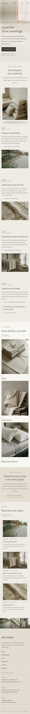

# Asa Linen

A serene, organic block theme for a **small linen bedding atelier** and its online shop. A ShipPress **store** theme: WooCommerce templates styled to match, seven sample products in three categories, and a shop page that still works without WooCommerce.

*Asa* means both flax and morning. The demo atelier is a fictional upstairs room above a paper shop in Hatori-machi, run by Yui Asakura, Haru Minase and Emi Tokura.

## Concept: a made bed, in morning light

- **Flax washi, stone, ink, one faded sage.** Ground `#F1EDE6` with pale washi `#F8F6F1` panels and stone `#DCD3C4` bands, warm ink text `#3E3A33` (9.7:1). The faded sage `#8C8F7A` is only 2.9:1 on washi, so it is kept to hairlines, chapter numerals and large marks; links and small labels use deep sage `#5A5E4C` (5.7:1) and secondary text quiet ink `#5B564D` (5.9:1).
- **Linen weave texture.** Two faint thread grids drawn in CSS (`--al-weave`) over the washi, the stone bands and the footer; no image.
- **Type.** Crimson Pro (display: light headings, chapter numerals, prices, quotes) and Nunito Sans (text, spaced-capital labels, the menu). Both OFL-1.1 from google/fonts without a Reserved Font Name, Latin WOFF2 subsets bundled, no CDN.
- **Linen weight on every product**, read from the product's `Linen weight` attribute (one source, edited in the product editor).
- Soft fades only (the header background), none under `prefers-reduced-motion`; no entrance animations, no hand-drawn illustrations.

## Header, footer, layout (ROADMAP codes)

- **H8 transparent → solid on scroll.** The wordmark and the menu lie over the top of every page; on the home page over the made-bed photograph with a soft washi veil, ink type. Over the first 80 px of scrolling the header fades to solid washi with a hairline (CSS scroll timeline; `assets/js/header.js` adds `is-solid` in other browsers). On phones a "Menu" word with two threads opens a washi sheet with large serif items.
- **F8 photo-strip footer.** Five square, softly desaturated photographs edge to edge (flax, weave, wash, cut, fold, captioned in spaced capitals; three on phones), then a stone colophon with the wordmark, the menu in Crimson Pro and the visit rows of the synced atelier card (delivery, returns and care rows are hidden there by CSS and shown on Care and Contact).
- **L13 sticky chapters.** On the home page a framed photograph of a made bed stays in place while four chapters scroll beside it: 01 Flax, 02 Weave, 03 Wash, 04 Sleep, each with a numeral, a short text, a facts line and a small photograph or a quote. Below 900 px the photograph sits above the chapters.

H8 + F8 + L13 is not used by any other theme.

## One source for shared details

| Synced pattern | Source | Shown on |
|---|---|---|
| Atelier address, hours, email, delivery, returns, care | `inc/info/atelier.html` | footer (every page: the address, hours and email rows), Care and Contact (all rows) |
| The shelf: seven pieces, linen weights, prices, the editable "Most loved" badge | `inc/info/shelf.html` | Shop (without WooCommerce) |

Each is a synced pattern (`wp_block`) created on activation by `inc/shared-info.php`, tagged `_asa_linen_info` and never created twice. With WooCommerce, the weight line comes from each product's attribute (`functions.php`, `render_block_woocommerce/product-price`).

## Pages and templates

Demo pages: Home, Shop, Fabric guide (linen weights, weave and finish, a size table), Care (four habits, what to avoid, delivery and returns), The atelier, Journal (posts page), Newsletter and Contact. Six sample posts in three categories (Flax & cloth, At the atelier, Care notes) with six tags.

Templates: front-page, page, page-wide, home, index, single, archive, category, tag, search and 404; for WooCommerce archive-product, single-product, page-cart, page-checkout, page-my-account, order-confirmation and product-search-results (search via core/search limited to products), plus a checkout header part.

## WooCommerce

Optional. With it active, `inc/woo-import.php` adds three product categories (Sheets, Duvet covers, Pillowcases & throws), five tags and seven products with photographs, prices and attributes (linen weight, size, fibre, care); run twice it creates nothing new. Without it the Shop page shows the synced shelf and orders go by email.

## Licence

GPL-2.0-or-later. Fonts OFL-1.1 (see `assets/fonts/`). Photographs AI-generated for this theme, released under GPL-2.0-or-later / CC0.

<!-- screenshots:start -->
## Screenshots

<table>
<tr>
<td valign="top"></td>
<td valign="top"></td>
</tr>
</table>

- Shop: [desktop](screenshots/shop-desktop.webp) · [mobile](screenshots/shop-mobile.webp)
- Product: [desktop](screenshots/product-desktop.webp) · [mobile](screenshots/product-mobile.webp)
- Fabric guide: [desktop](screenshots/fabric-guide-desktop.webp) · [mobile](screenshots/fabric-guide-mobile.webp)
- Care guide: [desktop](screenshots/care-guide-desktop.webp) · [mobile](screenshots/care-guide-mobile.webp)
- About: [desktop](screenshots/about-desktop.webp) · [mobile](screenshots/about-mobile.webp)
- Contact: [desktop](screenshots/contact-desktop.webp) · [mobile](screenshots/contact-mobile.webp)
- News: [desktop](screenshots/news-desktop.webp) · [mobile](screenshots/news-mobile.webp)
- Article: [desktop](screenshots/article-desktop.webp) · [mobile](screenshots/article-mobile.webp)
- Category: [desktop](screenshots/category-desktop.webp) · [mobile](screenshots/category-mobile.webp)
- Tag: [desktop](screenshots/tag-desktop.webp) · [mobile](screenshots/tag-mobile.webp)
- Newsletter: [desktop](screenshots/newsletter-desktop.webp) · [mobile](screenshots/newsletter-mobile.webp)
- Search: [desktop](screenshots/search-desktop.webp) · [mobile](screenshots/search-mobile.webp)
<!-- screenshots:end -->
