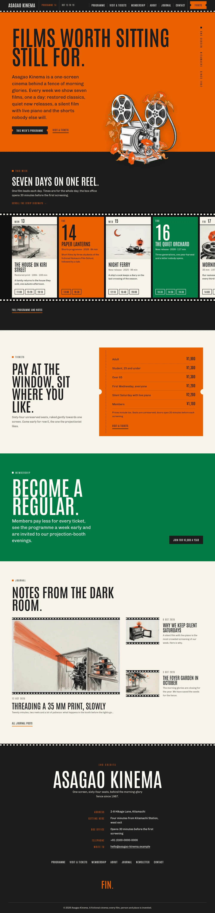
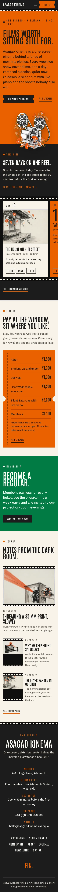

# Asagao Kinema

A cinematic, bold, Japanese-modern block theme for a **one-screen independent cinema**.

*Asagao* (morning glory). The demo cinema, its films, staff, the town, the address, phone numbers and prices are all fictional.

## Concept (1.1.0): the week as a film strip

- **Archetype: horizontal scroll strip.** The home page runs sideways: the week's programme is a film strip with sprocket edges that scrolls sideways (scroll-snap frames, keyboard-scrollable region). Days with a still are picture frames; days without one are vermilion or green intertitle cards with a giant day numeral.
- **Hero: cut-out break-frame.** A giant condensed headline on a full-width shu band, a vertical (tategaki) label on the right edge, and a transparent-background ink projector wound with morning glories that breaks out of the band onto the film strip below.
- **Japanese traditional colours, used big.** Shu vermilion `#EB6101` for the hero, page heads, intertitle cards and the ticket stub, always with sumi text (5.07:1; shu is never small text on paper, 3.04:1); sumi `#1C1C1C` for the bar, the strip, the credits and body text (on washi 15.39:1), with shu accents on it (5.07:1); tokiwa green `#007B43` for the membership band and every second intertitle (gofun text 5.27:1; as text on washi 4.84:1); washi `#F7F3EA` for reading areas. Links on washi deep shu `#A84200` (5.51:1), quiet text nezumi `#5B5650` (6.56:1), kinari `#E6DFCF` quiet text on sumi (12.84:1). No blue or yellow (those belong to Yoru Chocolate).
- **Type.** Antonio (tall condensed display: headings, bar, menu, numerals, prices, credits) over Chivo (text). Both OFL-1.1 without a Reserved Font Name, shipped as the upstream variable TTFs.
- **Illustration style: sumi-e ink with vermilion washes.** Brush-and-ink paintings on washi with one vermilion colour, raster WebP generated with Grok Build's image_gen through `scripts/grok-image.sh` (the hero projector with `--cutout`, transparent WebP).
- Vertical writing for the hero and page-head labels on the right edge; asymmetric 7/5 and 5/7 grids; no entrance animations.

## Header, footer, layout (ROADMAP codes)

- **H6 fixed top bar with ruled cells.** Name, the synced dateline (programme number, dates) in cells, the menu in cells and a notched shu Tickets button; a sprocket edge under the bar. Hamburger overlay (shu, sumi text) below 1024 px.
- **F9 end credits.** The footer rolls like credits on sumi: role and value pairs (address, getting here, box office, telephone, email), the synced prices (hidden on pages that already show them), the sitemap and "Fin."
- **L4 horizontal scroll.** Shu hero with the cut-out projector, sumi film strip, shu ticket stub, tokiwa membership band, journal (one large frame beside two small rows). The Programme page lays the same synced week out as a contact sheet. The combination H6 + F9 + L4 is not used by any other theme.

## One source for shared details

| Source | Edited in | Shown on |
|---|---|---|
| This week's programme | synced pattern, `inc/info/programme.html` | home, Programme |
| Ticket prices | synced pattern, `inc/info/prices.html` | home, Visit & tickets, Membership, footer credits |
| Programme dateline | synced pattern, `inc/info/week.html` | top bar on every page (wide screens) |

The synced patterns are created on activation by `inc/shared-info.php`, tagged `_asagao_kinema_info` and never created twice.

## Pages and templates

Demo pages: Home, Programme, Visit & tickets, Membership, About, Journal (posts page), Newsletter and Contact. Six sample posts in three categories with eight tags.

Templates: front-page, page, page-wide, home, index, single, archive, category, tag, search and 404.

## Upgrading from 1.0

Pages imported by 1.0 keep their content and pick up the new look from the stylesheet (the class names are unchanged and the four 1.0 picture files were repainted under the same names). The palette slugs keep their 1.0 names (night, plum, pale, lilac...) and now hold the new colours.

## Licence

GPL-2.0-or-later. Fonts OFL-1.1 (see `assets/fonts/`). Illustrations AI-generated for this theme, released under GPL-2.0-or-later / CC0. All names, the address, phone numbers and prices are fictional.

<!-- screenshots:start -->
## Screenshots

<table>
<tr>
<td valign="top"></td>
<td valign="top"></td>
</tr>
</table>

- Programme: [desktop](screenshots/programme-desktop.webp) · [mobile](screenshots/programme-mobile.webp)
- Visit: [desktop](screenshots/visit-desktop.webp) · [mobile](screenshots/visit-mobile.webp)
- Membership: [desktop](screenshots/membership-desktop.webp) · [mobile](screenshots/membership-mobile.webp)
- About: [desktop](screenshots/about-desktop.webp) · [mobile](screenshots/about-mobile.webp)
- News: [desktop](screenshots/news-desktop.webp) · [mobile](screenshots/news-mobile.webp)
- Article: [desktop](screenshots/article-desktop.webp) · [mobile](screenshots/article-mobile.webp)
- Category: [desktop](screenshots/category-desktop.webp) · [mobile](screenshots/category-mobile.webp)
- Tag: [desktop](screenshots/tag-desktop.webp) · [mobile](screenshots/tag-mobile.webp)
- Newsletter: [desktop](screenshots/newsletter-desktop.webp) · [mobile](screenshots/newsletter-mobile.webp)
- Contact: [desktop](screenshots/contact-desktop.webp) · [mobile](screenshots/contact-mobile.webp)
- Search: [desktop](screenshots/search-desktop.webp) · [mobile](screenshots/search-mobile.webp)
<!-- screenshots:end -->
