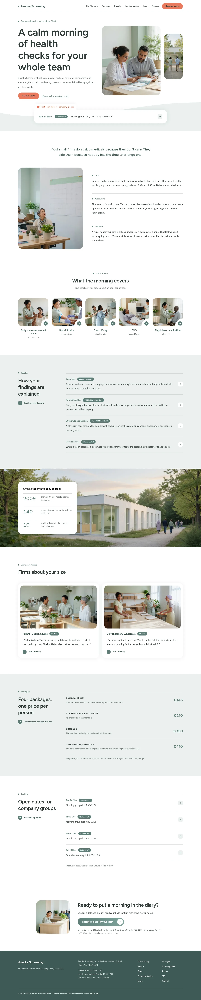
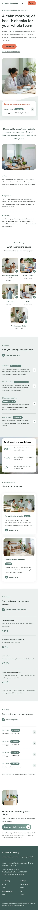

# Asaoka Screening

Asaoka Screening is a block theme for a corporate health screening centre that books employee medicals for small companies. The home page opens on a split hero with a mist wave and a tabbed notice card, then five scoop-corner photo tiles, ruled rows for how findings are explained, a parallax photo band, company stories, packages and open dates.

Signature techniques: a pale mist wave under the hero with a white notice card straddling it and a coral tab on its top-left edge; 1.08:1 photo tiles with a scooped bottom-right corner holding a round arrow; a square-dot label and large title in a left column with ruled dated rows on the right. Scroll effects: sp-parallax (hero photograph and the proof band), sp-stagger + sp-reveal--up (tiles, rows, panels), sp-count (the three figures). The hero photographs rise in on load with a CSS keyframe that stops under reduced motion.

See brand.md and brand/design-spec.md for the copy and the measured reference values.

## Pages

Home plus short pages for the six menu items (The Morning, Packages, Results, For Companies, Team, Access), all linked from the header menu. Full inner pages and the zh-TW, ja, fr and de translations follow in the next release.

<!-- screenshots:start -->
## Screenshots

<table>
<tr>
<td valign="top"></td>
<td valign="top"></td>
</tr>
</table>

- The morning: [desktop](screenshots/the-morning-desktop.webp) · [mobile](screenshots/the-morning-mobile.webp)
- Packages: [desktop](screenshots/packages-desktop.webp) · [mobile](screenshots/packages-mobile.webp)
- Results: [desktop](screenshots/results-desktop.webp) · [mobile](screenshots/results-mobile.webp)
- For companies: [desktop](screenshots/for-companies-desktop.webp) · [mobile](screenshots/for-companies-mobile.webp)
- Team: [desktop](screenshots/team-desktop.webp) · [mobile](screenshots/team-mobile.webp)
- Access: [desktop](screenshots/access-desktop.webp) · [mobile](screenshots/access-mobile.webp)
- About: [desktop](screenshots/about-desktop.webp) · [mobile](screenshots/about-mobile.webp)
- News: [desktop](screenshots/news-desktop.webp) · [mobile](screenshots/news-mobile.webp)
- Article: [desktop](screenshots/article-desktop.webp) · [mobile](screenshots/article-mobile.webp)
- Category: [desktop](screenshots/category-desktop.webp) · [mobile](screenshots/category-mobile.webp)
- Tag: [desktop](screenshots/tag-desktop.webp) · [mobile](screenshots/tag-mobile.webp)
- Newsletter: [desktop](screenshots/newsletter-desktop.webp) · [mobile](screenshots/newsletter-mobile.webp)
- Contact: [desktop](screenshots/contact-desktop.webp) · [mobile](screenshots/contact-mobile.webp)
- Other languages (home page): [zh-TW](screenshots/zh-TW/home-desktop.webp) · [ja](screenshots/ja/home-desktop.webp) · [fr](screenshots/fr/home-desktop.webp) · [de](screenshots/de/home-desktop.webp)
<!-- screenshots:end -->
