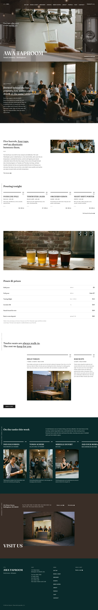
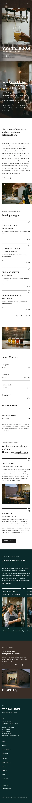

# Awa Taproom

Awa Taproom is a calm, booking-led WordPress block theme designed for small breweries, brewpubs, and independent taprooms. Featuring a framed-window hero, custom horizontal scroll strips, and clean rule-topped cards, it pairs Fraunces serif headings with Nunito Sans body typography. Built around authentic documentary photography and an earthy umber palette, it presents tap lists, table reservations, and brewhouse stories with quiet craftsmanship.

See brand.md for the brief and brand/design-spec.md for the design spec.

## Pages
Home, On Tap, Book a Seat, The Brewery, People and Visit. The demo import creates all six and a main menu linking to the inner pages. Each inner page is an editable pattern (`awa-taproom/inner-*`).

## Signature details
Framed-window hero (the frame wipes away on the first 120px of scroll, CSS only, off under reduced motion), rule-topped cards with an outline circle arrow, underlined lead phrases and a grey vertical side label. Photos are film-grain documentary images with no text or signage.

<!-- screenshots:start -->
## Screenshots

<table>
<tr>
<td valign="top"></td>
<td valign="top"></td>
</tr>
</table>

- On tap: [desktop](screenshots/on-tap-desktop.webp) · [mobile](screenshots/on-tap-mobile.webp)
- Book a seat: [desktop](screenshots/book-a-seat-desktop.webp) · [mobile](screenshots/book-a-seat-mobile.webp)
- The brewery: [desktop](screenshots/the-brewery-desktop.webp) · [mobile](screenshots/the-brewery-mobile.webp)
- People: [desktop](screenshots/people-desktop.webp) · [mobile](screenshots/people-mobile.webp)
- Visit: [desktop](screenshots/visit-desktop.webp) · [mobile](screenshots/visit-mobile.webp)
- About: [desktop](screenshots/about-desktop.webp) · [mobile](screenshots/about-mobile.webp)
- News: [desktop](screenshots/news-desktop.webp) · [mobile](screenshots/news-mobile.webp)
- Article: [desktop](screenshots/article-desktop.webp) · [mobile](screenshots/article-mobile.webp)
- Category: [desktop](screenshots/category-desktop.webp) · [mobile](screenshots/category-mobile.webp)
- Tag: [desktop](screenshots/tag-desktop.webp) · [mobile](screenshots/tag-mobile.webp)
- Newsletter: [desktop](screenshots/newsletter-desktop.webp) · [mobile](screenshots/newsletter-mobile.webp)
- Contact: [desktop](screenshots/contact-desktop.webp) · [mobile](screenshots/contact-mobile.webp)
- Other languages (home page): [zh-TW](screenshots/zh-TW/home-desktop.webp) · [ja](screenshots/ja/home-desktop.webp) · [fr](screenshots/fr/home-desktop.webp) · [de](screenshots/de/home-desktop.webp)
<!-- screenshots:end -->
