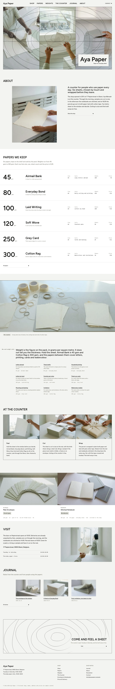

# Aya Paper

Aya Paper is a block theme for a stationery shop in Ghent, with WooCommerce shop templates and eight sample products. The same pages still read clearly when WooCommerce is not active, using the paper list as plain text. The home page is a quiet catalogue: a hairline frame of three photographs, six ruled paper rows with prices in EUR, and a text list of what each weight suits.

## Structure
- `patterns/front-*.php`: the ten home sections (hero frame, shop, papers, counter, weights, wrap, pair, visit, journal, close).
- `patterns/inner-*.php`, `shop-frame.php`, `shop-cats.php`: the inner pages (shop, papers, weights, counter, envelopes and notebooks, prices, about, contact, newsletter) and the shop head pieces.
- `inc/woo-import.php`, `assets/css/woocommerce.css`, `templates/archive-product.html` and the other store templates: the WooCommerce shop, active only with the plugin.
- `templates/`: block templates (front page, page, index/journal, single, archive, tag, category, search, 404).
- `demo-content.json`: sample content (en); the importer is `inc/demo-import.php`.
- `assets/sp-scroll.css`, `assets/sp-scroll.js`: scroll effects (shared component).
- Photos: `assets/images/` (AI-generated, GPL-2.0-or-later).

Design notes: `brand.md`, `brand/design-spec.md`, `brand/reference.md`.

License: GPL-2.0-or-later.

<!-- screenshots:start -->
## Screenshots

<table>
<tr>
<td valign="top"></td>
<td valign="top"></td>
</tr>
</table>

- Shop: [desktop](screenshots/shop-desktop.webp) · [mobile](screenshots/shop-mobile.webp)
- Product: [desktop](screenshots/product-desktop.webp) · [mobile](screenshots/product-mobile.webp)
- Papers: [desktop](screenshots/papers-desktop.webp) · [mobile](screenshots/papers-mobile.webp)
- Weights: [desktop](screenshots/weights-desktop.webp) · [mobile](screenshots/weights-mobile.webp)
- Counter: [desktop](screenshots/counter-desktop.webp) · [mobile](screenshots/counter-mobile.webp)
- Envelopes notebooks: [desktop](screenshots/envelopes-notebooks-desktop.webp) · [mobile](screenshots/envelopes-notebooks-mobile.webp)
- Prices: [desktop](screenshots/prices-desktop.webp) · [mobile](screenshots/prices-mobile.webp)
- About: [desktop](screenshots/about-desktop.webp) · [mobile](screenshots/about-mobile.webp)
- News: [desktop](screenshots/news-desktop.webp) · [mobile](screenshots/news-mobile.webp)
- Article: [desktop](screenshots/article-desktop.webp) · [mobile](screenshots/article-mobile.webp)
- Category: [desktop](screenshots/category-desktop.webp) · [mobile](screenshots/category-mobile.webp)
- Tag: [desktop](screenshots/tag-desktop.webp) · [mobile](screenshots/tag-mobile.webp)
- Newsletter: [desktop](screenshots/newsletter-desktop.webp) · [mobile](screenshots/newsletter-mobile.webp)
- Contact: [desktop](screenshots/contact-desktop.webp) · [mobile](screenshots/contact-mobile.webp)
- Search: [desktop](screenshots/search-desktop.webp) · [mobile](screenshots/search-mobile.webp)
- Other languages (home page): [zh-TW](screenshots/zh-TW/home-desktop.webp) · [ja](screenshots/ja/home-desktop.webp) · [fr](screenshots/fr/home-desktop.webp) · [de](screenshots/de/home-desktop.webp)
<!-- screenshots:end -->
