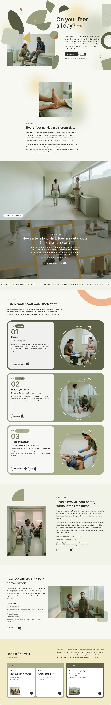

# Ayumi Podiatry

Ayumi Podiatry - a block theme for a foot clinic that treats people who are on their feet all day. A pale olive-white ground with a field of flat, grain-textured foot-world shapes (insole ovals, arch quarter-circles, heel half-circles, toe dots) that fly in around the headline and then drift; a split first screen with the clinician photograph below left and the lead below right; a full-bleed treatment-room band with parallax; a photograph wall tilted -8 degrees with gold strips and white centred copy; a pill marquee of complaints; three stacked 4rem colour cards with a white panel, a big number and a circle photograph; one outcome, the clinicians and a pale yellow booking band. Inter Tight for headings, Public Sans for reading, Noto Sans TC/JP for Chinese and Japanese. Works without WooCommerce.

## Structure
- `patterns/front-*.php`: the nine home sections (hero, listen, room, complaints, marquee, method, outcome, clinicians, visit); `header-main.php`, `footer-main.php`.
- `templates/`: front page, page, index, archive, single, search, 404.
- Photos: `assets/images/` (AI-generated, GPL-2.0-or-later / CC0). See `readme.txt` for the list.
- `patterns/page-*.php`: nine inner pages (About, Conditions, Treatments, Custom orthotics, Fees, First visit, Clinicians, Stories, Visit), each with a mini shape-field page head; the demo import creates them from `demo-content.json`, and the header and footer link to them.
- English only for now; zh-TW, ja, fr and de follow.

Design notes: `brand.md`, `brand/design-spec.md`, `brand/reference.md`.

License: GPL-2.0-or-later.

<!-- screenshots:start -->
## Screenshots

<table>
<tr>
<td valign="top"></td>
<td valign="top"></td>
</tr>
</table>

- About: [desktop](screenshots/about-desktop.webp) · [mobile](screenshots/about-mobile.webp)
- News: [desktop](screenshots/news-desktop.webp) · [mobile](screenshots/news-mobile.webp)
- Article: [desktop](screenshots/article-desktop.webp) · [mobile](screenshots/article-mobile.webp)
- Category: [desktop](screenshots/category-desktop.webp) · [mobile](screenshots/category-mobile.webp)
- Tag: [desktop](screenshots/tag-desktop.webp) · [mobile](screenshots/tag-mobile.webp)
- Newsletter: [desktop](screenshots/newsletter-desktop.webp) · [mobile](screenshots/newsletter-mobile.webp)
- Contact: [desktop](screenshots/contact-desktop.webp) · [mobile](screenshots/contact-mobile.webp)
- Conditions: [desktop](screenshots/conditions-desktop.webp) · [mobile](screenshots/conditions-mobile.webp)
- Treatments: [desktop](screenshots/treatments-desktop.webp) · [mobile](screenshots/treatments-mobile.webp)
- Orthotics: [desktop](screenshots/orthotics-desktop.webp) · [mobile](screenshots/orthotics-mobile.webp)
- Fees: [desktop](screenshots/fees-desktop.webp) · [mobile](screenshots/fees-mobile.webp)
- First visit: [desktop](screenshots/first-visit-desktop.webp) · [mobile](screenshots/first-visit-mobile.webp)
- Team: [desktop](screenshots/team-desktop.webp) · [mobile](screenshots/team-mobile.webp)
- Stories: [desktop](screenshots/stories-desktop.webp) · [mobile](screenshots/stories-mobile.webp)
- Visit: [desktop](screenshots/visit-desktop.webp) · [mobile](screenshots/visit-mobile.webp)
- Other languages (home page): [zh-TW](screenshots/zh-TW/home-desktop.webp) · [ja](screenshots/ja/home-desktop.webp) · [fr](screenshots/fr/home-desktop.webp) · [de](screenshots/de/home-desktop.webp)
<!-- screenshots:end -->
