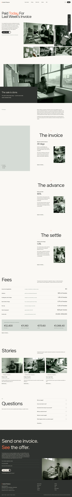

# Azuke Finance

A calm landing-page block theme (type landing) for small-supplier invoice funding. English only in this release (zh-TW, ja, fr and de follow): the home page plus twelve inner pages (How it works, Pricing, Who it's for, Stories, About, FAQ, Apply, Contact, Early access, Privacy, Terms, Thanks). The header menu links to the inner pages; the home page keeps its sections as one long conversion page.

## Signature
- A tight 4.5rem headline with one coral word above a bowed, monochrome documentary photo mosaic that bleeds off the right edge (Coral Capital, S5-Style #11295).
- A sticky flat sage panel with a chapter list beside three scrolling chapters with giant figures and touching thumbnails.
- A fixed dark vertical "Apply · 3 min" tab, the one repeated call to action.
- A flat dark overlay box on a full-bleed photograph (ALEX, S5-Style #12145).

## Motion
sp-scroll (assets/sp-scroll.css and .js): parallax on the mosaic and the full-bleed photograph, mask-wipe titles, rise-in with stagger. Final state with reduced motion, `?sp-static`, no JavaScript and in the editor.

## Patterns
- `front-hero`, `front-gap`, `front-chapters`, `front-pricing`, `front-stories`, `front-faq`, `front-apply`, `head-bar`, `foot-bar`, `page-head`

## Photos
All photographs are graded with a slightly higher contrast and darker midtones; each appears once on the home page.

## Fonts
Onest and Inter Tight (SIL OFL 1.1, licences in assets/fonts).

## Images (AI-generated for this theme, no text or logos; assets/images/)
See readme.txt.

<!-- screenshots:start -->
## Screenshots

<table>
<tr>
<td valign="top"></td>
<td valign="top"></td>
</tr>
</table>

- How it works: [desktop](screenshots/how-it-works-desktop.webp) · [mobile](screenshots/how-it-works-mobile.webp)
- Pricing: [desktop](screenshots/pricing-desktop.webp) · [mobile](screenshots/pricing-mobile.webp)
- Who its for: [desktop](screenshots/who-its-for-desktop.webp) · [mobile](screenshots/who-its-for-mobile.webp)
- Stories: [desktop](screenshots/stories-desktop.webp) · [mobile](screenshots/stories-mobile.webp)
- About: [desktop](screenshots/about-desktop.webp) · [mobile](screenshots/about-mobile.webp)
- Faq: [desktop](screenshots/faq-desktop.webp) · [mobile](screenshots/faq-mobile.webp)
- Apply: [desktop](screenshots/apply-desktop.webp) · [mobile](screenshots/apply-mobile.webp)
- Contact: [desktop](screenshots/contact-desktop.webp) · [mobile](screenshots/contact-mobile.webp)
- Early access: [desktop](screenshots/early-access-desktop.webp) · [mobile](screenshots/early-access-mobile.webp)
- Privacy: [desktop](screenshots/privacy-desktop.webp) · [mobile](screenshots/privacy-mobile.webp)
- Terms: [desktop](screenshots/terms-desktop.webp) · [mobile](screenshots/terms-mobile.webp)
- Thanks: [desktop](screenshots/thanks-desktop.webp) · [mobile](screenshots/thanks-mobile.webp)
- News: [desktop](screenshots/news-desktop.webp) · [mobile](screenshots/news-mobile.webp)
- Article: [desktop](screenshots/article-desktop.webp) · [mobile](screenshots/article-mobile.webp)
- Category: [desktop](screenshots/category-desktop.webp) · [mobile](screenshots/category-mobile.webp)
- Tag: [desktop](screenshots/tag-desktop.webp) · [mobile](screenshots/tag-mobile.webp)
- Newsletter: [desktop](screenshots/newsletter-desktop.webp) · [mobile](screenshots/newsletter-mobile.webp)
- Other languages (home page): [zh-TW](screenshots/zh-TW/home-desktop.webp) · [ja](screenshots/ja/home-desktop.webp) · [fr](screenshots/fr/home-desktop.webp) · [de](screenshots/de/home-desktop.webp)
<!-- screenshots:end -->
