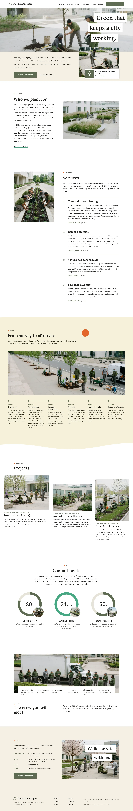

# Daichi Landscapes

A WordPress block theme for a commercial landscaping company in Vancouver (founded 2009). The demo company is fictional; people, places and prices are written down in [`brand.md`](brand.md). Type: business. Sample content is in English: the home page plus 12 inner pages (services, pricing, projects, three case pages, process, aftercare, about, team, careers, contact) and a journal; the other four languages follow.

- **Palette.** White ground, stone `#F2F1EC`, pale lime band `#F5F1D8`, ink `#1E1E1C`; moss `#5E6B52` only on small marks. First screen saturated pixels well under 15%.
- **Type.** Lora and Karla (OFL-1.1), bundled.
- **Signature.** Three stair-step white title tiles over the hero photograph; one asymmetric swell edge under the timeline band; ring meters with count-up numbers.
- **Motion.** `sp-scroll` (reveal, stagger, wipe, count, parallax); respects `prefers-reduced-motion`, content visible without JavaScript.

<!-- screenshots:start -->
## Screenshots

<table>
<tr>
<td valign="top"></td>
<td valign="top"></td>
</tr>
</table>

- Services: [desktop](screenshots/services-desktop.webp) · [mobile](screenshots/services-mobile.webp)
- Pricing: [desktop](screenshots/pricing-desktop.webp) · [mobile](screenshots/pricing-mobile.webp)
- Projects: [desktop](screenshots/projects-desktop.webp) · [mobile](screenshots/projects-mobile.webp)
- Northshore college forecourt: [desktop](screenshots/northshore-college-forecourt-desktop.webp) · [mobile](screenshots/northshore-college-forecourt-mobile.webp)
- Riverside general hospital courtyard: [desktop](screenshots/riverside-general-hospital-courtyard-desktop.webp) · [mobile](screenshots/riverside-general-hospital-courtyard-mobile.webp)
- Fraser street renewal: [desktop](screenshots/fraser-street-renewal-desktop.webp) · [mobile](screenshots/fraser-street-renewal-mobile.webp)
- Process: [desktop](screenshots/process-desktop.webp) · [mobile](screenshots/process-mobile.webp)
- Aftercare: [desktop](screenshots/aftercare-desktop.webp) · [mobile](screenshots/aftercare-mobile.webp)
- About: [desktop](screenshots/about-desktop.webp) · [mobile](screenshots/about-mobile.webp)
- Team: [desktop](screenshots/team-desktop.webp) · [mobile](screenshots/team-mobile.webp)
- Careers: [desktop](screenshots/careers-desktop.webp) · [mobile](screenshots/careers-mobile.webp)
- Contact: [desktop](screenshots/contact-desktop.webp) · [mobile](screenshots/contact-mobile.webp)
- Journal: [desktop](screenshots/journal-desktop.webp) · [mobile](screenshots/journal-mobile.webp)
- News: [desktop](screenshots/news-desktop.webp) · [mobile](screenshots/news-mobile.webp)
- Article: [desktop](screenshots/article-desktop.webp) · [mobile](screenshots/article-mobile.webp)
- Category: [desktop](screenshots/category-desktop.webp) · [mobile](screenshots/category-mobile.webp)
- Tag: [desktop](screenshots/tag-desktop.webp) · [mobile](screenshots/tag-mobile.webp)
- Newsletter: [desktop](screenshots/newsletter-desktop.webp) · [mobile](screenshots/newsletter-mobile.webp)
- Other languages (home page): [zh-TW](screenshots/zh-TW/home-desktop.webp) · [ja](screenshots/ja/home-desktop.webp) · [fr](screenshots/fr/home-desktop.webp) · [de](screenshots/de/home-desktop.webp)
<!-- screenshots:end -->
