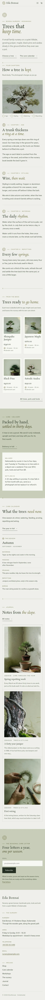

# Eda Bonsai

A quiet, organic block theme for a **small family bonsai nursery** and its online shop. A ShipPress **store** theme: WooCommerce templates styled to match, eight sample products in three categories, and a shop that still works without WooCommerce.

The demo nursery is fictional: Eda Bonsai on Kodama Slope in Kodamadai, a quiet hillside district, kept by Haruo Kanzaki and his apprentice Mio Ashida. They grow juniper, maple, black pine, azalea and beginner ficus slowly in the ground, sell handmade pots, tools and soil, and run weekend workshops. *Eda* means branch.

## Concept: growth rings and a branch line

- **Palette.** Pale moss `#EFF0EA` pages, lichen `#C7CDB8` panels, deep moss ink `#263023` text (12.0:1 on pale moss, 8.4:1 on lichen) and a muted olive accent `#6F6A3E` (4.8:1 on pale moss, but 3.4:1 on lichen, so on lichen it is used only for rules and marks), plus deep olive `#4B4A26` for links and small labels (7.9:1 pale moss, 5.6:1 lichen), quiet moss `#485342` for secondary text (7.1:1 / 5.0:1), moss paper `#F7F8F3` cells and a hairline `#B3B9A3`.
- **Type.** Rosarivo (display, italic accents, prices in tabular figures) and Red Hat Text (text, labels in spaced capitals).
- **Growth rings.** Very thin concentric olive rings, slightly off-centre like real wood, mark the wordmark, each chapter, section openings, the current season and the age line under every price (CSS gradients). A single fine branch hairline with one ring bud divides moss sections; a small SVG branch line sits under the vertical wordmark.

## Header, footer, layout (ROADMAP codes)

- **H11 vertical navigation on the right edge.** A slim (92 px) pale-moss rail fixed to the right edge with a hairline left border: a growth-ring mark, the Rosarivo wordmark set vertically, a fine branch line, then the core navigation stacked as vertical words (Shop, Care calendar, Workshops, Journal, Contact) with a small olive ring on the current page, and account and cart when WooCommerce is active. The content reserves the rail width. On phones (below 600 px) it becomes a plain top bar: wordmark, Menu and cart on one line; the menu opens as an overlay.
- **F4 newsletter-led footer.** A calm lichen band for the seasonal care letter ("Four letters a year, one per season") with the email form, then on moss the brand line, the synced nursery card and slim links. Stacks on phones. Where a page already shows the nursery card (Workshops, The nursery, Contact) the footer leaves it out.
- **L13 sticky photograph beside scrolling chapters.** A short title ("Trees that keep time"), then four chapters (Age, Styling, Watering, Repotting) scroll on the left beside one sticky tree photograph on the right that cross-fades to the chapter's photograph, with a vertical growth-ring chapter index joined by a hairline. Without JavaScript the first photograph stays and the index still jumps; with reduced motion the photographs change without a fade; on phones the photograph and a horizontal ring index stick under the top bar in a short band. Then featured trees, the care + delivery promise, this season from the care calendar and the journal.

## One source for shared details

| What | Source | Shown on |
| --- | --- | --- |
| Nursery address, opening days, telephone, email | `inc/info/nursery.html` (synced pattern) | Footer, Workshops, The nursery, Contact |
| Packing, delivery, 30-day settling-in promise, care sheet | `inc/info/care.html` (synced pattern) | Home (short), every product page (short), Care calendar (short), Contact (full) |
| Care calendar (watering, feeding, pruning, repotting, wiring by season) | `inc/info/calendar.html` (synced pattern) | Care calendar (whole year), Home (current season only, by the site's date) |
| Age · height · care level line | each product's `Age`, `Height`, `Care level` (or `Size`, `Made from`) attributes | Product cells and product page |

## Pages and templates

Demo pages: Home, Shop, Care calendar (the synced calendar, a care note), Workshops (four weekend workshops as editable cards, booked by email, and the synced nursery card), The nursery (keeper, apprentice, gate, moss beds, visit), Journal (posts page), Newsletter and Contact (nursery card, care + delivery in full, form). Six sample posts in three categories (At the nursery, Care through the year, Trees & styling) with six tags.

Templates: front page, page, wide page, single post, journal, archive, category, tag, search, 404, plus WooCommerce shop, product category and tag archives, product, cart, checkout, my account, order confirmation and product search.

## WooCommerce

Optional. With it active, `inc/woo-import.php` adds three product categories, the product tags and eight products (Shimpaku Juniper, Japanese Maple, Black Pine, Satsuki Azalea, Beginner Ficus, Handmade Unglazed Pot, Pruning Shears Set, Bonsai Soil Mix) with photographs, prices and attributes; run twice it creates nothing new. Without it the home page and the Shop page show static cells that link to Contact, and orders go by email.

## Licence

GPL-2.0-or-later. Fonts OFL-1.1 (see `assets/fonts/`): Rosarivo shipped unmodified (Reserved Font Names "Rosarivo", "Rosarivo Pro", "Rosarivo UGR"); Red Hat Text subset to Latin (no Reserved Font Name). Photographs AI-generated for this theme, released under GPL-2.0-or-later / CC0.

<!-- screenshots:start -->
## Screenshots

<table>
<tr>
<td valign="top"></td>
<td valign="top"></td>
</tr>
</table>

- Shop: [desktop](screenshots/shop-desktop.webp) · [mobile](screenshots/shop-mobile.webp)
- Product: [desktop](screenshots/product-desktop.webp) · [mobile](screenshots/product-mobile.webp)
- About: [desktop](screenshots/about-desktop.webp) · [mobile](screenshots/about-mobile.webp)
- Care calendar: [desktop](screenshots/care-calendar-desktop.webp) · [mobile](screenshots/care-calendar-mobile.webp)
- Workshops: [desktop](screenshots/workshops-desktop.webp) · [mobile](screenshots/workshops-mobile.webp)
- Contact: [desktop](screenshots/contact-desktop.webp) · [mobile](screenshots/contact-mobile.webp)
- News: [desktop](screenshots/news-desktop.webp) · [mobile](screenshots/news-mobile.webp)
- Article: [desktop](screenshots/article-desktop.webp) · [mobile](screenshots/article-mobile.webp)
- Category: [desktop](screenshots/category-desktop.webp) · [mobile](screenshots/category-mobile.webp)
- Tag: [desktop](screenshots/tag-desktop.webp) · [mobile](screenshots/tag-mobile.webp)
- Newsletter: [desktop](screenshots/newsletter-desktop.webp) · [mobile](screenshots/newsletter-mobile.webp)
- Search: [desktop](screenshots/search-desktop.webp) · [mobile](screenshots/search-mobile.webp)
<!-- screenshots:end -->
