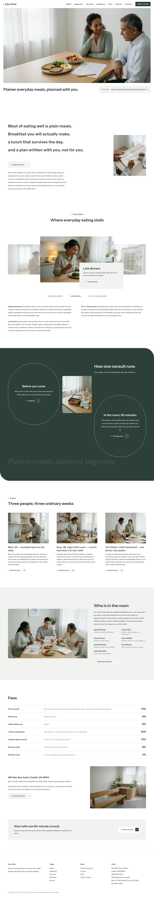

# Eiyo Clinic

Theme for a nutrition and dietetics clinic: white ground, cool paper, ink, one deep pine block, Instrument Sans and Public Sans. The home page opens on a rounded photograph inset from the sides that slowly crossfades and drifts with the scroll, with the headline under it and a paper strip at the right; then a four-line statement that lights up while scrolling, a coverflow problem row, a pine block with two hairline arches, three story cards, the people in the room, a quiet fee list and one closing strip. Works without WooCommerce.

## Structure
- `patterns/front-*.php` (home), `parts/header.html`, `parts/footer.html`; `templates/`; `demo-content.json`.
- Scroll effects: `assets/sp-scroll.css|js` (unchanged ShipPress copy): sp-parallax on the key visual, reveal-up with stagger on the statement lines, the arches and the story cards.
- Photographs are AI-generated in `assets/images/`.

Status: home page in English plus eight starter inner pages (About, Approach, Services, Dietitians, Stories, Fees, Contact, FAQ) and the Journal. Full inner-page design with the signature techniques and the zh-TW, ja, fr and de languages follow.

Design notes: `brand.md`, `brand/design-spec.md`, `brand/reference.md`. License: GPL-2.0-or-later.

<!-- screenshots:start -->
## Screenshots

<table>
<tr>
<td valign="top"></td>
<td valign="top"></td>
</tr>
</table>

- About: [desktop](screenshots/about-desktop.webp) · [mobile](screenshots/about-mobile.webp)
- News: [desktop](screenshots/news-desktop.webp) · [mobile](screenshots/news-mobile.webp)
- Article: [desktop](screenshots/article-desktop.webp) · [mobile](screenshots/article-mobile.webp)
- Category: [desktop](screenshots/category-desktop.webp) · [mobile](screenshots/category-mobile.webp)
- Tag: [desktop](screenshots/tag-desktop.webp) · [mobile](screenshots/tag-mobile.webp)
- Newsletter: [desktop](screenshots/newsletter-desktop.webp) · [mobile](screenshots/newsletter-mobile.webp)
- Contact: [desktop](screenshots/contact-desktop.webp) · [mobile](screenshots/contact-mobile.webp)
- Approach: [desktop](screenshots/approach-desktop.webp) · [mobile](screenshots/approach-mobile.webp)
- Services: [desktop](screenshots/services-desktop.webp) · [mobile](screenshots/services-mobile.webp)
- Dietitians: [desktop](screenshots/dietitians-desktop.webp) · [mobile](screenshots/dietitians-mobile.webp)
- Stories: [desktop](screenshots/stories-desktop.webp) · [mobile](screenshots/stories-mobile.webp)
- Fees: [desktop](screenshots/fees-desktop.webp) · [mobile](screenshots/fees-mobile.webp)
- Faq: [desktop](screenshots/faq-desktop.webp) · [mobile](screenshots/faq-mobile.webp)
- Journal: [desktop](screenshots/journal-desktop.webp) · [mobile](screenshots/journal-mobile.webp)
- Other languages (home page): [zh-TW](screenshots/zh-TW/home-desktop.webp) · [ja](screenshots/ja/home-desktop.webp) · [fr](screenshots/fr/home-desktop.webp) · [de](screenshots/de/home-desktop.webp)
<!-- screenshots:end -->
