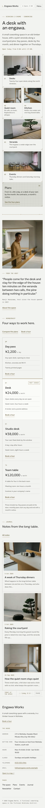

# Engawa Works

A quiet, geometric business theme for a **small neighbourhood coworking space**.

*Engawa* is the wooden veranda edge of a traditional house. The demo space is a fictional coworking space in a 1960s timber house on a back street of Nishioka 2-chome (fictional Minato-Kita City), with a cedar veranda along a small gravel courtyard and one pine. Host Kenji Hanazawa opens the house at eight; day passes and monthly desks by day, a community dinner on Thursdays. It is a business theme, not a shop: no WooCommerce templates or products.

## Concept: concrete grid + engawa rail

- **Palette.** Concrete `#F2F2EF` ground, soft grey `#D9D9D3` panels, ink `#262624` text (13.5:1 on concrete, 10.7:1 on grey). Deep ochre `#655835` for links, codes and labels (6.2:1 / 4.9:1); stone `#5A5954` for secondary text (6.3:1 / 4.95:1); paper `#FAFAF8` for the chosen plan, chips and fields. Muted ochre `#8A7A4E` (3.8:1 on concrete) appears only in rules and marks.
- **Type.** Geologica (variable 300-500: wordmark, headings, text) with Fragment Mono for hours, the ticker, plan codes, dates and labels. Both OFL-1.1 without a Reserved Font Name, subset to Latin WOFF2 (22 KB + 28 KB).
- **Motif.** A faint CSS hairline grid / twelve-column module on the utility strip, the ticker, the plans cell and room cards; cards sit on one 1 px hairline grid (gaps over a rule colour) with small ochre registration corner marks; a thin muted-ochre engawa rail with joints every 160 px divides sections. No wood photo texture, no hand-drawn illustration, no entrance animations.

## Header, footer, layout (ROADMAP codes)

- **H9 two-tier utility header**: a slim concrete strip (twelve-column hairlines, Fragment Mono) with today's hours and an "Open now / Opens 8:00 / Closed today" chip computed on the server from the WordPress timezone, the address line and a "Book a tour" link; below it the Geologica wordmark with a small ochre corner mark and the core Navigation (The space, Plans, Events, Journal, Contact). At 390 px the strip folds away and the row is wordmark + chip + Menu.
- **F5 quiet ticker footer**: a slow (about 22 px/s) one-line "today at the space" ticker in Fragment Mono — the first item is today's hours from Space details, the rest a plain list in the footer part — pausing on hover/focus with a Pause button; without JavaScript or with prefers-reduced-motion it is a still one-line list. Below: wordmark and Book a tour, the space details card (address, getting here, hours, closed day, phone, email) and slim page links. Stacks at 390 px.
- **L6 bento grid**: the home title "A desk with an engawa." with today's opening line, then six cells on one hairline grid (Desks 2x2, Quiet room, Kitchen, Veranda 1x2, Events 2x1, Plans 2x1 on a grey grid panel); a host quote with portrait; the synced plans; three journal cards.

## One source for shared details

- **Appearance > Space details** (`inc/space-info.php`): hours per weekday, closed day, address, station, phone, email; read by the `engawa-works/space-info` block in the utility strip, the ticker, the home title, the footer card, Plans, Tour booking and Contact.
- **Membership plans** synced pattern (`inc/shared-info.php`, `inc/info/plans.html`): Home, Plans and Tour booking (short), with the editable "Most chosen" badge.
- The demo import (`inc/demo-import.php`) is idempotent and never overwrites user content.

## Pages and templates

Home; The space (courtyard, room by room on a hairline grid, people and the street); Plans (synced plans, what every plan includes, the week's hours); Events (five upcoming community evenings as editable rows, the board by the door); Tour booking (request form that composes an email, the week and the address, plans briefly); Journal (posts page); Newsletter; Contact (details card and a message form); article, category, tag, search and 404 templates. Six journal posts in three categories (Community, The house, Neighbourhood) with six tags.

## Licence

GPL-2.0-or-later. Fonts OFL-1.1 (see `assets/fonts/`). Photographs AI-generated for this theme, released under GPL-2.0-or-later / CC0. The space, hosts, members, district, city, address, phone numbers, events and prices are fictional.

<!-- screenshots:start -->
## Screenshots

<table>
<tr>
<td valign="top"></td>
<td valign="top"></td>
</tr>
</table>

- About: [desktop](screenshots/about-desktop.webp) · [mobile](screenshots/about-mobile.webp)
- Plans: [desktop](screenshots/plans-desktop.webp) · [mobile](screenshots/plans-mobile.webp)
- Community events: [desktop](screenshots/community-events-desktop.webp) · [mobile](screenshots/community-events-mobile.webp)
- Tour booking: [desktop](screenshots/tour-booking-desktop.webp) · [mobile](screenshots/tour-booking-mobile.webp)
- Contact: [desktop](screenshots/contact-desktop.webp) · [mobile](screenshots/contact-mobile.webp)
- News: [desktop](screenshots/news-desktop.webp) · [mobile](screenshots/news-mobile.webp)
- Article: [desktop](screenshots/article-desktop.webp) · [mobile](screenshots/article-mobile.webp)
- Category: [desktop](screenshots/category-desktop.webp) · [mobile](screenshots/category-mobile.webp)
- Tag: [desktop](screenshots/tag-desktop.webp) · [mobile](screenshots/tag-mobile.webp)
- Newsletter: [desktop](screenshots/newsletter-desktop.webp) · [mobile](screenshots/newsletter-mobile.webp)
- Search: [desktop](screenshots/search-desktop.webp) · [mobile](screenshots/search-mobile.webp)
<!-- screenshots:end -->
