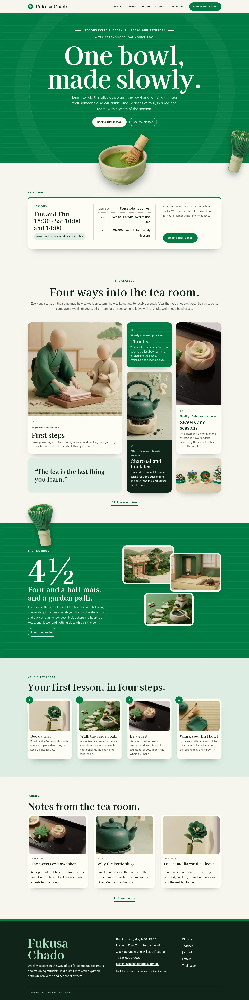
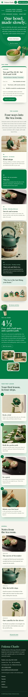

# Fukusa Chado

Fukusa Chado — a tea ceremony school theme laid out as a mosaic of soft rounded cards, with a formal top header: the school name and tagline on the left, the menu in the bar and the Book a trial lesson button on the right (an overlay menu on phones and tablets). Tokiwa evergreen (#007B43) is the main colour: the cover hero, the tea room band, every page head and the overlay menu are full green fields with a faint tatami weave, set in cream. The hero is centred giant type — the lesson days, the title in very large display type, the lead and the buttons on one axis — with a cut-out clay tea bowl that breaks out over the hero bottom edge and a cut-out whisk leaning out of the right edge. The four classes and a pull quote sit in a card mosaic of different sizes and colours; the tea room band sets four and a half in giant type beside rounded picture cards, with the cut-out whisk breaking over its top edge. Every picture is a soft matte 3D clay illustration. Kaisei Opti for display, Mulish for reading, Noto Serif TC for Traditional Chinese headings. Sample content in English, Traditional Chinese, Japanese, French and German; vertical labels only in Chinese and Japanese. WCAG AA colours; no entrance animations.

- Design plan row b4-3: card-mosaic, centered-giant-type hero, top-bar nav, full-illustration, 3d-clay, tokiwa #007B43, Kaisei Opti + Mulish.
- Sample content languages: en, zh-TW, ja, fr, de.
- Contrast: cream #FFFDF5 on tokiwa #007B43 5.3:1 (all text on the cover hero, the tea room band, every page head, the green class card, the header button and the overlay menu); pine black #10251A on washi white #F6F5EE 14.8:1 and on cream cards 15.8:1; deep tokiwa #00603A on washi white 7.0:1, on cream 7.5:1 and on pale tokiwa #DDEEE2 6.4:1 (links, labels, card numbers, drop caps); moss grey #46584D on washi white 7.0:1 and on cream 7.5:1 (secondary text); pine black on pale tokiwa 13.4:1 (fees, details, steps band, quote card); cream on pine black 15.8:1 (footer, dark class card, letter card); light tokiwa #A9DDBD on pine black 10.6:1 (labels on dark cards, footer legal); tokiwa on washi white 4.9:1 (drop caps and marks); pine black on tokiwa only 3.0:1 and light tokiwa on tokiwa 3.5:1, never used for text.
- Break-frame: the cut-out clay tea bowl (transparent WebP) sits under the hero buttons and breaks out over the green hero bottom edge into the term board below, and the cut-out whisk leans out over the hero right edge; the cut-out whisk also breaks over the top edge of the green tea room band and over the bottom edge of every page head.

## Templates and patterns

Every template is the top header, the page column and the footer. Page bodies come from patterns (home-hero with the centred giant title, the cut-out tea bowl and whisk, home-board with the synced term board, home-works as the card mosaic of the classes, home-serial as the green tea room band with the cut-out whisk, home-process with the four first-lesson steps, home-journal, and a green page head with a rounded picture card per page). The term board, school details and fees are synced patterns.

<!-- screenshots:start -->
## Screenshots

<table>
<tr>
<td valign="top"></td>
<td valign="top"></td>
</tr>
</table>

- Lessons: [desktop](screenshots/lessons-desktop.webp) · [mobile](screenshots/lessons-mobile.webp)
- About: [desktop](screenshots/about-desktop.webp) · [mobile](screenshots/about-mobile.webp)
- News: [desktop](screenshots/news-desktop.webp) · [mobile](screenshots/news-mobile.webp)
- Article: [desktop](screenshots/article-desktop.webp) · [mobile](screenshots/article-mobile.webp)
- Category: [desktop](screenshots/category-desktop.webp) · [mobile](screenshots/category-mobile.webp)
- Tag: [desktop](screenshots/tag-desktop.webp) · [mobile](screenshots/tag-mobile.webp)
- Newsletter: [desktop](screenshots/newsletter-desktop.webp) · [mobile](screenshots/newsletter-mobile.webp)
- Contact: [desktop](screenshots/contact-desktop.webp) · [mobile](screenshots/contact-mobile.webp)
- Search: [desktop](screenshots/search-desktop.webp) · [mobile](screenshots/search-mobile.webp)
- Other languages (home page): [zh-TW](screenshots/zh-TW/home-desktop.webp) · [ja](screenshots/ja/home-desktop.webp) · [fr](screenshots/fr/home-desktop.webp) · [de](screenshots/de/home-desktop.webp)
<!-- screenshots:end -->
