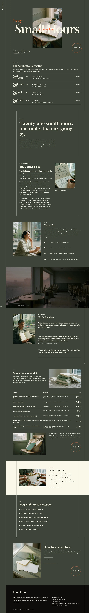

# Fumi Press Launch

Fumi Press Launch is an editorial magazine WordPress block theme created for the single-book launch of Clara Hsu's essay collection Small Hours. Designed with a signature framed-window hero, hairline grid borders, and a quiet rikyu-green palette, it presents launch event dates, sample essays, and multiple pre-order editions. Built for Fumi Press, an independent publisher based in Da'an District, Taipei.

## Pages
Home (long conversion page with anchor menu), Excerpt, Editions (price table and pre-order process), Newsletter (early-access sign-up) and Thanks. Menu links go to the inner pages where one exists and to home anchors otherwise.

## Signature
Fixed 92px left rail with hairline frame columns and corner ticks, a giant Gloock title crossing a framed-window film-grain photograph, and a rotating "Pre-order" stamp. Photographs are AI-generated for this theme; fonts are Gloock, Public Sans and Noto Serif TC/JP (OFL).

<!-- screenshots:start -->
## Screenshots

<table>
<tr>
<td valign="top"></td>
<td valign="top"></td>
</tr>
</table>

- Excerpt: [desktop](screenshots/excerpt-desktop.webp) · [mobile](screenshots/excerpt-mobile.webp)
- Editions: [desktop](screenshots/editions-desktop.webp) · [mobile](screenshots/editions-mobile.webp)
- Newsletter: [desktop](screenshots/newsletter-desktop.webp) · [mobile](screenshots/newsletter-mobile.webp)
- Thanks: [desktop](screenshots/thanks-desktop.webp) · [mobile](screenshots/thanks-mobile.webp)
- About: [desktop](screenshots/about-desktop.webp) · [mobile](screenshots/about-mobile.webp)
- News: [desktop](screenshots/news-desktop.webp) · [mobile](screenshots/news-mobile.webp)
- Article: [desktop](screenshots/article-desktop.webp) · [mobile](screenshots/article-mobile.webp)
- Category: [desktop](screenshots/category-desktop.webp) · [mobile](screenshots/category-mobile.webp)
- Tag: [desktop](screenshots/tag-desktop.webp) · [mobile](screenshots/tag-mobile.webp)
- Contact: [desktop](screenshots/contact-desktop.webp) · [mobile](screenshots/contact-mobile.webp)
- Other languages (home page): [zh-TW](screenshots/zh-TW/home-desktop.webp) · [ja](screenshots/ja/home-desktop.webp) · [fr](screenshots/fr/home-desktop.webp) · [de](screenshots/de/home-desktop.webp)
<!-- screenshots:end -->
