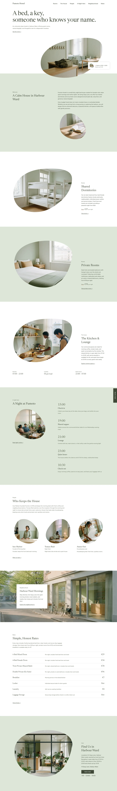

# Fumoto Hostel

A calm block theme (type business) for a small urban hostel. Home plus eight inner pages (Rooms, The House, People, A Night Here, Neighbourhood, Rates, Booking, Contact) in English; other languages follow.

## Signature
- Tilted organic pebble window holding the reception photograph on white, with slow parallax inside it; pebble photographs repeat through the page.
- White and willow-tint sections, photo on one side and a short text column bottom-aligned on the other.
- Slim vertical "Book a bed" tab on the right edge (bar under the header on small screens) and a small check-in card.

## Patterns
- `front-hero`, `front-welcome`, `front-dorms`, `front-private`, `front-kitchen`, `front-night`, `front-people`, `front-band`, `front-rates`, `front-visit`

## Fonts
Newsreader, Figtree, Noto Serif TC / JP (SIL OFL 1.1, licences in assets/fonts).

## Motion
Pebble photographs show a small "View" circle on hover (desktop); willow sections fade in from white as they enter (CSS scroll-driven, static where unsupported or with reduced motion).

## Pages
Demo content creates the home page and the eight inner pages, using the `page-*` patterns and the "Sections page" template.

<!-- screenshots:start -->
## Screenshots

<table>
<tr>
<td valign="top"></td>
<td valign="top"></td>
</tr>
</table>

- Rooms: [desktop](screenshots/rooms-desktop.webp) · [mobile](screenshots/rooms-mobile.webp)
- The house: [desktop](screenshots/the-house-desktop.webp) · [mobile](screenshots/the-house-mobile.webp)
- People: [desktop](screenshots/people-desktop.webp) · [mobile](screenshots/people-mobile.webp)
- A night here: [desktop](screenshots/a-night-here-desktop.webp) · [mobile](screenshots/a-night-here-mobile.webp)
- Neighbourhood: [desktop](screenshots/neighbourhood-desktop.webp) · [mobile](screenshots/neighbourhood-mobile.webp)
- Rates: [desktop](screenshots/rates-desktop.webp) · [mobile](screenshots/rates-mobile.webp)
- Booking: [desktop](screenshots/booking-desktop.webp) · [mobile](screenshots/booking-mobile.webp)
- Contact: [desktop](screenshots/contact-desktop.webp) · [mobile](screenshots/contact-mobile.webp)
- About: [desktop](screenshots/about-desktop.webp) · [mobile](screenshots/about-mobile.webp)
- News: [desktop](screenshots/news-desktop.webp) · [mobile](screenshots/news-mobile.webp)
- Article: [desktop](screenshots/article-desktop.webp) · [mobile](screenshots/article-mobile.webp)
- Category: [desktop](screenshots/category-desktop.webp) · [mobile](screenshots/category-mobile.webp)
- Tag: [desktop](screenshots/tag-desktop.webp) · [mobile](screenshots/tag-mobile.webp)
- Newsletter: [desktop](screenshots/newsletter-desktop.webp) · [mobile](screenshots/newsletter-mobile.webp)
- Other languages (home page): [zh-TW](screenshots/zh-TW/home-desktop.webp) · [ja](screenshots/ja/home-desktop.webp) · [fr](screenshots/fr/home-desktop.webp) · [de](screenshots/de/home-desktop.webp)
<!-- screenshots:end -->
