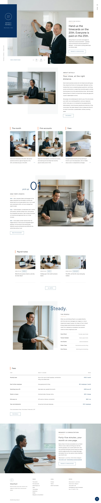

# Getsuji Payroll

Landing theme for a payroll bureau: white ground, a flush navy panel, orange hairlines, Figtree and Manrope. The home page opens on a framed full-bleed photograph cut by white panels, then an about row over an offset dot grid, three square doors, a pick-up with an oversized 01, payroll notes, the people, a fee table and one parallax request cover. Works without WooCommerce.

## Structure
- `patterns/front-*.php` (home), `head-main.php`, `foot-main.php`; `templates/`; `demo-content.json`.
- Scroll effects: `assets/sp-scroll.css|js` (unchanged ShipPress copy): reveal-up with stagger, dot-grid fade, parallax on the cover, the pick-up photo and the request cover.
- Photographs are AI-generated in `assets/images/`.

Status: home page and compact inner pages (the month, fees, firm accounts, the bureau, request, letter, privacy, terms) in English. The framed inner-page heads and the fr, de, zh-TW and ja languages follow.

Design notes: `brand.md`, `brand/design-spec.md`, `brand/reference.md`. License: GPL-2.0-or-later.

<!-- screenshots:start -->
## Screenshots

<table>
<tr>
<td valign="top"></td>
<td valign="top"></td>
</tr>
</table>

- The month: [desktop](screenshots/the-month-desktop.webp) · [mobile](screenshots/the-month-mobile.webp)
- Fees: [desktop](screenshots/fees-desktop.webp) · [mobile](screenshots/fees-mobile.webp)
- Accounts: [desktop](screenshots/accounts-desktop.webp) · [mobile](screenshots/accounts-mobile.webp)
- The bureau: [desktop](screenshots/the-bureau-desktop.webp) · [mobile](screenshots/the-bureau-mobile.webp)
- Request: [desktop](screenshots/request-desktop.webp) · [mobile](screenshots/request-mobile.webp)
- Letter: [desktop](screenshots/letter-desktop.webp) · [mobile](screenshots/letter-mobile.webp)
- News: [desktop](screenshots/news-desktop.webp) · [mobile](screenshots/news-mobile.webp)
- Article: [desktop](screenshots/article-desktop.webp) · [mobile](screenshots/article-mobile.webp)
- Category: [desktop](screenshots/category-desktop.webp) · [mobile](screenshots/category-mobile.webp)
- Search: [desktop](screenshots/search-desktop.webp) · [mobile](screenshots/search-mobile.webp)
- Privacy: [desktop](screenshots/privacy-desktop.webp) · [mobile](screenshots/privacy-mobile.webp)
- Terms: [desktop](screenshots/terms-desktop.webp) · [mobile](screenshots/terms-mobile.webp)
- About: [desktop](screenshots/about-desktop.webp) · [mobile](screenshots/about-mobile.webp)
- Tag: [desktop](screenshots/tag-desktop.webp) · [mobile](screenshots/tag-mobile.webp)
- Newsletter: [desktop](screenshots/newsletter-desktop.webp) · [mobile](screenshots/newsletter-mobile.webp)
- Contact: [desktop](screenshots/contact-desktop.webp) · [mobile](screenshots/contact-mobile.webp)
- Other languages (home page): [zh-TW](screenshots/zh-TW/home-desktop.webp) · [ja](screenshots/ja/home-desktop.webp) · [fr](screenshots/fr/home-desktop.webp) · [de](screenshots/de/home-desktop.webp)
<!-- screenshots:end -->
