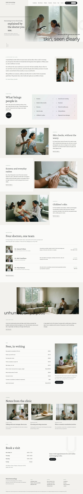

# Hada Dermatology

A calm block theme (type health) for a community dermatology clinic. Home page (English) in this release; inner pages and other languages follow.

## Signature
- Inset hero photograph on an L-shaped band, with a thin oversized line crossing its lower edge and hairline arcs.
- Numbered hairline lists on a pale gradient panel.

## Patterns
- `front-chapters`
- `front-concerns-index`
- `front-doctor-letter`
- `front-doctors-line`
- `front-fees-list`
- `front-inset-hero`
- `front-journal`
- `front-standard-band`
- `front-visit-close`

## Fonts
Crimson Pro and Figtree (SIL OFL 1.1, licences in assets/fonts).

## Images (AI-generated for this theme, no text or logos; assets/images/)
- assets/images/p01-consult.webp
- assets/images/p03-skincheck.webp
- assets/images/p04-moisturiser.webp
- assets/images/p05-child.webp
- assets/images/p06-reyes.webp
- assets/images/p07-odum.webp
- assets/images/p08-castellano.webp
- assets/images/p09-reception.webp
- assets/images/p10-waiting.webp
- assets/images/p11-cosmetic.webp
- assets/images/p12-raman.webp
- assets/images/p14-sunscreen.webp
- assets/images/p15-teen.webp

The journal posts reuse three of them from assets/images/demo/.

<!-- screenshots:start -->
## Screenshots

<table>
<tr>
<td valign="top"></td>
<td valign="top"></td>
</tr>
</table>

- Conditions: [desktop](screenshots/conditions-desktop.webp) · [mobile](screenshots/conditions-mobile.webp)
- Skin checks: [desktop](screenshots/skin-checks-desktop.webp) · [mobile](screenshots/skin-checks-mobile.webp)
- Children: [desktop](screenshots/children-desktop.webp) · [mobile](screenshots/children-mobile.webp)
- Cosmetic: [desktop](screenshots/cosmetic-desktop.webp) · [mobile](screenshots/cosmetic-mobile.webp)
- Doctors: [desktop](screenshots/doctors-desktop.webp) · [mobile](screenshots/doctors-mobile.webp)
- Fees: [desktop](screenshots/fees-desktop.webp) · [mobile](screenshots/fees-mobile.webp)
- First visit: [desktop](screenshots/first-visit-desktop.webp) · [mobile](screenshots/first-visit-mobile.webp)
- Book: [desktop](screenshots/book-desktop.webp) · [mobile](screenshots/book-mobile.webp)
- About: [desktop](screenshots/about-desktop.webp) · [mobile](screenshots/about-mobile.webp)
- News: [desktop](screenshots/news-desktop.webp) · [mobile](screenshots/news-mobile.webp)
- Article: [desktop](screenshots/article-desktop.webp) · [mobile](screenshots/article-mobile.webp)
- Category: [desktop](screenshots/category-desktop.webp) · [mobile](screenshots/category-mobile.webp)
- Tag: [desktop](screenshots/tag-desktop.webp) · [mobile](screenshots/tag-mobile.webp)
- Newsletter: [desktop](screenshots/newsletter-desktop.webp) · [mobile](screenshots/newsletter-mobile.webp)
- Contact: [desktop](screenshots/contact-desktop.webp) · [mobile](screenshots/contact-mobile.webp)
- Search: [desktop](screenshots/search-desktop.webp) · [mobile](screenshots/search-mobile.webp)
- Other languages (home page): [zh-TW](screenshots/zh-TW/home-desktop.webp) · [ja](screenshots/ja/home-desktop.webp) · [fr](screenshots/fr/home-desktop.webp) · [de](screenshots/de/home-desktop.webp)
<!-- screenshots:end -->
