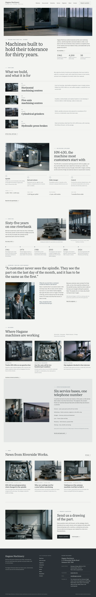

# Hagane Machinery

A quiet, photograph-led block theme for an **industrial machinery maker**: horizontal and five-axis machining centres, cylindrical grinders and press brakes, built to order, with service bases on three continents.

The demo company is fictional: Hagane Machinery, founded in 1961 by the toolmaker Kenji Hagane at 2-14 Riverside Works Road, Ostmere, and run today by his grandson Ren Hagane with Mika Oda (chief engineer), Tomas Lindqvist (head of service, Europe) and Aiko Mori (scraping and assembly). The whole brand (people, place, tone, a day at Riverside Works) is written down in [`brand.md`](brand.md); every page's copy comes from it. Type: manufacturing. Sample content in English, Traditional Chinese (zh-TW), Japanese, French and German. Built to the quality gate in ROADMAP §4 (rule 0) and `rules.quality_gate` in design-plan.json (row b6-6).

## Concept: machines that hold their tolerance

- **Palette.** Steel white `#F3F3F1` ground, light steel `#E4E6E6` panels, paper `#FAFAF9` fields, graphite ink `#1F2427` text, quiet ink `#5C656B` secondary text, dark graphite `#2A3136` for the one dark band and the footer, and a single iron blue-grey `#455765` for labels, links and numbered markers. Mist `#A3ADB3` appears only as hairlines. The photographs carry the colour; the first screen stays well below 15 % saturated pixels.
- **Type.** IBM Plex Serif (display) up to 4.5 rem over IBM Plex Sans (text, figures with tabular numbers).
- **Photographs.** 16 documentary photographs of one plant: the machining hall at dawn, the HM-630, a spindle, the scraping bench, the inspection room, the casting yard, the service van and four portraits and training scenes. No cut-outs, no illustrations.

## Front page

A first screen in two halves: the machining hall at dawn over one plain sentence and three figures (founded 1961, 4,200 machines in service, 38 countries); the four product lines as a numbered index; the HM-630 explained with numbered notes; a timeline from 1961; an interview with Mika Oda; delivered machines by industry; the service network; news; and a quiet request-a-quotation close. No search, form or table on the first screen.

## Languages

The sample content and every word the theme itself shows come in **en, zh-TW, ja, fr and de**, using the mechanism of Hokuto Driving School 1.1.0: the shared importer picks the language (`shippress_demo_lang`, else the site language) and imports `demo-content.<lang>.json`; patterns print their words through `hagane_machinery_t( 'key' )` from `inc/i18n/<lang>.php` (English fallback, `inc/i18n.php`), and the synced company card starts from `inc/info/<lang>/office.html`.

The copy is localised, not translated: the company and people keep the brand (Ren, Mika, Tomas, Aiko, Riverside Works Road, Ostmere), while the wording of machines, service and quotations follows each market (a Taiwanese machine-tool builder, a Japanese industrial machinery maker, a French fabricant de machines industrielles, a German Maschinenbau company).

- **Type.** zh-TW headings use a bundled subset of Noto Serif TC (Regular), ja headings a bundled subset of Noto Serif JP (Regular), built with fontTools from exactly the characters of that language's sample text; Latin letters and figures stay in Plex. CJK headings run at about three quarters of the English sizes, body line height 1.85, no italics.
- **German and French** paragraphs hyphenate (`hyphens: auto`).

## One source for shared details

The company details (address, sales office, telephone, email, finding us) are one synced pattern created on activation from `inc/info/<lang>/office.html`; the footer and Contact only reference it.

## Pages and templates

Home, Machines, How we build, Engineers, Industries, Service, About, News, Newsletter, Contact; six posts in three categories (Company news, Technical notes, Fairs and events). Templates: front page, page, wide page, single, archive, category, tag, home (posts), search, 404.

## Licence

GPL-2.0-or-later. Fonts OFL-1.1 (see `assets/fonts/`). Photographs generated with Grok for this theme, released under GPL-2.0-or-later / CC0. All names, the city, the address, telephone numbers and figures are fictional.

<!-- screenshots:start -->
## Screenshots

<table>
<tr>
<td valign="top"></td>
<td valign="top"></td>
</tr>
</table>

- Machines: [desktop](screenshots/machines-desktop.webp) · [mobile](screenshots/machines-mobile.webp)
- How we build: [desktop](screenshots/how-we-build-desktop.webp) · [mobile](screenshots/how-we-build-mobile.webp)
- Engineers: [desktop](screenshots/engineers-desktop.webp) · [mobile](screenshots/engineers-mobile.webp)
- Industries: [desktop](screenshots/industries-desktop.webp) · [mobile](screenshots/industries-mobile.webp)
- Service: [desktop](screenshots/service-desktop.webp) · [mobile](screenshots/service-mobile.webp)
- About: [desktop](screenshots/about-desktop.webp) · [mobile](screenshots/about-mobile.webp)
- News: [desktop](screenshots/news-desktop.webp) · [mobile](screenshots/news-mobile.webp)
- Article: [desktop](screenshots/article-desktop.webp) · [mobile](screenshots/article-mobile.webp)
- Category: [desktop](screenshots/category-desktop.webp) · [mobile](screenshots/category-mobile.webp)
- Tag: [desktop](screenshots/tag-desktop.webp) · [mobile](screenshots/tag-mobile.webp)
- Newsletter: [desktop](screenshots/newsletter-desktop.webp) · [mobile](screenshots/newsletter-mobile.webp)
- Contact: [desktop](screenshots/contact-desktop.webp) · [mobile](screenshots/contact-mobile.webp)
- Search: [desktop](screenshots/search-desktop.webp) · [mobile](screenshots/search-mobile.webp)
- Other languages (home page): [zh-TW](screenshots/zh-TW/home-desktop.webp) · [ja](screenshots/ja/home-desktop.webp) · [fr](screenshots/fr/home-desktop.webp) · [de](screenshots/de/home-desktop.webp)
<!-- screenshots:end -->
