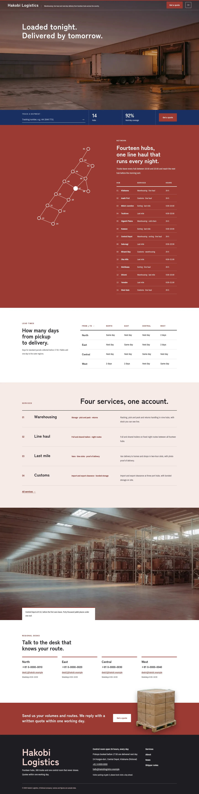
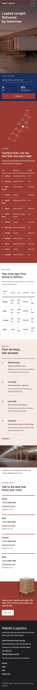

# Hakobi Logistics

Hakobi Logistics — a theme for a logistics company (warehousing, line haul, last mile and customs), laid out as sticky media under a formal top header: the company name and tagline on the left, a Get a quote button and a menu button on the right, the menu always opening as a full bengara overlay. Bengara red (#9A3A33) is the main colour: the network section, the quote band, every page head and the overlay menu are bengara fields in white type. The front page is a locations network: one unframed full-bleed film-grain photograph of a loading dock at dusk with a two-line headline, a navy info bar with a tracking field, hub count, next-day coverage and a quote button; then a sticky line map of fourteen hubs beside the scrolling hub list, a lead-time table, four services as one-line rows, a wide depot photograph with a caption, four regional desks and a narrow quote band where a transparent cut-out pallet of boxes breaks above the band edge. Photographs are realistic film-grain images (35mm film, 50mm f/2, natural side light, fine grain, slightly faded, graded toward bengara). Zen Kaku Gothic New for headings, Archivo Narrow for text, Noto Sans TC for Traditional Chinese headings. Sample content in English, Traditional Chinese, Japanese, French and German. WCAG AA colours; no entrance animations.

- Design plan row b5-9: sticky-media, full-bleed-illustration (as a full-bleed film-grain photograph), overlay nav, real-photography film-grain, bengara #9A3A33, Zen Kaku Gothic New + Archivo Narrow; first screen full-bleed-photo-info-bar, page structure locations-network.
- Front page blocks: hero-dock-trackbar, network-map, lead-time-table, services-list, depot-photo-band, regional-contacts, quote-cta.
- Sample content languages: en, zh-TW, ja, fr, de.
- Contrast: white on bengara #9A3A33 6.9:1 (network section, hub list, quote band, page heads, overlay menu); white on konjo navy #192F60 13.1:1 and pale #E6E9F2 on navy 10.9:1 (tracking bar); white on bengara button 6.9:1; ink #1F1D22 on white 16.6:1 and on bengara tint #F6EAE7 14.6:1; deep bengara #7A2A24 on white 9.6:1 and on tint 8.5:1 (labels, links); quiet #4E4A50 on white 8.6:1 and on tint 7.6:1; bengara #9A3A33 on white 6.9:1 (quote button text).
- Break-frame: the transparent cut-out pallet (WebP) breaks above the quote band top edge and over the page-head edges.

<!-- screenshots:start -->
## Screenshots

<table>
<tr>
<td valign="top"></td>
<td valign="top"></td>
</tr>
</table>

- Services: [desktop](screenshots/services-desktop.webp) · [mobile](screenshots/services-mobile.webp)
- About: [desktop](screenshots/about-desktop.webp) · [mobile](screenshots/about-mobile.webp)
- News: [desktop](screenshots/news-desktop.webp) · [mobile](screenshots/news-mobile.webp)
- Article: [desktop](screenshots/article-desktop.webp) · [mobile](screenshots/article-mobile.webp)
- Category: [desktop](screenshots/category-desktop.webp) · [mobile](screenshots/category-mobile.webp)
- Tag: [desktop](screenshots/tag-desktop.webp) · [mobile](screenshots/tag-mobile.webp)
- Newsletter: [desktop](screenshots/newsletter-desktop.webp) · [mobile](screenshots/newsletter-mobile.webp)
- Contact: [desktop](screenshots/contact-desktop.webp) · [mobile](screenshots/contact-mobile.webp)
- Search: [desktop](screenshots/search-desktop.webp) · [mobile](screenshots/search-mobile.webp)
- Other languages (home page): [zh-TW](screenshots/zh-TW/home-desktop.webp) · [ja](screenshots/ja/home-desktop.webp) · [fr](screenshots/fr/home-desktop.webp) · [de](screenshots/de/home-desktop.webp)
<!-- screenshots:end -->
