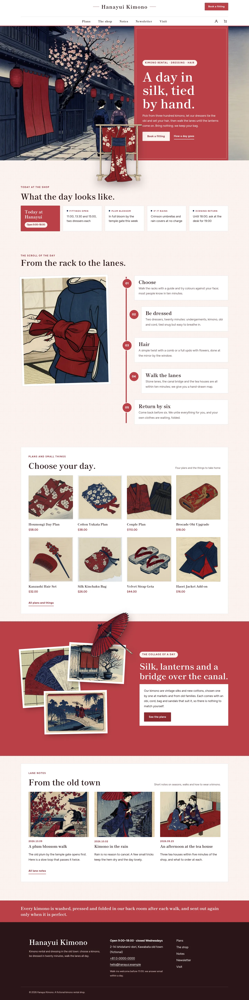
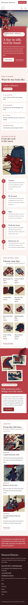

# Hanayui Kimono

Hanayui Kimono — a WooCommerce store theme for a kimono rental and dressing shop in an old town, laid out as a hanging scroll you read from top to bottom. A formal white top header carries the shop name in the centre, the Book a fitting button, and the main menu centred on a second row with the account and the cart. Enji crimson (#B94047) is the main colour: the hero panel, the scroll spine, the collage band, every page head and the footer strip are crimson fields on plum-washi paper. The hero is a full-bleed woodblock illustration of a stone lane at dusk with a crimson panel standing on it (a vertical line in Chinese and Japanese); a cut-out kimono on its stand (transparent WebP) breaks over the panel and the hero's bottom edge. The day hangs on a crimson spine in five scenes, and a collage of pasted woodblock prints sits on a crimson band with a cut-out umbrella breaking out of it. Every picture is a woodblock-print illustration. Shippori Mincho for display, Figtree for reading. Sample content and products in English, Traditional Chinese, Japanese, French and German; vertical lines only in Chinese and Japanese. Works without WooCommerce. WCAG AA colours; no entrance animations.

- Design plan row b3-29: tategaki-vertical-scroll, full-bleed-illustration hero, centered nav, collage, woodblock, enji #B94047, Shippori Mincho + Figtree.
- Sample content languages: en, zh-TW, ja, fr, de.
- Contrast: white #FFFFFF on enji #B94047 5.4:1 (hero panel, page heads, collage band, footer strip and the scroll numbers: body text and titles); paper #FBF3F0 on enji 4.9:1; deep enji #8C2A31 on paper 7.7:1 (chips on crimson, links, prices, labels) and on white 8.4:1 (white on deep 8.4:1 buttons); ink #2A1517 on paper 15.8:1, on white 17.2:1 and on mist #F4E4E0 14.0:1; plum grey #634B4D on paper 7.3:1 and on white 7.9:1 (secondary text); indigo #253458 on paper 11.2:1 (small marks; white on indigo 12.3:1); pale blush #F6D9D6 on ink 13.0:1 and white on ink 17.2:1 (footer); ink on enji only 3.2:1, never used for text.
- Break-frame: the cut-out kimono on its stand (transparent WebP) breaks over the crimson hero panel's edge and the hero's bottom edge into the shop board; the cut-out crimson umbrella breaks out of the pasted collage and over the top edge of the crimson collage band; the umbrella also breaks over the bottom edge of every page head.

## Templates and patterns

Every template is the header (the shop name centred, the Book a fitting button, the main menu centred on a second row with the account and the cart; a crimson overlay menu below 782 px), the page column and the footer. Page bodies come from patterns: home-hero (full-bleed woodblock lane, crimson panel, cut-out kimono breaking out), home-board (synced shop board), home-waters (the day as a vertical scroll on a crimson spine), home-shelf (plans and small things; WooCommerce products, pictures without it), home-break (crimson collage band with the cut-out umbrella), home-journal (lane notes), and the page heads and bodies of Plans, The shop, Newsletter and Visit. WooCommerce templates (shop, product, cart, checkout, account, order confirmation, product search) use tpl-* patterns for their text.

<!-- screenshots:start -->
## Screenshots

<table>
<tr>
<td valign="top"></td>
<td valign="top"></td>
</tr>
</table>

- Shop: [desktop](screenshots/shop-desktop.webp) · [mobile](screenshots/shop-mobile.webp)
- Product: [desktop](screenshots/product-desktop.webp) · [mobile](screenshots/product-mobile.webp)
- About: [desktop](screenshots/about-desktop.webp) · [mobile](screenshots/about-mobile.webp)
- Contact: [desktop](screenshots/contact-desktop.webp) · [mobile](screenshots/contact-mobile.webp)
- News: [desktop](screenshots/news-desktop.webp) · [mobile](screenshots/news-mobile.webp)
- Article: [desktop](screenshots/article-desktop.webp) · [mobile](screenshots/article-mobile.webp)
- Category: [desktop](screenshots/category-desktop.webp) · [mobile](screenshots/category-mobile.webp)
- Tag: [desktop](screenshots/tag-desktop.webp) · [mobile](screenshots/tag-mobile.webp)
- Newsletter: [desktop](screenshots/newsletter-desktop.webp) · [mobile](screenshots/newsletter-mobile.webp)
- Search: [desktop](screenshots/search-desktop.webp) · [mobile](screenshots/search-mobile.webp)
- Other languages (home page): [zh-TW](screenshots/zh-TW/home-desktop.webp) · [ja](screenshots/ja/home-desktop.webp) · [fr](screenshots/fr/home-desktop.webp) · [de](screenshots/de/home-desktop.webp)
<!-- screenshots:end -->
