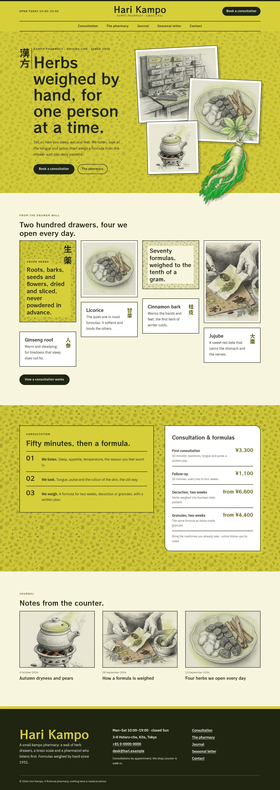
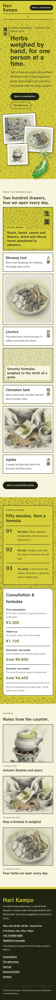

# Hari Kampo

Hari Kampo — A kampo pharmacy theme set as an asymmetric masonry in hiwa siskin yellow-green (#D7CF3A), the main colour on the header, the stacked-collage hero, the consultation band and every page head, over a pencil-sketched herb pattern texture, with graphite green ink and herb paper; RocknRoll One display over IBM Plex Sans JP. The art is pencil-sketch raster illustration (graphite cross-hatching with a hiwa wash): three sketches of the herbs, the drawer wall and the decoction pot stacked as a collage, a ginseng root as a transparent cut-out that breaks over the collage, the section edge and a card, and a seamless herb pattern used as texture on the hiwa fields and masonry tiles. A full top header with the pharmacy name centred, the menu centred beneath it between ink rules, and a Book a consultation button. Vertical Japanese only on Japanese text; English always runs horizontally. The consultation fees and the pharmacy details are synced patterns edited in one place. WCAG AA colours; no entrance animations.

- Design plan row: b3-16 (asymmetric-masonry archetype, stacked-collage hero, centered nav, pattern-texture images, pencil-sketch illustration, hiwa #D7CF3A, RocknRoll One + IBM Plex Sans JP).
- Header: a full hiwa top header with the pharmacy name centred, opening hours on the left, the Book a consultation button on the right and the menu centred beneath between two ink rules.
- Pattern texture: a seamless pencil-sketched herb pattern multiplied under the hiwa hero, the consultation band, the page heads and the masonry tiles.
- Break-frame: the cut-out ginseng root breaks over the stacked collage and the bottom edge of the hero; on The pharmacy page it leaves its hiwa card.
- Asymmetric masonry: the herb-drawer tiles run in uneven columns (herb names with vertical Japanese, sketches, a pattern tile).
- Vertical Japanese (hero label, herb names, page-head labels, spines) is lang="ja"; only CJK text runs vertically, English stays horizontal.
- Synced: consultation fees (home, Consultation) and pharmacy details (footer, Contact).
- Contrast: graphite ink #1F2410 on hiwa #D7CF3A 9.8:1 (all text on the hiwa header, hero, consultation band, tiles and page heads); white on graphite 15.9:1; hiwa on graphite 9.8:1 (footer name); graphite on herb paper #F7F5DF 14.5:1; olive #5E5A0C on paper 6.5:1 and on white 7.1:1; white on olive 7.1:1; quiet #4E4F36 on paper 7.7:1; white never on hiwa (1.6:1).

## Templates
front-page, home, index, page, page-wide, single, archive, category, tag, search, 404.

## Patterns
home-hero, home-drawer, home-consult, home-journal, consultation-head, consultation-main, about-head, about-main, newsletter-head, newsletter-signup, contact-head, contact-main, prices, details-card, not-found.

<!-- screenshots:start -->
## Screenshots

<table>
<tr>
<td valign="top"></td>
<td valign="top"></td>
</tr>
</table>

- Consultation: [desktop](screenshots/consultation-desktop.webp) · [mobile](screenshots/consultation-mobile.webp)
- About: [desktop](screenshots/about-desktop.webp) · [mobile](screenshots/about-mobile.webp)
- News: [desktop](screenshots/news-desktop.webp) · [mobile](screenshots/news-mobile.webp)
- Article: [desktop](screenshots/article-desktop.webp) · [mobile](screenshots/article-mobile.webp)
- Category: [desktop](screenshots/category-desktop.webp) · [mobile](screenshots/category-mobile.webp)
- Tag: [desktop](screenshots/tag-desktop.webp) · [mobile](screenshots/tag-mobile.webp)
- Newsletter: [desktop](screenshots/newsletter-desktop.webp) · [mobile](screenshots/newsletter-mobile.webp)
- Contact: [desktop](screenshots/contact-desktop.webp) · [mobile](screenshots/contact-mobile.webp)
- Search: [desktop](screenshots/search-desktop.webp) · [mobile](screenshots/search-mobile.webp)
<!-- screenshots:end -->
