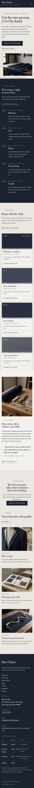

# Hari Tailor

An elegant, precise and traditional block theme for a **bespoke tailor's atelier**: made-to-measure suits, jackets and overcoats, measured, cut, basted, fitted and finished by hand.

*Hari* (needle). The demo atelier is a fictional three-cutter room on Shears Lane in Kirinomachi, opened in 1987 by Sota Harimoto with Mio Kanzaki and Ren Ashida. It is a business theme, not a shop: no WooCommerce templates or products (and nothing breaks if WooCommerce is active).

## Concept: navy wool, chalk and a tape measure

- **Palette.** Navy wool `#1B2230` (text, rail, bands, footer; 12.8:1 on chalk), slate navy `#2C3446`, chalk `#E9E6E0` ground, pale chalk `#F3F1EC` cards, and muted brass `#9C8B6E` for the tape ticks, hairlines and marks only (2.7:1 on chalk, so never small text there). Deep brass `#6B5A3C` carries links and labels on chalk (5.4:1); pale brass `#BCAB88` carries small text on navy (7.1:1); quiet ink `#4A5161` secondary text (6.4:1). No bright colour.
- **Type.** Libre Bodoni (display, roman and italic) over Geologica (text, Light 300). Both OFL-1.1 without a Reserved Font Name, subset to Latin WOFF2 (~61 KB total).
- **Marks.** Brass tape-measure tick scales, tailor's-chalk crosses (×) and dashed chalk lines, all drawn in CSS. No entrance animations; transitions stop under `prefers-reduced-motion`.

## Header, footer, layout (ROADMAP codes)

- **H3 side rail**: a navy rail fixed on the left (wordmark, descriptor, the menu as ruled rows, "By appointment" with a booking button) with a brass tape-measure scale numbered 10–90 down its inner edge. Below 1024 px it becomes a navy top bar with the tape ticks along its lower edge and an overlay menu.
- **F11 hours table footer**: navy footer with the wordmark and page list beside the synced atelier card, whose appointment hours table (day, hours, what each day is for) is the centre of the footer.
- **L12 timeline**: the five fittings (measure, cut, baste, first fitting, finish) as a numbered tailor's-chalk timeline: italic Bodoni numerals, a dashed chalk line with a chalk cross at each stage, duration labels. On the home page it runs on a navy wool band; on The Process page on chalk, with a photograph and a stitched list per stage.

## One source for shared details

- **Atelier details and appointment hours** (address, telephone, email, station, hours table) are the synced pattern `Hari Tailor: atelier details and appointment hours`, shown in the footer and on the Appointments and Contact pages (the footer copy hides itself on those two pages). Created once by `inc/shared-info.php` from `inc/info/atelier.html`; pages hold only references. The demo import (`inc/demo-import.php`) is idempotent and never overwrites user content.

## Pages and templates

Home, The Process, Cloth Book (eight swatch cards with CSS weaves, weight, a note and a price; the "House cloth" badge is editable text), Appointments, About, Journal (posts page), Newsletter, Contact; article, category, tag, search and 404 templates. Six journal posts in three categories (Cloth, Fittings, Care) with six tags.

## Licence

GPL-2.0-or-later. Fonts OFL-1.1 (see `assets/fonts/`). Photographs AI-generated for this theme, released under GPL-2.0-or-later / CC0. All names, the address, phone numbers, cloths and prices are fictional.

<!-- screenshots:start -->
## Screenshots

<table>
<tr>
<td valign="top"></td>
<td valign="top"></td>
</tr>
</table>

- Process: [desktop](screenshots/process-desktop.webp) · [mobile](screenshots/process-mobile.webp)
- Cloth book: [desktop](screenshots/cloth-book-desktop.webp) · [mobile](screenshots/cloth-book-mobile.webp)
- Appointments: [desktop](screenshots/appointments-desktop.webp) · [mobile](screenshots/appointments-mobile.webp)
- About: [desktop](screenshots/about-desktop.webp) · [mobile](screenshots/about-mobile.webp)
- News: [desktop](screenshots/news-desktop.webp) · [mobile](screenshots/news-mobile.webp)
- Article: [desktop](screenshots/article-desktop.webp) · [mobile](screenshots/article-mobile.webp)
- Category: [desktop](screenshots/category-desktop.webp) · [mobile](screenshots/category-mobile.webp)
- Tag: [desktop](screenshots/tag-desktop.webp) · [mobile](screenshots/tag-mobile.webp)
- Newsletter: [desktop](screenshots/newsletter-desktop.webp) · [mobile](screenshots/newsletter-mobile.webp)
- Contact: [desktop](screenshots/contact-desktop.webp) · [mobile](screenshots/contact-mobile.webp)
- Search: [desktop](screenshots/search-desktop.webp) · [mobile](screenshots/search-mobile.webp)
<!-- screenshots:end -->
