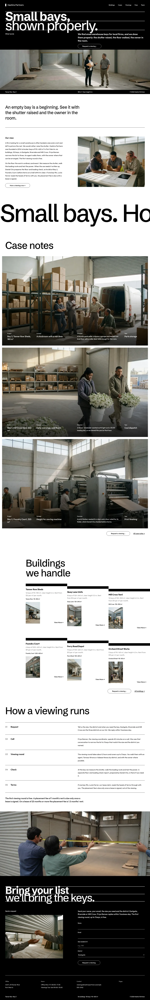

# Hashira Partners

Hashira Partners is a small-warehouse leasing brokerage in Port Merrin, founded in 2014. The site presents six buildings and 50 bays from 90 to 420 m², and takes viewing requests for Eastgate, Riverside and Mill Cross. Office hours are Mon–Fri 08:30–17:30, and viewing hours are Tue–Sat 09:00–15:00.

## Structure
- `patterns/front-*.php`: the seven home sections (hero, vision, marquee, cases, buildings, viewing, request).
- `parts/`: transparent overlay header, black footer. `templates/`: front page and plain templates.
- `assets/sp-scroll.css`, `assets/sp-scroll.js`: ShipPress scroll effects (reveal, stagger, marquee, parallax).
- `demo-content.json`: sample content (English; the other languages follow with the inner pages).
- Photos: `assets/images/` (AI-generated, GPL-2.0-or-later / CC0). See `readme.txt` for the list.

Design notes: `brand.md`, `brand/design-spec.md`, `brand/reference.md`.

License: GPL-2.0-or-later.

## Status
Home page (English) is complete: gates pass at 390 px and 1280 px, 13 block documents validate, editor and front fonts match. The inner pages (Buildings, Cases, Viewings, Fees, Team), the language switch, the privacy, terms and thanks pages and the zh-TW, ja, fr and de versions come in the next step; the menu and "View More" links point to those pages.

<!-- screenshots:start -->
## Screenshots

<table>
<tr>
<td valign="top"></td>
<td valign="top"></td>
</tr>
</table>

- About: [desktop](screenshots/about-desktop.webp) · [mobile](screenshots/about-mobile.webp)
- News: [desktop](screenshots/news-desktop.webp) · [mobile](screenshots/news-mobile.webp)
- Article: [desktop](screenshots/article-desktop.webp) · [mobile](screenshots/article-mobile.webp)
- Category: [desktop](screenshots/category-desktop.webp) · [mobile](screenshots/category-mobile.webp)
- Tag: [desktop](screenshots/tag-desktop.webp) · [mobile](screenshots/tag-mobile.webp)
- Buildings: [desktop](screenshots/buildings-desktop.webp) · [mobile](screenshots/buildings-mobile.webp)
- Cases: [desktop](screenshots/cases-desktop.webp) · [mobile](screenshots/cases-mobile.webp)
- Viewings: [desktop](screenshots/viewings-desktop.webp) · [mobile](screenshots/viewings-mobile.webp)
- Fees: [desktop](screenshots/fees-desktop.webp) · [mobile](screenshots/fees-mobile.webp)
- Team: [desktop](screenshots/team-desktop.webp) · [mobile](screenshots/team-mobile.webp)
- Owners: [desktop](screenshots/owners-desktop.webp) · [mobile](screenshots/owners-mobile.webp)
- Bay guide: [desktop](screenshots/bay-guide-desktop.webp) · [mobile](screenshots/bay-guide-mobile.webp)
- Notes: [desktop](screenshots/notes-desktop.webp) · [mobile](screenshots/notes-mobile.webp)
- Contact: [desktop](screenshots/contact-desktop.webp) · [mobile](screenshots/contact-mobile.webp)
- Newsletter: [desktop](screenshots/newsletter-desktop.webp) · [mobile](screenshots/newsletter-mobile.webp)
- Thanks: [desktop](screenshots/thanks-desktop.webp) · [mobile](screenshots/thanks-mobile.webp)
- Privacy: [desktop](screenshots/privacy-desktop.webp) · [mobile](screenshots/privacy-mobile.webp)
- Terms: [desktop](screenshots/terms-desktop.webp) · [mobile](screenshots/terms-mobile.webp)
- Other languages (home page): [zh-TW](screenshots/zh-TW/home-desktop.webp) · [ja](screenshots/ja/home-desktop.webp) · [fr](screenshots/fr/home-desktop.webp) · [de](screenshots/de/home-desktop.webp)
<!-- screenshots:end -->
