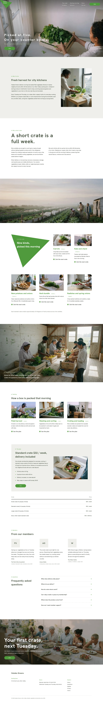
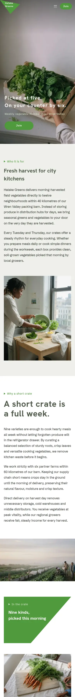

# Hatake Greens

A quiet block theme for a **weekly vegetable-box membership** for city households (landing type): picked at five, on the counter by six.

The demo business is fictional (packing barn at 14 Orchard Lane, Wren Valley; founded 2019 by Ines Calder and Tomas Achebe). The whole brand is in [`brand.md`](brand.md). The English home page and twelve inner pages (the crate, packing morning, growers, plans, delivery, stories, questions, waitlist, about, privacy, terms, thanks) are in; zh-TW, ja, fr, de follow.

## Concept: a documentary morning, then one way to join

- **Full-bleed photo hero.** A documentary photograph with a wide-tracked white two-line headline bottom-left and a scrim that deepens on scroll; the photo drifts slower than the page (`sp-parallax`).
- **Sage triangle.** The logo mark at the top-left corner and a large solid triangle holding the label and heading of "In the crate".
- **Tagged photo cards.** 3:2 photos, a bright-leaf title with a `[ tag ]`, two lines of text and a round-dot link.
- **Palette.** Pine sage `#4E5A48`, leaf `#4F9A3C`, sage white `#EEF0EA`, ink `#1F251C`, white ground.
- **Type.** Hanken Grotesk (headings) over Schibsted Grotesk (text); Noto Sans TC / JP for Chinese and Japanese.

## Menu

The header menu goes to the real inner pages (the crate, packing morning, plans, growers, delivery, stories); the Join pill goes to the waitlist, and stays visible on mobile. The footer links About, Questions, Waitlist, Privacy and Terms.

## Scroll effects

`assets/sp-scroll.css` and `.js` (ShipPress sp-scroll): parallax on the hero and the join band, `sp-reveal--up` with `sp-stagger`, a wipe on the barn photo. Off with prefers-reduced-motion, without JavaScript and in the editor.

<!-- screenshots:start -->
## Screenshots

<table>
<tr>
<td valign="top"></td>
<td valign="top"></td>
</tr>
</table>
<!-- screenshots:end -->
