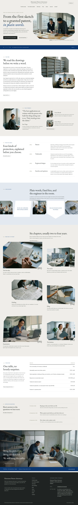

# Hatsumei Patent Attorneys

A calm, photograph-led block theme for a **patent and trademark attorney firm** that works with inventors and growing companies: practice areas, the route from first idea to granted patent in photographs, the attorneys by name and fixed fees in one plain table.

The demo firm is fictional: Hatsumei Patent Attorneys, founded in 2011 by Ines Varga at 22 Foundry Row, Halden, with Tomas Brandt (patents, electronics) and Amara Okoye (trademarks), nine people in all. See `brand.md`.

## Concept: a firm that reads the drawings first

- **Palette.** Stone-white and white ground, ink text, one deep patent-blue band and olive-grey labels, taken from the S5-Style references (see `brand/reference.md`). No grant rates, guarantees or client names.
- **Type.** EB Garamond (display) over Schibsted Grotesk (text, labels, tables, navigation).
- **Photographs.** 18 documentary office photographs in one film-grain style (28 mm, soft window light): attorneys with inventors, prototypes on the desk, drawings, the library, the archive and three portraits. Listed in `readme.txt`.
- **Techniques.** Chamfered polygon photographs with bracketed numerals; a strip of chamfered photographs alternating with shaped notes; a deep blue band under the first screen and the closing photograph, with a centred brand over one centred menu.

## Inner pages (1.0.1)

The page heads, the main photographs of every page and the article photograph reuse the front page's chamfered polygons (`.hp-cut--a` … `--j`) with bracketed numerals (001), (002)… in the caption; journal cards use the plainer one-corner chamfers of the how-we-work strip.

## Front page

Cover, the firm in three paragraphs, the attorneys, practice areas, how we work (shape strip), six chapters from idea to patent, fixed fees, notes for inventors and a closing invitation.

## Languages

The sample content and every word the theme shows come in **en, zh-TW, ja, fr and de**, using the mechanism of Hokuto Driving School 1.1.0: the shared importer picks the language (`shippress_demo_lang`, else the site language) and imports `demo-content.<lang>.json`; patterns print their words through `hatsumei_patent_t( 'key' )` from `inc/i18n/<lang>.php` (English fallback), and the synced office card starts from `inc/info/<lang>/office.html`.

The copy is localised, not translated: the firm, its people and Foundry Row keep the brand, while the offices (UK IPO, EPO and USPTO in English; TIPO, JPO, INPI and DPMA with the EPO and USPTO), professional titles, telephone formats and fee wording follow each market. Fees stay the same EUR amounts in every language.

- **Type.** zh-TW headings use a bundled subset of Noto Serif TC, ja headings a bundled subset of Noto Serif JP (Regular), built with fontTools from exactly the characters of that language's sample text. CJK headings run at about three quarters of the English sizes, body line height 1.85.
- **German and French** paragraphs hyphenate (`hyphens: auto`).

## Pages and templates

Home, Practice areas, From idea to patent, Attorneys, First meeting, Fees, About, Journal, Notes, Contact; six posts in three categories. Templates: front page, page, wide page, single, archive, category, tag, home (posts), search, 404.

## Licence

GPL-2.0-or-later. Fonts OFL-1.1 (see `assets/fonts/`). Photographs generated with Grok for this theme, released under GPL-2.0-or-later / CC0. All names, the place, the address, telephone numbers and figures are fictional.

<!-- screenshots:start -->
## Screenshots

<table>
<tr>
<td valign="top"></td>
<td valign="top"></td>
</tr>
</table>

- Practice areas: [desktop](screenshots/practice-areas-desktop.webp) · [mobile](screenshots/practice-areas-mobile.webp)
- From idea to patent: [desktop](screenshots/from-idea-to-patent-desktop.webp) · [mobile](screenshots/from-idea-to-patent-mobile.webp)
- Attorneys: [desktop](screenshots/attorneys-desktop.webp) · [mobile](screenshots/attorneys-mobile.webp)
- First meeting: [desktop](screenshots/first-meeting-desktop.webp) · [mobile](screenshots/first-meeting-mobile.webp)
- Fees: [desktop](screenshots/fees-desktop.webp) · [mobile](screenshots/fees-mobile.webp)
- About: [desktop](screenshots/about-desktop.webp) · [mobile](screenshots/about-mobile.webp)
- News: [desktop](screenshots/news-desktop.webp) · [mobile](screenshots/news-mobile.webp)
- Article: [desktop](screenshots/article-desktop.webp) · [mobile](screenshots/article-mobile.webp)
- Category: [desktop](screenshots/category-desktop.webp) · [mobile](screenshots/category-mobile.webp)
- Tag: [desktop](screenshots/tag-desktop.webp) · [mobile](screenshots/tag-mobile.webp)
- Newsletter: [desktop](screenshots/newsletter-desktop.webp) · [mobile](screenshots/newsletter-mobile.webp)
- Contact: [desktop](screenshots/contact-desktop.webp) · [mobile](screenshots/contact-mobile.webp)
- Search: [desktop](screenshots/search-desktop.webp) · [mobile](screenshots/search-mobile.webp)
- Other languages (home page): [zh-TW](screenshots/zh-TW/home-desktop.webp) · [ja](screenshots/ja/home-desktop.webp) · [fr](screenshots/fr/home-desktop.webp) · [de](screenshots/de/home-desktop.webp)
<!-- screenshots:end -->
