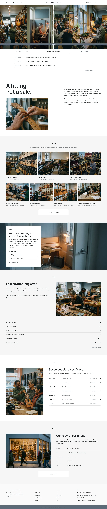
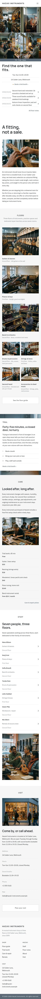

# Hazuki Instruments

Hazuki Instruments is a calm, sans-serif WordPress theme crafted for musical instrument shops, featuring asymmetric masonry layouts and dedicated WooCommerce integration. Built around an unhurried fitting philosophy, it provides structured floor directories, private trial booth reservations, and clear repair service price lists. Designed with balanced steel tones and refined typography, it delivers an honest, tactile storefront experience across all devices.

## Structure
- `patterns/front-*.php`: the home sections (seam strip, notes, statement, floors, trial, care, staff, visit).
- `templates/`: block templates, including the WooCommerce shop, product, cart, checkout and account templates.
- `inc/woo-import.php` and `assets/css/woocommerce.css`: sample products (8) and shop styles, active only with WooCommerce.
- `demo-content.json`: sample content (en).
- Photos: `assets/images/` (AI-generated, GPL-2.0-or-later / CC0).
- Scroll effects: `assets/sp-scroll.css`, `assets/sp-scroll.js`.

Design notes: `brand.md`, `brand/design-spec.md`, `brand/reference.md`.

License: GPL-2.0-or-later.

<!-- screenshots:start -->
## Screenshots

<table>
<tr>
<td valign="top"></td>
<td valign="top"></td>
</tr>
</table>

- About: [desktop](screenshots/about-desktop.webp) · [mobile](screenshots/about-mobile.webp)
- News: [desktop](screenshots/news-desktop.webp) · [mobile](screenshots/news-mobile.webp)
- Article: [desktop](screenshots/article-desktop.webp) · [mobile](screenshots/article-mobile.webp)
- Category: [desktop](screenshots/category-desktop.webp) · [mobile](screenshots/category-mobile.webp)
- Tag: [desktop](screenshots/tag-desktop.webp) · [mobile](screenshots/tag-mobile.webp)
- Newsletter: [desktop](screenshots/newsletter-desktop.webp) · [mobile](screenshots/newsletter-mobile.webp)
- Contact: [desktop](screenshots/contact-desktop.webp) · [mobile](screenshots/contact-mobile.webp)
- Floors: [desktop](screenshots/floors-desktop.webp) · [mobile](screenshots/floors-mobile.webp)
- Trial booth: [desktop](screenshots/trial-booth-desktop.webp) · [mobile](screenshots/trial-booth-mobile.webp)
- Care: [desktop](screenshots/care-desktop.webp) · [mobile](screenshots/care-mobile.webp)
- Rentals: [desktop](screenshots/rentals-desktop.webp) · [mobile](screenshots/rentals-mobile.webp)
- Staff: [desktop](screenshots/staff-desktop.webp) · [mobile](screenshots/staff-mobile.webp)
- Visit: [desktop](screenshots/visit-desktop.webp) · [mobile](screenshots/visit-mobile.webp)
- Shop: [desktop](screenshots/shop-desktop.webp) · [mobile](screenshots/shop-mobile.webp)
- Other languages (home page): [zh-TW](screenshots/zh-TW/home-desktop.webp) · [ja](screenshots/ja/home-desktop.webp) · [fr](screenshots/fr/home-desktop.webp) · [de](screenshots/de/home-desktop.webp)
<!-- screenshots:end -->
