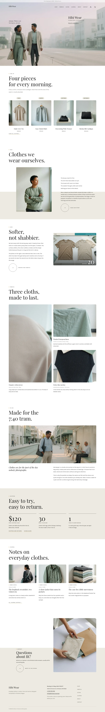

# Hibi Wear

Hibi Wear — a WooCommerce store theme for a small everyday-clothing label. A white ground with a warm stone band (#EDEAE2) that cuts through rounded 8 px photographs, gold-dot labels above big two-line Playfair Display headings, an outline circle arrow beside short statements, and a before and after wash photograph with two flat tabs and a big serif number. The home page opens on a hazy full-bleed morning street photograph with tiny captions at the left and right thirds and a vertical scroll rule; it continues with a four-piece line-up with category pills, the idea, the wash split, an aligned fabric masonry, a commute photograph, the store promise on the band, the journal and a mirrored contact block. The same three techniques run through the shop, single product, cart, About, Makers and Fabrics, Sizing, Shipping and Returns, Contact and the journal. Playfair Display for headings, Karla for reading. Sample content and products in English, Traditional Chinese, Japanese, French and German. Works without WooCommerce. WCAG AA colours; no entrance animations.

## Structure
- `patterns/front-*.php`: the nine home sections (cover, line-up, idea, wash, fabrics, city, promise, journal, close).
- `patterns/*-head.php`, `*-main.php`: the inner pages (shop, about, fabrics, sizing, shipping, contact); `tpl-*.php`: archive, search, 404, single entry and the store page heads.
- `templates/`: block templates including the WooCommerce ones (archive-product, single-product, cart, checkout, my account, order confirmation, product search).
- `inc/i18n/<lang>.php`: the theme strings in five languages; `demo-content*.json`: sample content in five languages.
- Photos: `assets/images/demo/` (AI-generated, GPL-2.0-or-later / CC0). See `readme.txt` for the list.

Design notes: `brand.md`, `brand/design-spec.md`, `brand/reference.md`.

License: GPL-2.0-or-later.

<!-- screenshots:start -->
## Screenshots

<table>
<tr>
<td valign="top"></td>
<td valign="top"></td>
</tr>
</table>

- Shop: [desktop](screenshots/shop-desktop.webp) · [mobile](screenshots/shop-mobile.webp)
- Product: [desktop](screenshots/product-desktop.webp) · [mobile](screenshots/product-mobile.webp)
- About: [desktop](screenshots/about-desktop.webp) · [mobile](screenshots/about-mobile.webp)
- Makers: [desktop](screenshots/makers-desktop.webp) · [mobile](screenshots/makers-mobile.webp)
- Sizing: [desktop](screenshots/sizing-desktop.webp) · [mobile](screenshots/sizing-mobile.webp)
- Shipping: [desktop](screenshots/shipping-desktop.webp) · [mobile](screenshots/shipping-mobile.webp)
- News: [desktop](screenshots/news-desktop.webp) · [mobile](screenshots/news-mobile.webp)
- Article: [desktop](screenshots/article-desktop.webp) · [mobile](screenshots/article-mobile.webp)
- Category: [desktop](screenshots/category-desktop.webp) · [mobile](screenshots/category-mobile.webp)
- Tag: [desktop](screenshots/tag-desktop.webp) · [mobile](screenshots/tag-mobile.webp)
- Newsletter: [desktop](screenshots/newsletter-desktop.webp) · [mobile](screenshots/newsletter-mobile.webp)
- Contact: [desktop](screenshots/contact-desktop.webp) · [mobile](screenshots/contact-mobile.webp)
- Search: [desktop](screenshots/search-desktop.webp) · [mobile](screenshots/search-mobile.webp)
- Other languages (home page): [zh-TW](screenshots/zh-TW/home-desktop.webp) · [ja](screenshots/ja/home-desktop.webp) · [fr](screenshots/fr/home-desktop.webp) · [de](screenshots/de/home-desktop.webp)
<!-- screenshots:end -->
