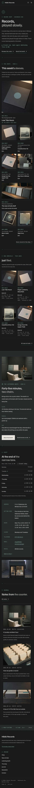

# Hibiki Records

A quiet, dark block theme for a **small independent record shop** and its online shop. A ShipPress **store** theme: WooCommerce templates styled to match, eight sample products in three categories, and a shop that still works without WooCommerce.

The demo shop is fictional: Hibiki Records, in a narrow lane behind a bakery in Sakanoue-cho, Minase City, run since 2006 by Tetsuo Hayami (the owner, late fifties, round glasses) and Nanami Kurose (the clerk). Second-hand and new vinyl, mostly jazz, ambient, folk and city pop by fictional artists on fictional labels, a few care accessories, and one bookable listening booth at the back. *Hibiki* means resonance, an echo.

## Concept: groove + catalogue number

- **Palette (dark but soft).** Charcoal `#17191A` pages, graphite `#262A2B` panels and the ticker band, deep graphite `#1E2122` cells, bone `#E6E3DD` text (13.8:1 on charcoal, 11.3:1 on graphite). The muted grey-teal `#5C8A86` is 4.6:1 on charcoal but only 3.8:1 on graphite, so it is used only for groove rings, rules and marks; pale teal `#8DB5AF` carries links, catalogue numbers and small labels (7.9:1 charcoal, 6.5:1 graphite); warm grey `#A9A69F` secondary text (7.3:1 / 6.0:1); hairline `#3A3F40` is decorative. Buttons are bone with charcoal text (13.8:1), pale teal on hover.
- **Type.** Familjen Grotesk (display and text, medium headings with slight negative tracking, prices in tabular figures) and Martian Mono (catalogue numbers like HBK-0412, labels, side markers, run-times, the ticker).
- **Grooves.** Very fine concentric rings (CSS radial gradients) mark the wordmark, section labels, section dividers and the booth status dot; Side A / Side B and run-times are quiet UI typography. No illustrations.

## Header, footer, layout (ROADMAP codes)

- **H1 logo left, menu right.** A slim charcoal bar with a hairline bottom rule, sticky: a small groove mark, the Familjen Grotesk wordmark with a Martian Mono sub-line (Records · Minase) on the left; the core navigation (Shop, New arrivals, Listening booth, Journal, Contact) with a small dot under the current page, the server-side Open now chip and, with WooCommerce, account and cart on the right. At 390 px: groove, wordmark, Menu and cart on one line; the menu opens as a dark overlay.
- **F5 marquee footer.** A graphite band with hairlines: "Now playing" and a slow line in Martian Mono (today's hours from Shop details, then what is on the turntable, next in the booth, what came in). It drifts at about 14 px a second (at least a minute per loop), pauses on hover and focus and has a Pause button; under prefers-reduced-motion or without JavaScript it stays still. The lines are plain text in the footer template part. Below: brand line and letter link, the shop card, slim links, and a run-out line.
- **L8 card mosaic.** A short quiet intro ("Records, played slowly.", one paragraph, today's opening line) and then the record-crate mosaic: square sleeve cards on one four-column grid, a 2x2 feature ("In the booth this week"), small 1x1 sleeves and a 2x1 crop of the new-arrivals shelf, each with a Martian Mono catalogue number, artist · genre, title and price. Hover lifts the sleeve a few pixels while the disc edge rises out of it (no movement with reduced motion). On phones two calm columns with the feature and the shelf full width. With WooCommerce the sleeves link to their products. Then new arrivals (four newest products), the listening booth teaser, shop details + hours and the journal.

## One source for shared details

| What | Source | Shown on |
| --- | --- | --- |
| Opening hours, closed days, address, how to find the shop, phone, email, social | Appearance > Shop details (`inc/shop-info.php`, block `hibiki-records/shop-info`) | Header Open now chip, footer ticker + shop card, Home (opening line, hours, card), Listening booth, The shop, Contact |
| Listening booth terms (booth hours, 45-minute slots, up to two people, fee, set-up, how to book) | `inc/info/booth.html` (synced pattern) | Listening booth (full), Home teaser (slots, people, fee) |
| Grading (M, NM, VG+, VG), played through, packing, shipping and returns | `inc/info/grading.html` (synced pattern) | Every product page (short), New arrivals (short), Contact (full) |
| Catalogue number, format · condition · year | each product's SKU and `Format`, `Condition`, `Year` (or `Contents`) attributes | Product cells and product page |

## Pages and templates

Demo pages: Home, Shop, New arrivals (this week's records sorted by newest, the grading note), Listening booth (photographs, the synced terms, a booking request form with date, time slot, people, name, email and records to hear), The shop (owner and clerk, the counter turntable and catalogue cards, visit), Journal (posts page), Newsletter (the Sunday sleeve letter) and Contact (shop card, hours, grading + shipping in full, form). Six sample posts in three categories (Crate notes, Booth sessions, Shop diary) with six tags.

Templates: front page, page, wide page, single post, journal, archive, category, tag, search, 404, plus WooCommerce shop, product category and tag archives, product (big square sleeve, catalogue number, format line, grading + shipping, tracklist with side run-times in the description), cart, checkout, my account, order confirmation and product search.

## WooCommerce

Optional. With it active, `inc/woo-import.php` adds three product categories, the product tags and eight products (Low Tide Hours, Paper Lanterns, Slow Rain, Coastline Drive '83, Songs from the Upper Field, Blue Hour at Minase, Warm Static, Record Brush Cleaning Kit, Inner Sleeves 25-pack) with photographs, prices, attributes and tracklists; run twice it creates nothing new. Without it the home mosaic, New arrivals and the Shop page show static sleeve cells, and orders go by email.

## Licence

GPL-2.0-or-later. Fonts OFL-1.1 without Reserved Font Names (see `assets/fonts/`): Familjen Grotesk and Martian Mono, both Latin WOFF2 subsets. Photographs AI-generated for this theme, released under GPL-2.0-or-later / CC0.

<!-- screenshots:start -->
## Screenshots

<table>
<tr>
<td valign="top"></td>
<td valign="top"></td>
</tr>
</table>

- Shop: [desktop](screenshots/shop-desktop.webp) · [mobile](screenshots/shop-mobile.webp)
- Product: [desktop](screenshots/product-desktop.webp) · [mobile](screenshots/product-mobile.webp)
- New arrivals: [desktop](screenshots/new-arrivals-desktop.webp) · [mobile](screenshots/new-arrivals-mobile.webp)
- Listening booth: [desktop](screenshots/listening-booth-desktop.webp) · [mobile](screenshots/listening-booth-mobile.webp)
- About: [desktop](screenshots/about-desktop.webp) · [mobile](screenshots/about-mobile.webp)
- Contact: [desktop](screenshots/contact-desktop.webp) · [mobile](screenshots/contact-mobile.webp)
- News: [desktop](screenshots/news-desktop.webp) · [mobile](screenshots/news-mobile.webp)
- Article: [desktop](screenshots/article-desktop.webp) · [mobile](screenshots/article-mobile.webp)
- Category: [desktop](screenshots/category-desktop.webp) · [mobile](screenshots/category-mobile.webp)
- Tag: [desktop](screenshots/tag-desktop.webp) · [mobile](screenshots/tag-mobile.webp)
- Newsletter: [desktop](screenshots/newsletter-desktop.webp) · [mobile](screenshots/newsletter-mobile.webp)
- Search: [desktop](screenshots/search-desktop.webp) · [mobile](screenshots/search-mobile.webp)
<!-- screenshots:end -->
