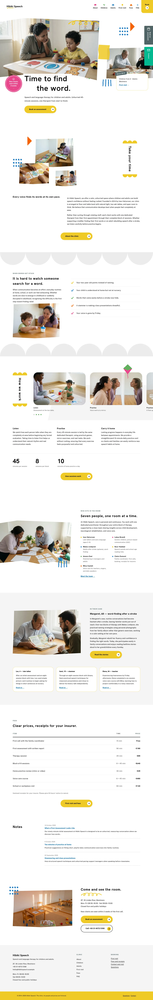

# Hibiki Speech

A calm block theme (type business) for a speech and language therapy clinic. Home page (English) in this release; inner pages and other languages follow.

## Signature
- Torn-edge photo pair with a tape strip, crayon marks and a floating round badge (first screen).
- Vertical heading between two scalloped bars beside a rounded two-up photo row.
- Scroll: slow parallax on the hero photograph, rise and stagger on the photo cluster and story cards, count-up figures (sp-scroll).

## Patterns
- `front-hero`
- `front-welcome`
- `front-difficulty`
- `front-method`
- `front-people`
- `front-proof`
- `front-fees`
- `front-notes`
- `front-close`

## Fonts
Hanken Grotesk, Public Sans, Noto Sans TC and Noto Sans JP (SIL OFL 1.1, licences in assets/fonts).

## Images (AI-generated for this theme, no text or logos; assets/images/)
- assets/images/d1.webp
- assets/images/k1.webp
- assets/images/k2.webp
- assets/images/k3.webp
- assets/images/m1.webp
- assets/images/m2.webp
- assets/images/m3.webp
- assets/images/m4.webp
- assets/images/p1.webp
- assets/images/r1.webp
- assets/images/s1.webp
- assets/images/w1.webp
- assets/images/w2.webp
- assets/images/w3.webp

<!-- screenshots:start -->
## Screenshots

<table>
<tr>
<td valign="top"></td>
<td valign="top"></td>
</tr>
</table>

- About: [desktop](screenshots/about-desktop.webp) · [mobile](screenshots/about-mobile.webp)
- Children: [desktop](screenshots/children-desktop.webp) · [mobile](screenshots/children-mobile.webp)
- Adults: [desktop](screenshots/adults-desktop.webp) · [mobile](screenshots/adults-mobile.webp)
- Method: [desktop](screenshots/method-desktop.webp) · [mobile](screenshots/method-mobile.webp)
- First visit: [desktop](screenshots/first-visit-desktop.webp) · [mobile](screenshots/first-visit-mobile.webp)
- Team: [desktop](screenshots/team-desktop.webp) · [mobile](screenshots/team-mobile.webp)
- Fees: [desktop](screenshots/fees-desktop.webp) · [mobile](screenshots/fees-mobile.webp)
- Stories: [desktop](screenshots/stories-desktop.webp) · [mobile](screenshots/stories-mobile.webp)
- News: [desktop](screenshots/news-desktop.webp) · [mobile](screenshots/news-mobile.webp)
- Article: [desktop](screenshots/article-desktop.webp) · [mobile](screenshots/article-mobile.webp)
- Category: [desktop](screenshots/category-desktop.webp) · [mobile](screenshots/category-mobile.webp)
- Tag: [desktop](screenshots/tag-desktop.webp) · [mobile](screenshots/tag-mobile.webp)
- Newsletter: [desktop](screenshots/newsletter-desktop.webp) · [mobile](screenshots/newsletter-mobile.webp)
- Faq: [desktop](screenshots/faq-desktop.webp) · [mobile](screenshots/faq-mobile.webp)
- Contact: [desktop](screenshots/contact-desktop.webp) · [mobile](screenshots/contact-mobile.webp)
- Search: [desktop](screenshots/search-desktop.webp) · [mobile](screenshots/search-mobile.webp)
- Other languages (home page): [zh-TW](screenshots/zh-TW/home-desktop.webp) · [ja](screenshots/ja/home-desktop.webp) · [fr](screenshots/fr/home-desktop.webp) · [de](screenshots/de/home-desktop.webp)
<!-- screenshots:end -->
