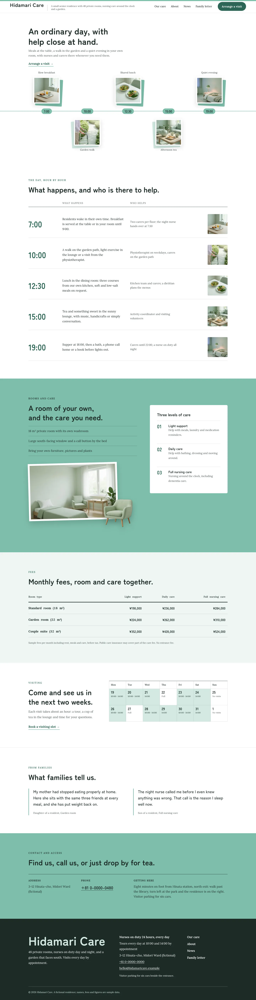
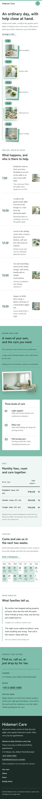

# Hidamari Care

Hidamari Care — a theme for a small senior care residence, laid out split-screen under a formal white top-bar header: the residence name and tagline on the left, the menu in one line and an Arrange a visit button on the right. Celadon (#7EBEAB) is the main colour: the rooms-and-care section, the contact section, every page head and the time marks are celadon fields in ink type. The front page is a day schedule: a white first screen with the headline top left and one edge-to-edge celadon day line with five time marks (7:00 to 19:00), each carrying a small stacked collage of a high-key photograph over an offset celadon card, alternating above and below the line; then the day hour by hour (time, what happens, who helps, a small photo), rooms and care on a celadon field where a transparent cut-out armchair breaks out of the framed room photograph, a monthly fees table, a two-week visiting calendar, two family quotes and contact and access. Photographs are realistic high-key images (85mm f/2.8, large softbox fill, near-white backgrounds, pale shadows, graded toward celadon). Zen Maru Gothic for headings, Lora for text, Noto Sans TC for Traditional Chinese headings. Sample content in English, Traditional Chinese, Japanese, French and German. WCAG AA colours; no entrance animations.

- Design plan row b5-10: split-screen, stacked-collage, top-bar nav, collage images, 3d-clay rendered as high-key photographs, celadon #7EBEAB, Zen Maru Gothic + Lora; first screen timeline-line, page structure day-schedule.
- Front page blocks: hero-day-line, schedule-detail, rooms-and-care, fees-table, visit-calendar, family-voices, contact-access.
- Sample content languages: en, zh-TW, ja, fr, de.
- Contrast: ink #1D2B27 on celadon #7EBEAB 6.9:1 (rooms and care, contact, page heads, time marks); ink on white 14.7:1 and on celadon tint #EEF6F3 13.4:1; white on deep celadon #2D6656 6.7:1 (buttons); deep celadon #2D6656 on white 6.7:1 and on tint 6.1:1 (links, numerals); quiet #4A5653 on white 7.6:1, on tint 7.0:1, on pale celadon #D3EAE2 6.1:1.
- Break-frame: the transparent cut-out armchair (WebP) breaks out of the framed room photo into the celadon field, and over the page-head edges.

<!-- screenshots:start -->
## Screenshots

<table>
<tr>
<td valign="top"></td>
<td valign="top"></td>
</tr>
</table>

- Services: [desktop](screenshots/services-desktop.webp) · [mobile](screenshots/services-mobile.webp)
- About: [desktop](screenshots/about-desktop.webp) · [mobile](screenshots/about-mobile.webp)
- News: [desktop](screenshots/news-desktop.webp) · [mobile](screenshots/news-mobile.webp)
- Article: [desktop](screenshots/article-desktop.webp) · [mobile](screenshots/article-mobile.webp)
- Category: [desktop](screenshots/category-desktop.webp) · [mobile](screenshots/category-mobile.webp)
- Tag: [desktop](screenshots/tag-desktop.webp) · [mobile](screenshots/tag-mobile.webp)
- Newsletter: [desktop](screenshots/newsletter-desktop.webp) · [mobile](screenshots/newsletter-mobile.webp)
- Contact: [desktop](screenshots/contact-desktop.webp) · [mobile](screenshots/contact-mobile.webp)
- Search: [desktop](screenshots/search-desktop.webp) · [mobile](screenshots/search-mobile.webp)
- Other languages (home page): [zh-TW](screenshots/zh-TW/home-desktop.webp) · [ja](screenshots/ja/home-desktop.webp) · [fr](screenshots/fr/home-desktop.webp) · [de](screenshots/de/home-desktop.webp)
<!-- screenshots:end -->
