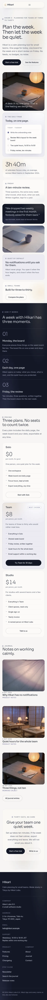

# Hikari App

A calm, restrained WordPress **block theme** for a **small software product (SaaS / startup)**. Washi off-white ground (#F6F5F2), **deep ink-indigo** type and two ink bands (#121726), pale **lavender-grey** panels (#ECEBF2), slate meta text (#5A6072) and one **desaturated dusk violet** (#6E6F9E) kept for small marks, hairlines and glows (accent text uses the deeper #55578A, 6.1:1 on washi). **Sora** headings (light weights) over **Inter**.

All sample copy is English and every name is fictional: Hikari Labs K.K., founder Nao Shimizu, customer Aya Kurosaki of Nanami Works, the Kuramae address, the email and the prices.

## Signature: lantern light

Very soft, low-contrast radial gradients (CSS only, no images, no animation) like light through washi paper: a warm paper glow with a faint dusk halo behind the hero, page headings, bento tiles, the "Most chosen" plan, the ink band, the closing invitation and the footer. No neon, no glass-startup gradients. The brand mark and the label dots are tiny paper lanterns drawn with radial gradients.

## Who it is for

- **Industry:** saas: software products, apps, small startups and studios.
- **Site type:** business. No WooCommerce.

## Layout codes

- **Header H10 — floating pill:** a sticky washi pill as wide as the content (1200 px), with a lantern-dot wordmark, the menu and a small ink "Try Hikari" button. Unlike Kami Salon's dark pill and Kaori Cosme's frosted centred lilac pill, it is a full-width bar-shaped pill on washi with an ink CTA.
- **Footer F2 — multi-column sitemap:** on ink with a faint lantern glow: wordmark, a line about the studio and the synced company details, then Product / Company / Stay close columns and a legal line.
- **Home L6 — bento grid:** one 12-column bento of rounded tiles: the lantern-lit desk photograph (large), "Today, on one page" (a daily-page mock-up composed from plain paragraphs), the focus figure, the Friday review, an ink customer-quote tile, the laptop on washi, "Quiet by default" and "Built for three to thirty". Then a week in three moments on an ink band, the synced plans, the journal and a lantern-lit invitation. Distinct from Hakuba Dental's tooth-shaped clinical cells and Sakura Juku's rounded pink/blue stickers.

## Pages

Home, Features (two feature rows and six smaller features), Pricing (synced plans, questions), Changelog (dated release entries as editable content), About (founder, three promises, team photo), Journal (6 posts, 3 categories, 6 tags) with article, category and tag archives, Newsletter, Contact, Search and 404.

## Edited in one place

- **Plans, prices and the "Most chosen" badge:** synced pattern on the home and Pricing pages (the badge is an ordinary paragraph inside it, so it can be edited or removed).
- **Company address, email and support hours:** synced pattern in the footer and on the Contact page.

Both are created by `inc/app-info.php` on activation (never twice). Demo import: shared `inc/demo-import.php` driven by `demo-content.json`; idempotent.

## Deviations from the roadmap

- Palette toned down at the user's request: planned #0E1222 / #6C7CFF / #E9ECFF (indigo-violet, dark) became a mostly light theme on washi #F6F5F2 with ink #121726 bands and text, lavender-grey #ECEBF2 panels and a desaturated dusk #6E6F9E (#55578A for accent text). Colour tags light + indigo + neutral instead of dark.
- Style tags modern + product + elegant (elegant added for the restrained direction).

## Credits

Fonts: Sora and Inter (SIL OFL 1.1, from google/fonts). Photographs: AI-generated for this theme, GPL-2.0-or-later / CC0 (see readme.txt).

<!-- screenshots:start -->
## Screenshots

<table>
<tr>
<td valign="top"></td>
<td valign="top"></td>
</tr>
</table>

- Features: [desktop](screenshots/features-desktop.webp) · [mobile](screenshots/features-mobile.webp)
- Pricing: [desktop](screenshots/pricing-desktop.webp) · [mobile](screenshots/pricing-mobile.webp)
- Changelog: [desktop](screenshots/changelog-desktop.webp) · [mobile](screenshots/changelog-mobile.webp)
- About: [desktop](screenshots/about-desktop.webp) · [mobile](screenshots/about-mobile.webp)
- News: [desktop](screenshots/news-desktop.webp) · [mobile](screenshots/news-mobile.webp)
- Article: [desktop](screenshots/article-desktop.webp) · [mobile](screenshots/article-mobile.webp)
- Category: [desktop](screenshots/category-desktop.webp) · [mobile](screenshots/category-mobile.webp)
- Tag: [desktop](screenshots/tag-desktop.webp) · [mobile](screenshots/tag-mobile.webp)
- Newsletter: [desktop](screenshots/newsletter-desktop.webp) · [mobile](screenshots/newsletter-mobile.webp)
- Contact: [desktop](screenshots/contact-desktop.webp) · [mobile](screenshots/contact-mobile.webp)
- Search: [desktop](screenshots/search-desktop.webp) · [mobile](screenshots/search-mobile.webp)
<!-- screenshots:end -->
