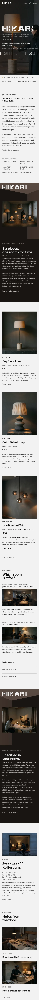

# Hikari Lighting

Hikari Lighting is an editorial block theme for independent lighting showrooms, design studios and boutique retailers. A warm-black curtain lifts on a low-key photograph, a stencil wordmark and a running thin-caps line sit on the first screen, and dark room boxes with one lit photo window alternate with a light grey ground. It is a store theme: WooCommerce-ready, and every template works without it.

## Concept: lights on in a stone bay

- **Palette.** Light grey ground `#F2F2F2`, ink `#0E0E0E`, warm-black curtain `#1A1512`, black oak `#3F332C`, ceiling `#5A4C43`, side wall `#2B231F`, and brass `#C9A063` for the small status dot and hover underline only (under 1% of the screen). First-screen saturated share is about 7%.
- **Type.** Outfit (headings, the stencil wordmark, the thin-caps marquee) and Figtree (body), IBM Plex Mono for navigation, labels and the info bar. All OFL-1.1, subset to Latin WOFF2.
- **Signature moves.** A lights-on curtain over the hero photograph, a stencil `HIKARI` wordmark, a thin-caps marquee line in the hero and footer, and two perspective room boxes (standard and mirrored) with a sloping ceiling, side wall and one lit parallax window. Wipe reveals on the room rows and photographs. All motion honours `prefers-reduced-motion`.

## Header and navigation

A sticky bar: the wordmark, a mono menu with the current page in brackets, and `Bag (0)`. The bar is transparent on the hero and turns solid warm-black over the first 80px of scroll. On mobile the right side is the text links `Bag (0)` and `Menu`.

## Structure

- `patterns/front-*.php`: the eight home sections (lights-on cover, intro and makers, floor room box, three pieces, rooms rows, specify room box, visit, journal).
- `patterns/header-bar.php`, `footer-main.php`: header and footer parts; `templates/`: block templates.
- `assets/sp-scroll.*`: ShipPress scroll effects (parallax, wipe reveal, marquee).
- Photos: `assets/images/demo/` (AI-generated, GPL-2.0-or-later / CC0).

Design notes: `brand.md`, `brand/design-spec.md`, `brand/reference.md`.

All names, addresses, phone numbers, pieces and prices are fictional.

License: GPL-2.0-or-later. Fonts OFL-1.1 (see `assets/fonts/`).

<!-- screenshots:start -->
## Screenshots

<table>
<tr>
<td valign="top"></td>
<td valign="top"></td>
</tr>
</table>

- Lamps: [desktop](screenshots/lamps-desktop.webp) · [mobile](screenshots/lamps-mobile.webp)
- Rooms: [desktop](screenshots/rooms-desktop.webp) · [mobile](screenshots/rooms-mobile.webp)
- Fitting: [desktop](screenshots/fitting-desktop.webp) · [mobile](screenshots/fitting-mobile.webp)
- Projects: [desktop](screenshots/projects-desktop.webp) · [mobile](screenshots/projects-mobile.webp)
- Visit: [desktop](screenshots/visit-desktop.webp) · [mobile](screenshots/visit-mobile.webp)
- Journal: [desktop](screenshots/journal-desktop.webp) · [mobile](screenshots/journal-mobile.webp)
- About: [desktop](screenshots/about-desktop.webp) · [mobile](screenshots/about-mobile.webp)
- Contact: [desktop](screenshots/contact-desktop.webp) · [mobile](screenshots/contact-mobile.webp)
- News: [desktop](screenshots/news-desktop.webp) · [mobile](screenshots/news-mobile.webp)
- Article: [desktop](screenshots/article-desktop.webp) · [mobile](screenshots/article-mobile.webp)
- Category: [desktop](screenshots/category-desktop.webp) · [mobile](screenshots/category-mobile.webp)
- Tag: [desktop](screenshots/tag-desktop.webp) · [mobile](screenshots/tag-mobile.webp)
- Newsletter: [desktop](screenshots/newsletter-desktop.webp) · [mobile](screenshots/newsletter-mobile.webp)
- Other languages (home page): [zh-TW](screenshots/zh-TW/home-desktop.webp) · [ja](screenshots/ja/home-desktop.webp) · [fr](screenshots/fr/home-desktop.webp) · [de](screenshots/de/home-desktop.webp)
<!-- screenshots:end -->
