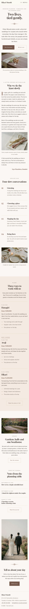

# Hikari Musubi

A quiet, elegant WordPress **block theme** for **small wedding planners** and wedding studios. *Hikari musubi* means "a knot of light": the theme borrows the **mizuhiki** paper cords tied around Japanese wedding gifts, drawn as a fine knot between two hairlines and used as the divider throughout. An ivory ground, soft blush bands, champagne lines and a single mauve-brown accent; generous whitespace and nothing loud.

All sample copy is in English and every name is fictional. The sample studio, **Hikari Musubi**, is a three-person planning studio in Kamakura (Sayo Hanabusa, Kei Moriyasu, Nao Tsukishima) working with three fictional venues (The Moss Garden, Hinoki Hall, The Boathouse). Address, phone, email and prices are placeholders.

## Who it is for

- **Industry:** wedding-planner: wedding planners, elopement and small-wedding studios, ceremony coordinators.
- **Site type:** business. Plans and prices, venues, a gallery, about, a journal (news), a seasonal newsletter and contact.
- **Mood:** elegant, soft; Japanese minimal, restrained.

## Design concept

| Axis | Choice |
|------|--------|
| Palette (pink, gold, light) | **Ivory** `#FBF8F4` ground, **blush** `#F3EAE1` bands and cards, **champagne** `#D9C3A5` hairlines (decorative only), **mauve brown** `#8C6A5D` the knot, numerals and accents (4.6:1 on ivory), **deep mauve** `#76574B` buttons and links (6.1:1; ivory on it 6.1:1), **taupe** `#685A53` quiet text (6.3:1, 5.6:1 on blush), **ink** `#3B302C` text (12.1:1) |
| Type | **Gloock** for headings, the wordmark, the open menu, plan names and prices; **Public Sans** (variable, used light at 300) for reading, labels, navigation and forms. Both bundled Latin subsets, SIL OFL 1.1, no CDNs |
| Header (H4, menu only) | Wordmark left, a small **Menu** button (two fine cords + the word) right. It opens the core Navigation block's overlay as a full-screen ivory sheet with large centred Gloock links and the knot near the bottom. Focus stays inside, Escape closes it, `assets/js/menu.js` keeps `aria-expanded`/`aria-controls` in step |
| Footer (F3, one line) | One quiet line: the wordmark, the studio details (the synced pattern, shown inline) and a small note. Stacks on phones |
| Home (L7, single-column long read) | Centred opening (label, display title, knot, two links, wide photo), a letter from the planner with a drop cap and signature, four numbered planning stages, the plans with prices on a blush band (synced), the venues, the three latest journal notes, and a closing invitation with a portrait photograph |
| Motion | None on entry. Only gentle colour changes on hover; off under `prefers-reduced-motion` |

### Block styles

- Paragraph: *Label*, *Lead*
- Separator: *Mizuhiki knot*
- Button: *Quiet (outline)*
- Group: *Blush card*
- List: *Cord list*
- Details: *Question*

## Single sources

- `inc/info/studio.html` → synced pattern **Hikari Musubi: studio address, hours, phone and email** (footer, Contact, Venues).
- `inc/info/plans.html` → synced pattern **Hikari Musubi: plans and prices** (Home, Plans).

Both are created once by `inc/shared-info.php` (tagged with `_hikari_musubi_info`), before the demo import runs.

## Templates

`front-page`, `home` (journal), `index`, `single`, `page`, `page-wide`, `archive`, `category`, `tag`, `search`, `404`; parts `header`, `footer`.

## Credits

Fonts: Gloock and Public Sans (SIL OFL 1.1). Photographs: AI-generated for this theme (GPL-2.0-or-later / CC0). See `readme.txt`.

<!-- screenshots:start -->
## Screenshots

<table>
<tr>
<td valign="top"></td>
<td valign="top"></td>
</tr>
</table>

- About: [desktop](screenshots/about-desktop.webp) · [mobile](screenshots/about-mobile.webp)
- Plans: [desktop](screenshots/plans-desktop.webp) · [mobile](screenshots/plans-mobile.webp)
- Gallery: [desktop](screenshots/gallery-desktop.webp) · [mobile](screenshots/gallery-mobile.webp)
- Venues: [desktop](screenshots/venues-desktop.webp) · [mobile](screenshots/venues-mobile.webp)
- News: [desktop](screenshots/news-desktop.webp) · [mobile](screenshots/news-mobile.webp)
- Article: [desktop](screenshots/article-desktop.webp) · [mobile](screenshots/article-mobile.webp)
- Category: [desktop](screenshots/category-desktop.webp) · [mobile](screenshots/category-mobile.webp)
- Tag: [desktop](screenshots/tag-desktop.webp) · [mobile](screenshots/tag-mobile.webp)
- Newsletter: [desktop](screenshots/newsletter-desktop.webp) · [mobile](screenshots/newsletter-mobile.webp)
- Contact: [desktop](screenshots/contact-desktop.webp) · [mobile](screenshots/contact-mobile.webp)
- Search: [desktop](screenshots/search-desktop.webp) · [mobile](screenshots/search-mobile.webp)
<!-- screenshots:end -->
