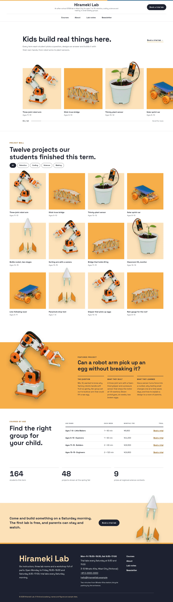
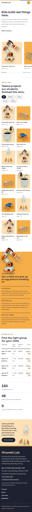

# Hirameki Lab

Hirameki Lab — a theme for an after-school STEM academy (robotics, coding, science and making for ages 7 to 15), laid out as a card mosaic under a formal white top header: the lab name and tagline centred on top, a Book a trial lab button at the right and the menu as a centred row underneath (a kouji-orange numbered overlay on phones). Kouji orange (#F6AD49) is the main colour: the project tiles, the featured-project band, every page head and the overlay menu are kouji fields in graphite type. The front page leads with results: a one-line headline with a text link, then a horizontal scroll strip of five student-project cards that bleeds off the right edge, a twelve-card project wall with filter chips, one featured project read in three columns, a courses-by-age table, three lab figures and a trial band. Every project object is a transparent high-key photographic cut-out (WebP) that breaks over the top edge of its tile; a large cut-out robot arm breaks above the featured band and a bottle rocket rises out of the trial band. Photographs are realistic high-key studio images (85mm f/2.8, softbox light, near-white grounds). Space Grotesk for Latin text, Kosugi for Japanese, Noto Sans TC for Traditional Chinese headings. Sample content in English, Traditional Chinese, Japanese, French and German; vertical labels only in Chinese and Japanese. WCAG AA colours; no entrance animations.

- Design plan row b5-8: card-mosaic, product-grid-hero, centered nav, cutout-break-frame, illustration paper-cut converted to high-key photographs, kouji #F6AD49, Kosugi + Space Grotesk; first screen horizontal-scroll-strip, page structure results-first-case-wall.
- Front page blocks: hero-project-strip, project-wall, featured-project, courses-by-age, lab-figures, trial-cta.
- Sample content languages: en, zh-TW, ja, fr, de.
- Contrast: graphite ink #1D2230 on kouji #F6AD49 8.3:1 (all text on the featured band, page heads, kouji tiles and the overlay menu; white on kouji is 1.91:1 so it is never used for text there); ink on kouji tint #FCE1B8 12.5:1 (tile labels, trial band); ink on white 15.9:1; burnt orange #8A4500 on white 7.2:1 and on tint 5.7:1 (links, labels); quiet #4B5262 on white 7.8:1 and on tint 6.2:1 (ages, secondary text); white on ink 15.9:1 and pale kouji #FBD9A8 on ink 11.8:1 (buttons, footer); lab blue #2F6690 on white 6.1:1, decoration only (header rule).
- Break-frame: every project cut-out (transparent WebP) breaks over the top edge of its tile; the large robot-arm cut-out breaks above the featured band and the bottle rocket rises out of the trial band.

<!-- screenshots:start -->
## Screenshots

<table>
<tr>
<td valign="top"></td>
<td valign="top"></td>
</tr>
</table>

- Services: [desktop](screenshots/services-desktop.webp) · [mobile](screenshots/services-mobile.webp)
- About: [desktop](screenshots/about-desktop.webp) · [mobile](screenshots/about-mobile.webp)
- News: [desktop](screenshots/news-desktop.webp) · [mobile](screenshots/news-mobile.webp)
- Article: [desktop](screenshots/article-desktop.webp) · [mobile](screenshots/article-mobile.webp)
- Category: [desktop](screenshots/category-desktop.webp) · [mobile](screenshots/category-mobile.webp)
- Tag: [desktop](screenshots/tag-desktop.webp) · [mobile](screenshots/tag-mobile.webp)
- Newsletter: [desktop](screenshots/newsletter-desktop.webp) · [mobile](screenshots/newsletter-mobile.webp)
- Contact: [desktop](screenshots/contact-desktop.webp) · [mobile](screenshots/contact-mobile.webp)
- Search: [desktop](screenshots/search-desktop.webp) · [mobile](screenshots/search-mobile.webp)
- Other languages (home page): [zh-TW](screenshots/zh-TW/home-desktop.webp) · [ja](screenshots/ja/home-desktop.webp) · [fr](screenshots/fr/home-desktop.webp) · [de](screenshots/de/home-desktop.webp)
<!-- screenshots:end -->
