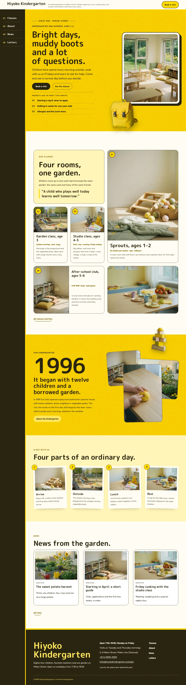
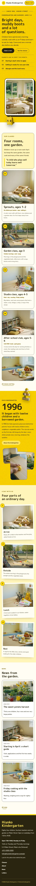

# Hiyoko Kindergarten

Hiyoko Kindergarten — a kindergarten and nursery theme laid out as a card mosaic: under a formal top header (kindergarten name, tagline and a Book a visit button), the menu leaves the bar on wide screens and becomes a fixed bark-ink side rail down the left edge with numbered entries (in Chinese and Japanese the entries run top to bottom). Dandelion yellow (#FFD900) is the main colour: the hero, the story band and every page head are yellow fields set in bark ink, with a faint paper grain. The hero is a cut-out object breaking its frame: the title, lead and buttons on the left, an ink-framed photograph of a bright classroom on the right, and a cut-out yellow backpack (transparent WebP) sitting over the frame's corner, half inside and half out, dropping past the hero bottom edge; cut-out wooden blocks break over the story band and every page head. The four classes sit in a rounded card mosaic. Every picture is a realistic 35mm film-grain photograph of a modern, international kindergarten. M PLUS Rounded 1c for display, Fredoka for reading, Noto Sans TC for Traditional Chinese headings. Sample content in English, Traditional Chinese, Japanese, French and German; vertical labels only in Chinese and Japanese. WCAG AA colours; no entrance animations.

- Design plan row b5-2: card-mosaic, cutout-break-frame-object hero, side-rail nav, cutout-break-frame, illustration woodblock converted to film-grain photographs, dandelion #FFD900, M PLUS Rounded 1c + Fredoka.
- Sample content languages: en, zh-TW, ja, fr, de.
- Contrast: bark ink #2A2410 on dandelion #FFD900 11.2:1 (all text on the hero, the story band, every page head, the yellow overlay menu and yellow buttons); cream #FFFDF2 on bark ink 15.2:1 (side rail, footer, ink buttons); bright yellow #FFE45C on bark ink 12.2:1 (rail numbers and footer labels); deep mustard #7A5A00 on cream 6.3:1 and on pale yellow #FFF4B8 5.7:1 (links, eyebrows, card facts); olive grey #5C5440 on cream 7.4:1 (secondary text); white on dandelion 1.4:1 is used for nothing.
- Break-frame: the cut-out backpack (transparent WebP) breaks out of the framed hero photo and the hero bottom edge; the cut-out wooden blocks break over the story band and page heads.

<!-- screenshots:start -->
## Screenshots

<table>
<tr>
<td valign="top"></td>
<td valign="top"></td>
</tr>
</table>

- Services: [desktop](screenshots/services-desktop.webp) · [mobile](screenshots/services-mobile.webp)
- About: [desktop](screenshots/about-desktop.webp) · [mobile](screenshots/about-mobile.webp)
- News: [desktop](screenshots/news-desktop.webp) · [mobile](screenshots/news-mobile.webp)
- Article: [desktop](screenshots/article-desktop.webp) · [mobile](screenshots/article-mobile.webp)
- Category: [desktop](screenshots/category-desktop.webp) · [mobile](screenshots/category-mobile.webp)
- Tag: [desktop](screenshots/tag-desktop.webp) · [mobile](screenshots/tag-mobile.webp)
- Newsletter: [desktop](screenshots/newsletter-desktop.webp) · [mobile](screenshots/newsletter-mobile.webp)
- Contact: [desktop](screenshots/contact-desktop.webp) · [mobile](screenshots/contact-mobile.webp)
- Search: [desktop](screenshots/search-desktop.webp) · [mobile](screenshots/search-mobile.webp)
- Other languages (home page): [zh-TW](screenshots/zh-TW/home-desktop.webp) · [ja](screenshots/ja/home-desktop.webp) · [fr](screenshots/fr/home-desktop.webp) · [de](screenshots/de/home-desktop.webp)
<!-- screenshots:end -->
