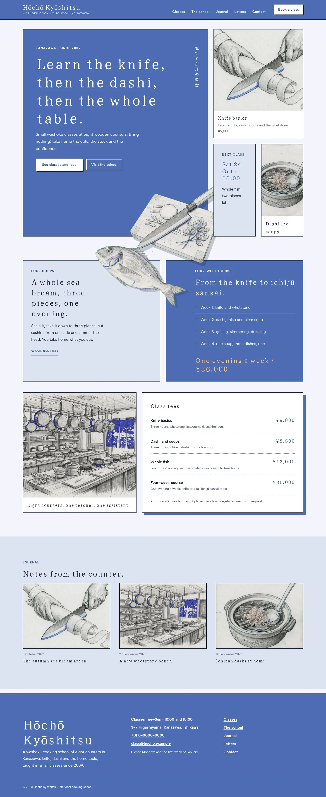
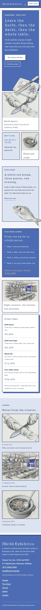

# Hōchō Kyōshitsu

Hōchō Kyōshitsu — A washoku cooking school theme built as a card mosaic in gunjō ultramarine (#4C6CB3), the main colour on the hero card, every page head, the header bar and the footer, over washi-textured pale paper with sumi indigo ink; Yuji Syuku brush display over Albert Sans. The art is pencil-sketch raster illustration (graphite hatching with ultramarine pencil accents): a yanagiba knife on a hinoki board and a whole sea bream as transparent cut-outs that break out of their cards, plus a dashi pot, a katsuramuki lesson, a bento and the school kitchen. A full top header: one ultramarine bar with the school name, the menu and a Book a class button. The home page is a mosaic of cards: the large ultramarine title card with a vertical Japanese spine and the cut-out knife crossing its edge, class cards, the sea bream swimming over the four-week course card, the synced fees card and the journal. The fees card and the school details are synced patterns edited in one place. WCAG AA colours; no entrance animations.

- Design plan row: b3-12 (card-mosaic archetype, cut-out break-frame object hero, top-bar nav, collage images, pencil-sketch illustration, gunjo ultramarine #4C6CB3, Yuji Syuku + Albert Sans).
- Break-frame: the cut-out knife and hinoki board cross the lower and right edges of the ultramarine hero card onto the next cards; the cut-out sea bream swims out of its card over the four-week course card; on The school page the knife steps out of its ultramarine card.
- Collage: every page is a mosaic of cards in different sizes mixing pencil sketches, notes and prices.
- Vertical Japanese spines ("a school of knife and dashi", "sharpen, cut, taste") are lang="ja" and only CJK text runs vertically.
- Synced: class fees (home, Classes & fees) and school details (footer, Contact).

## Templates
front-page, home, index, page, page-wide, single, archive, category, tag, search, 404.

## Patterns
home-hero, home-fish, home-rates, home-journal, classes-head, classes-main, about-head, about-main, newsletter-head, newsletter-signup, contact-head, contact-main, prices, details-card, not-found.

<!-- screenshots:start -->
## Screenshots

<table>
<tr>
<td valign="top"></td>
<td valign="top"></td>
</tr>
</table>

- Classes: [desktop](screenshots/classes-desktop.webp) · [mobile](screenshots/classes-mobile.webp)
- About: [desktop](screenshots/about-desktop.webp) · [mobile](screenshots/about-mobile.webp)
- News: [desktop](screenshots/news-desktop.webp) · [mobile](screenshots/news-mobile.webp)
- Article: [desktop](screenshots/article-desktop.webp) · [mobile](screenshots/article-mobile.webp)
- Category: [desktop](screenshots/category-desktop.webp) · [mobile](screenshots/category-mobile.webp)
- Tag: [desktop](screenshots/tag-desktop.webp) · [mobile](screenshots/tag-mobile.webp)
- Newsletter: [desktop](screenshots/newsletter-desktop.webp) · [mobile](screenshots/newsletter-mobile.webp)
- Contact: [desktop](screenshots/contact-desktop.webp) · [mobile](screenshots/contact-mobile.webp)
- Search: [desktop](screenshots/search-desktop.webp) · [mobile](screenshots/search-mobile.webp)
<!-- screenshots:end -->
