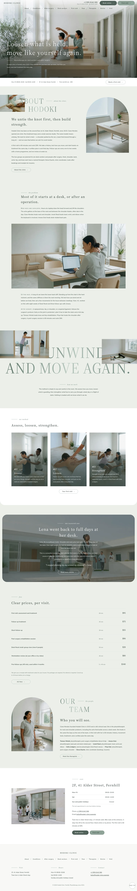

# Hodoki Clinic

A WordPress block theme for a fictional physiotherapy clinic in Fernhill (founded 2015) for desk workers and people after surgery. People, places and fees are in [`brand.md`](brand.md). Type: health. Sample content is in English; zh-TW, ja, fr and de follow in stage two.

## Concept
- **Palette.** Ground `#ECEFEA`, white bands, ink `#33403A`; seiji-nezu `#6E847C` only on labels, hairlines and slashes; pills `#4F6159` and `#8FA398`.
- **Type.** Source Serif 4 (light 300 for display) and Nunito Sans.
- **Signature.** Full-bleed photograph hero with bottom-left headline, hairline sub-line and a white info bar; an arch-topped photograph beside a gradient two-line label; a giant light-serif phrase with two photographs bleeding off the page edges. Scroll: sp-parallax on the hero and the rounded proof band, text fade and left-to-right photo wipes.

## Navigation
The header menu links to the nine inner pages (About, Conditions, After surgery, Desk workers, First visit, Fees, Therapists, Stories, Visit). In the mobile overlay the two header pills move into the menu as "Book online" and "First visit".

<!-- screenshots:start -->
## Screenshots

<table>
<tr>
<td valign="top"></td>
<td valign="top"></td>
</tr>
</table>

- About: [desktop](screenshots/about-desktop.webp) · [mobile](screenshots/about-mobile.webp)
- Conditions: [desktop](screenshots/conditions-desktop.webp) · [mobile](screenshots/conditions-mobile.webp)
- After surgery: [desktop](screenshots/after-surgery-desktop.webp) · [mobile](screenshots/after-surgery-mobile.webp)
- Desk workers: [desktop](screenshots/desk-workers-desktop.webp) · [mobile](screenshots/desk-workers-mobile.webp)
- First visit: [desktop](screenshots/first-visit-desktop.webp) · [mobile](screenshots/first-visit-mobile.webp)
- Fees: [desktop](screenshots/fees-desktop.webp) · [mobile](screenshots/fees-mobile.webp)
- Therapists: [desktop](screenshots/therapists-desktop.webp) · [mobile](screenshots/therapists-mobile.webp)
- Stories: [desktop](screenshots/stories-desktop.webp) · [mobile](screenshots/stories-mobile.webp)
- Visit: [desktop](screenshots/visit-desktop.webp) · [mobile](screenshots/visit-mobile.webp)
- News: [desktop](screenshots/news-desktop.webp) · [mobile](screenshots/news-mobile.webp)
- Article: [desktop](screenshots/article-desktop.webp) · [mobile](screenshots/article-mobile.webp)
- Category: [desktop](screenshots/category-desktop.webp) · [mobile](screenshots/category-mobile.webp)
- Tag: [desktop](screenshots/tag-desktop.webp) · [mobile](screenshots/tag-mobile.webp)
- Newsletter: [desktop](screenshots/newsletter-desktop.webp) · [mobile](screenshots/newsletter-mobile.webp)
- Contact: [desktop](screenshots/contact-desktop.webp) · [mobile](screenshots/contact-mobile.webp)
- Journal: [desktop](screenshots/journal-desktop.webp) · [mobile](screenshots/journal-mobile.webp)
- Other languages (home page): [zh-TW](screenshots/zh-TW/home-desktop.webp) · [ja](screenshots/ja/home-desktop.webp) · [fr](screenshots/fr/home-desktop.webp) · [de](screenshots/de/home-desktop.webp)
<!-- screenshots:end -->
