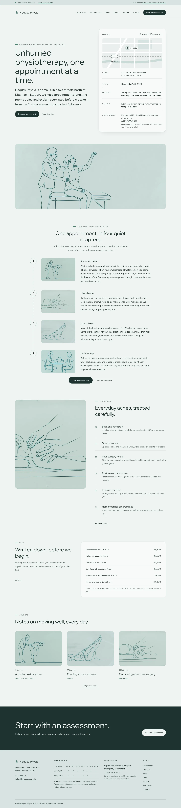
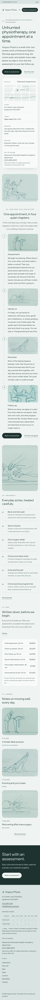

# Hogusu Physio

A clean, serene and modern block theme for a **small neighbourhood physiotherapy clinic**.

*Hogusu* (to loosen, to ease). The demo clinic, its physiotherapists, the town, the address, phone numbers and prices are all fictional.

## Concept: first visit, step by step

- **Sea-glass and deep teal.** Mist `#EFF3F2` ground, wash `#D8E3E1` for panels and bands, deep sea ink `#1F3330` for text and the dark band (11.9:1). One muted deep teal `#4F7C76` for lines, dots, numerals and large type only (4.2:1); links use `#355C56` (6.7:1), quiet text `#4A5E5B` (6.2:1).
- **Type.** Wix Madefor Display (headings) over Wix Madefor Text. Both OFL-1.1 without a Reserved Font Name, shipped as the upstream variable TTFs.
- **Illustration style: continuous single-line drawing.** The hero and the chapter pictures are raster WebP line drawings (one unbroken deep-teal stroke per figure), generated with Grok Build's image_gen through `scripts/grok-image.sh`.
- No entrance animations.

## Header, footer, layout (ROADMAP codes)

- **H9 two-tier header.** A wash utility strip with today's opening hours (in the site's timezone) and the phone number, over the main bar with the site title, the menu and a "Book an assessment" pill.
- **F7 CTA band footer.** A quiet deep-teal "Book an assessment" band, over the clinic details (address, phone and email, hours table) and a small sitemap.
- **L7 single-column long read.** The home page walks through one first appointment in four chapters (assessment, hands-on, exercises, follow-up), each one row with its number on a dotted rail and a line drawing. The combination H9 + F7 + L7 is not used by any other theme.

## One source for shared details

| Source | Edited in | Shown on |
|---|---|---|
| Opening hours, phone, email, address | Appearance > Clinic details (`inc/clinic-info.php`, block `hogusu-physio/clinic-info`) | utility strip, locator card, contact, footer |
| Locator card | synced pattern, `inc/info/locator.html` | home, contact |
| Fees table | synced pattern, `inc/info/fees.html` | home, fees |

The synced patterns are created on activation by `inc/shared-info.php`, tagged `_hogusu_physio_info` and never created twice.

## Pages and templates

Demo pages: Home, Treatments, Your first visit, Fees, Team, Journal (posts page), Newsletter and Contact. Six sample posts in three categories with six tags.

Templates: front-page, page, page-wide, home, index, single, archive, category, tag, search and 404.

## Licence

GPL-2.0-or-later. Fonts OFL-1.1 (see `assets/fonts/`). Illustrations AI-generated for this theme, released under GPL-2.0-or-later / CC0. All names, the address, phone numbers and prices are fictional.

<!-- screenshots:start -->
## Screenshots

<table>
<tr>
<td valign="top"></td>
<td valign="top"></td>
</tr>
</table>

- Treatments: [desktop](screenshots/treatments-desktop.webp) · [mobile](screenshots/treatments-mobile.webp)
- First visit: [desktop](screenshots/first-visit-desktop.webp) · [mobile](screenshots/first-visit-mobile.webp)
- Fees: [desktop](screenshots/fees-desktop.webp) · [mobile](screenshots/fees-mobile.webp)
- About: [desktop](screenshots/about-desktop.webp) · [mobile](screenshots/about-mobile.webp)
- News: [desktop](screenshots/news-desktop.webp) · [mobile](screenshots/news-mobile.webp)
- Article: [desktop](screenshots/article-desktop.webp) · [mobile](screenshots/article-mobile.webp)
- Category: [desktop](screenshots/category-desktop.webp) · [mobile](screenshots/category-mobile.webp)
- Tag: [desktop](screenshots/tag-desktop.webp) · [mobile](screenshots/tag-mobile.webp)
- Newsletter: [desktop](screenshots/newsletter-desktop.webp) · [mobile](screenshots/newsletter-mobile.webp)
- Contact: [desktop](screenshots/contact-desktop.webp) · [mobile](screenshots/contact-mobile.webp)
- Search: [desktop](screenshots/search-desktop.webp) · [mobile](screenshots/search-mobile.webp)
<!-- screenshots:end -->
