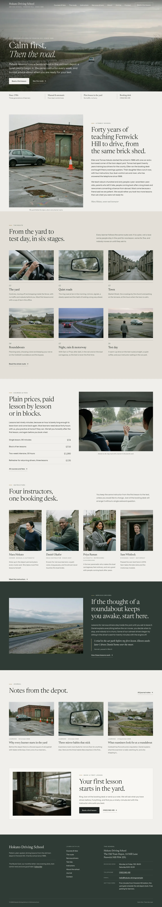

# Hokuto Driving School

A calm, photograph-led block theme for a **family driving school**: lessons in manual and automatic cars, nervous-driver lessons, refreshers and test preparation.

The demo school is fictional: founded in 1986 by Ellen and Tomas Hokuto in the old tram depot on Mill Lane, Fenwick Hill, run today by their daughter Mara with four instructors and Joan at the booking desk. The whole brand (people, place, tone, a day at the school) is written down in [`brand.md`](brand.md); every page's copy comes from it. Type: education, English only. Built to the quality gate in ROADMAP §4 (rule 0) and `rules.quality_gate` in design-plan.json (row b6-3).

## Concept: calm first, then the road

- **Palette.** Pale concrete `#F1EFEA` ground, kerb stone `#E3E0D8` panels, paper `#F8F7F3` cards, asphalt `#1E2421` text (13.8:1), quiet asphalt `#565C57` secondary text (6.0:1), deep slate green `#2F3A35` for the one dark band and the footer, road-sign sage `#56645A` for labels, numerals and links (5.4:1). A faded lane-line amber `#9A7B45` appears only as short rules and quote marks, never as text or a fill. The photographs carry the colour; the first screen stays below 15 % saturated pixels.
- **Type.** Newsreader (display, roman and italic, optical sizes) up to 4.75 rem over Instrument Sans (text). Both OFL-1.1 without a Reserved Font Name, subset to Latin WOFF2.
- **Photographs.** Twenty photographs generated with one shared style string (quiet editorial photography, soft overcast daylight, muted stone and grey-green tones, shallow depth of field, subtle 35 mm grain). People appear as hands, backs and calm portraits. No cut-outs, no illustrations.

## Front page

1. **The road at first light**: a full-bleed photograph of an empty country road; the single top header lies over it, transparent; the headline "Calm first. *Then the road.*", a short paragraph, two links and a facts bar (since 1986, manual and automatic, first lesson in the yard, booking desk).
2. **A family school**: a letter from the owner (two narrative paragraphs) beside the practice yard.
3. **The route**: six photographed stages, from the yard to test day.
4. **Courses & fees**: how lessons work and four plain prices beside a lesson photograph.
5. **Instructors**: four portraits with one line each.
6. **Nervous drivers**: a deep slate band with the moor road and a learner's words.
7. **Journal** (latest three) and a **booking call** beside the booking office.

## One source for shared details

The school details and booking-desk hours are the synced pattern `Hokuto Driving School: school details and booking desk hours`, shown in the footer and on the Courses & fees and Contact pages (the footer copy hides itself where the page already shows it). Created once by `inc/shared-info.php` from `inc/info/school.html`; pages hold only references. The demo import (`inc/demo-import.php`) is idempotent and never overwrites user content.

## Pages and templates

Home, Courses & fees, The route, Instructors, Nervous drivers, Test day, About, Journal (posts page), Newsletter, Contact; article, category, tag, search and 404 templates. Six journal posts in three categories (Learning, Road notes, School news) with six tags.

## Licence

GPL-2.0-or-later. Fonts OFL-1.1 (see `assets/fonts/`). Photographs AI-generated for this theme, released under GPL-2.0-or-later / CC0. All names, the town, the address, telephone numbers and prices are fictional.

<!-- screenshots:start -->
## Screenshots

<table>
<tr>
<td valign="top"></td>
<td valign="top"></td>
</tr>
</table>

- Courses: [desktop](screenshots/courses-desktop.webp) · [mobile](screenshots/courses-mobile.webp)
- The route: [desktop](screenshots/the-route-desktop.webp) · [mobile](screenshots/the-route-mobile.webp)
- Instructors: [desktop](screenshots/instructors-desktop.webp) · [mobile](screenshots/instructors-mobile.webp)
- Nervous drivers: [desktop](screenshots/nervous-drivers-desktop.webp) · [mobile](screenshots/nervous-drivers-mobile.webp)
- Test day: [desktop](screenshots/test-day-desktop.webp) · [mobile](screenshots/test-day-mobile.webp)
- About: [desktop](screenshots/about-desktop.webp) · [mobile](screenshots/about-mobile.webp)
- News: [desktop](screenshots/news-desktop.webp) · [mobile](screenshots/news-mobile.webp)
- Article: [desktop](screenshots/article-desktop.webp) · [mobile](screenshots/article-mobile.webp)
- Category: [desktop](screenshots/category-desktop.webp) · [mobile](screenshots/category-mobile.webp)
- Tag: [desktop](screenshots/tag-desktop.webp) · [mobile](screenshots/tag-mobile.webp)
- Newsletter: [desktop](screenshots/newsletter-desktop.webp) · [mobile](screenshots/newsletter-mobile.webp)
- Contact: [desktop](screenshots/contact-desktop.webp) · [mobile](screenshots/contact-mobile.webp)
- Search: [desktop](screenshots/search-desktop.webp) · [mobile](screenshots/search-mobile.webp)
<!-- screenshots:end -->
